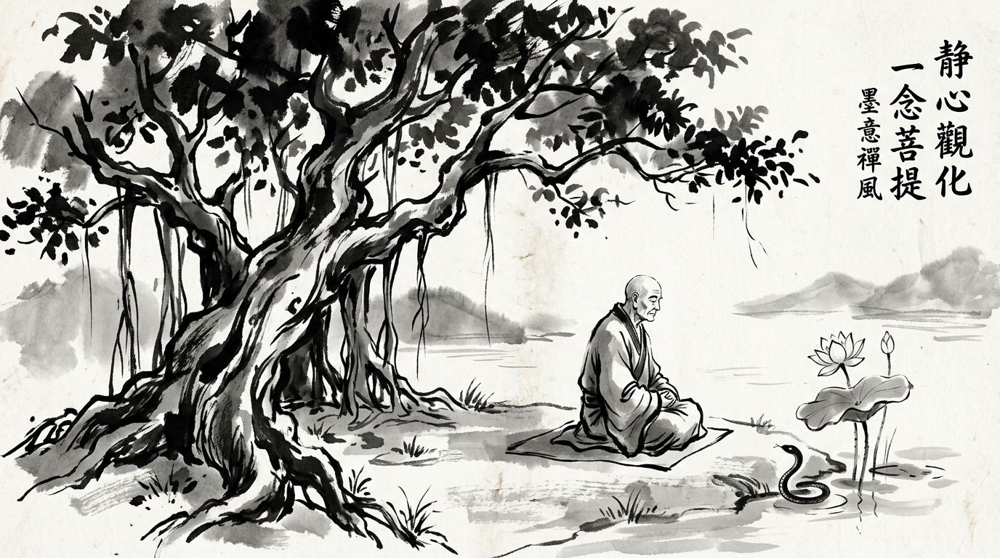

# The Smiling Snake in the Assembly: A Lesson from Vidura and Vemana

A young courtier climbed the stone steps to the hermitage in the hills. His face was pale, his shoulders hunched with bitterness.

"Master," the courtier began, "I have been betrayed by my closest colleague in the ministry. When we drank tea in private, he praised my initiatives and offered his support. But in the King’s council today, he softly asked three devastating questions—couched in feigned innocence—that dismantled my proposal and made me appear incompetent. Why are people so treacherous?"

The monk dipped his bamboo brush into black ink and drew a single, fluid circle on rice paper before speaking.

---

## The Wisdom of Yogi Vemana

The monk chanted a verse written centuries ago by the Telugu mystic, Yogi Vemana:

> **విషము చూడు పాము విషమందుననుండు**  
> **తేలుకును విషమ్ము తోకనుండు**  
> **దుర్జనునకు విషము తోడై శరీరమౌ**  
> **విశ్వదాభిరామ వినుర వేమ!**  
> 
> *“The serpent holds poison only in its fangs; the scorpion carries venom only in its tail. But the malicious person is poison through and through—every thought and limb is filled with venom.”*

"A natural viper," the monk said gently, "strikes only when startled, hungry, or defending its nest. Its venom is localized. But a person driven by envy and insecurity (*durjana*) carries venom in their entire character. You expected them to behave like a friend because they smiled at you. Milk fed to a cobra does not turn into nectar; it only nourishes more venom."

---

## The Shakuni Pattern: Modern Office Politics

In the *Mahabharata*, Shakuni never carried a sword onto the battlefield against the Pandavas. Instead, he whispered into the ear of Prince Duryodhana with constant concern, affectionate flattery, and insidious advice. 

In modern corporate and startup environments, the **"Master Snake"** exhibits predictable behavioral hallmarks:

1. **The Private Ally, Public Critic**: In 1-on-1s, they agree with your ideas and urge you to present them. In broad meetings, they suddenly adopt the posture of "the objective skeptic," blindsiding you with objections they withheld earlier.
2. **Backhanded Praise & Micro-Sabotage**: *"Sampath did a fantastic job with this deck, especially given how challenging basic data analysis can be for his team."*
3. **Information Gatekeeping**: They hoard organizational context, subtly isolating you from senior stakeholders while acting as a helpful intermediary.

---

## The Strategic Counter-Play

How do you survive in an arena shared with snakes without becoming venomous yourself?

### 1. Law of Power: Conceal Your True Hand
As Robert Greene observes in *The 48 Laws of Power* (Law 3), **Conceal Your Intentions**. Never share your unfinished ideas, vulnerabilities, or personal career ambitions with a charming colleague whose loyalty has not been battle-tested under adverse conditions.

### 2. Disarm Through Documentation (Chanakya's Rule)
Acharya Chanakya taught that treachery thrives in dark, unrecorded corners. 
- After every verbal meeting, send a crisp summary email: *"Per our discussion, you agreed that X is within scope and Y is our metric."*
- When a covert adversary realizes everything is tethered to clear written records, their ability to execute plausible deniability vanishes.

### 3. Cultivate Emotional Composure (Nishkama Detachment)
The snake's greatest weapon is provoking you into an emotional, defensive outburst in public. If you lose your temper during a meeting, the room forgets their subtle sabotage and only remembers your instability.
- Breathe.
- Pause for three seconds.
- Respond with calm, objective data: *"That is an interesting question, Rohan. If you recall our review yesterday, slide 4 directly addresses this risk model. Let's walk through those exact numbers."*

---

## Monk's Reflection

Do not spend your energy hating the snake for possessing venom. It is merely following its nature. Spend your energy becoming watchful, disciplined, and unshakable.

*When you walk in tall grass, carry a walking staff, step deliberately, and keep your eyes open.*
