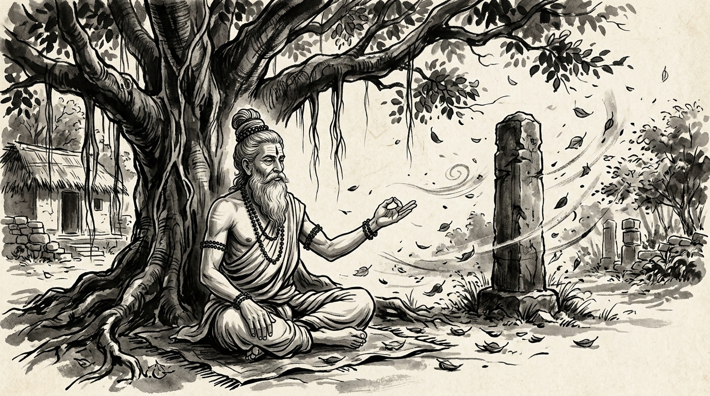

# The Unshakable Pillar: Vidura's Counsel on Navigating Slander and Toxic Provocation

The forest was heavy with early morning mist when Sanjaya, a young counselor to the royal court, approached the hermitage of Sage Vidura. His breath came fast, his brows knit with bitter indignation.

"Revered Master," the young courtier spoke, bowing with clasped hands, "I come seeking counsel before my patience gives way to rage. In the king's council yesterday, several courtiers launched an orchestrated campaign against me. They twisted my words, spread vile insinuations regarding my integrity, and sought to provoke me in front of the elders. Every fiber of my being wanted to rise, shout their deceit to the rafters, and strike back with equal venom. Why must those who serve with sincere dedication endure the poisoned barbs of envious fools?"

The venerable Rishi, adorned in humble ascetic wraps and sacred rudraksha beads, sat composed beneath the sprawling canopy of an ancient banyan tree. He gestured toward the courtyard boundary, where a weathered granite pillar stood firmly rooted in the soil. A gust of harsh autumn wind whipped through the clearing, carrying dust and dry leaves that struck the stone face and scattered harmlessly away.

"Tell me, my son," the Rishi said with quiet gravity, "when the dust storms rage against that ancient stone pillar, does the pillar shout back? Does it bend to plead with the wind, or shake in fury at the dust?"

"It does neither, Master," Sanjaya replied. "It simply stands."

"Indeed," replied the Sage. "And when the storm exhausts itself, what remains? The wind is gone, the dust settles upon the dirt, but the pillar stands undiminished, bearing the weight of the roof just as before."

---

## The Wisdom of Vidura Neeti

In the strategic wisdom of the *Mahabharata*, Mahatma Vidura expounded upon the supreme virtue of composure (*Kshama*) and the folly of surrendering leverage through impulsive reaction:

> **అక్రోధనః క్రోధనేభ్యః విశిష్టః తథా తితిక్షుః అతితిక్షోః విశిష్టః |**  
> **అమానుషః మానుషేభ్యో విశిష్టః తథా జ్ఞానీ అజ్ఞానిభ్యో విశిష్టః ||**  
> *(The composed is superior to the wrathful; the forbearing is superior to the intolerant; the tranquil mind commands dominion over chaos.)*

Vidura taught that the chief strategy of a political adversary is not always to defeat your arguments, but to **shatter your emotional equilibrium**. 

In palace intrigue as in modern corporate corridors, a toxic provocateur thrives on reactive drama. When they accuse or slander you, their weapon is not their falsehood—it is your reflexive anger. The moment you lose composure, raise your voice, or counter-attack defensively, you enter their theatre, play by their corrupted rules, and surrender your psychological high ground.

---

## Deconstructing the Provocation Pattern

Modern workplace psychology and ancient statecraft reveal four eternal dynamics of political provocation:

### 1. The Bait of Manufactured Outrage
Hostile colleagues often manufacture slight slights or public jabs solely to observe your threshold. If you react visibly, you validate their provocation and signal that they possess the power to destabilize you.

### 2. The Trap of Premature Self-Defense
When slander is hurled without merit, rushing into an emotional, rambling defense often creates the optical illusion of guilt. As Vidura observed: *“The fool enters uninvited and speaks unasked; the wise man anchors his purpose in silence until the ground is solid.”*

### 3. The Power of the Calculated Pause
Refusing to match the adversary's frantic tempo is the ultimate power move. A flat, steady gaze and deliberate silence rob the agitator of the spectacle they sought to orchestrate.

---

## Tactical Framework: The Vidura Composure Protocol

When faced with toxic office politics, whispering campaigns, or aggressive provocations, apply these actionable principles:

| Provocation Stage | Reactive Impulse (The Trap) | Vidura's Dharmic Response (The Mastery) |
| :--- | :--- | :--- |
| **Public Jab / Innuendo** | Retort angrily or argue semantics in front of stakeholders. | Maintain steady silence. Respond with calm clarification or redirect strictly to verified metrics: *"Let us examine the recorded milestones."* |
| **Behind-the-Scenes Slander** | Panic, launch whisper counter-campaigns, or complain bitterly. | Fulfill your dharma. Keep transparent, auditable paper trails and let objective work dismantle false narratives. |
| **Gaslighting & False Accusations** | Question your worth and engage in defensive justification. | Remain anchored like the stone pillar. Disarm the ego, document facts, and escalate via formal governance channels dispassionately. |

---

## The Final Reflection

The Rishi placed a gentle hand upon Sanjaya's shoulder.

"Remember, my son: the dog barks at the elephant, yet the elephant continues walking toward the temple gates without breaking stride. Slander harms only the slanderer when the target refuses to become its receptacle. Keep your conduct flawless, your purpose concealed, and your mind serene. Let your results speak; time will bury the dust."

Sanjaya bowed low before the Rishi, his anger dissolved, his resolve hardened like the ancient pillar.
