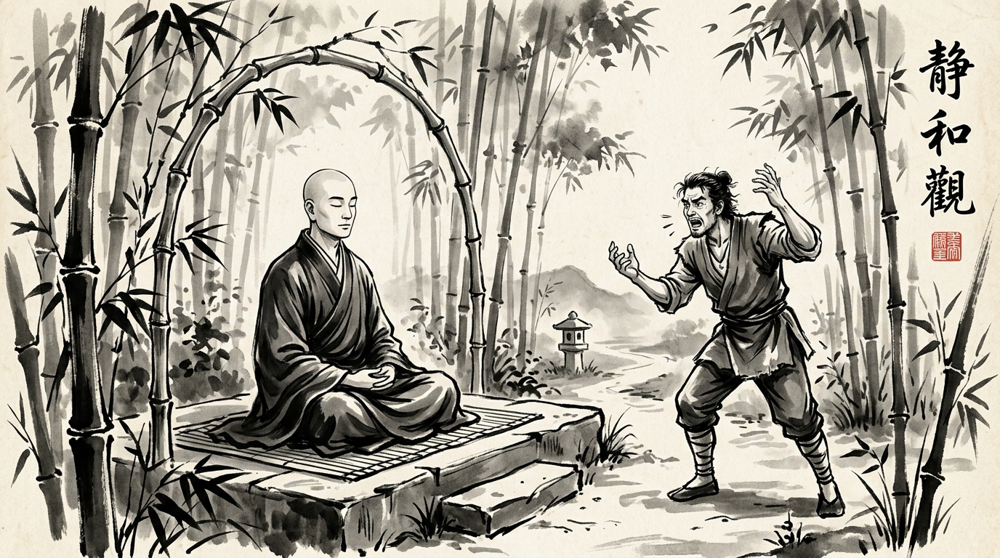

# The Unaccepted Gift: The Art of Deflecting Toxic Attacks and Workplace Hostility

The afternoon sun filtered through the tall bamboo grove, casting long, quiet shadows across the stone garden of the mountain monastery. A young court administrator named Khemaka entered the courtyard with hurried footsteps, his jaw clenched and his fists trembling with suppressed fury.

He found the venerable Master seated serenely upon a flat granite slab beside the quiet mountain stream, pouring hot water over fresh tea leaves.

"Master," Khemaka burst out, struggling to maintain formal courtesy, "I can no longer bear the venom of the King’s chief treasurer. Today in the grand assembly, without provocation, he stood before the ministers and launched a vicious tirade against me. He called me incompetent, mocked my junior rank, and twisted an honest scheduling delay into an accusation of neglect. The entire hall fell silent. I sat burning in humiliation, swallowing my tongue only to avoid causing a riot before the elders. Tell me, how does one endure such unprovoked insults without taking a blade to one’s slanderer?"

The Master poured a shallow bowl of tea with unhurried precision, the amber liquid steaming gently in the cool mountain air. He gestured for Khemaka to sit on the neighboring stone.

"Tell me, Khemaka," the monk asked in a soft, resonant tone, "when festival days arrive at your estate, do your relatives and neighbors come to visit?"

"They do, Master," Khemaka answered, puzzled by the detour.

"And do you prepare hospitality for them—platters of fresh sweets, spiced dishes, and ceremonial gifts?"

"Of course. It is the custom of our family."

"Now tell me," the Master continued, fixing his steady, compassionate gaze upon the agitated young man, "suppose a guest arrives at your threshold, but refuses your hospitality. Suppose they turn their face away and decline to accept the sweets and gifts you offer them. To whom do those gifts belong?"

Khemaka paused, blinking in confusion. "If the guest does not accept them, they remain mine, Master. They stay with the host who prepared them."

The Master smiled gently and set down the teapot.

"Just so, my son. When a hostile man approaches you laden with anger, contempt, insult, and bitterness, he is offering you a gift. If you do not accept it—if you refuse to ingest his fury, take ownership of his insults, or mirror his resentment—with whom does that toxic offering remain?"

Khemaka stared at the monk, the tightness in his chest loosening like a snapped knot.

"It remains entirely with him," Khemaka whispered.

"Indeed," said the Master. "He carried the poison in his mind, he carried it on his tongue, and because you refused to become its vessel, he must carry it all the way home."

---

## The Wisdom of the Akkosa Sutta

This timeless parable originates from the **Akkosa Sutta** (*Samyutta Nikaya 7.2*), wherein the Buddha was confronted by an abusive critic named Akkosaka Bharadvaja, who hurled torrents of foul words at the Enlightened One.

Instead of retaliating or retreating defensively, the Buddha exposed the fundamental mechanics of emotional ownership:

> **అక్కోసంతం న పచ్చక్కోసామి, రోసంతం న పటిరోసామి, భండంతం న పటిభండామి |**  
> *(As you who do not abuse do not abuse back, who do not scold do not scold back, who do not rage do not rage back—we do not accept your offering. It remains yours alone.)*

In human psychological combat, hostility requires a **counterpart** to complete the circuit. An insult has zero kinetic power unless the receiver catches it, accepts its premises, and permits it to ignite their internal nervous system.

When an adversary attacks you in an executive review, a public Slack channel, or a steering committee, their objective is rarely factual clarity. Their primary goal is **emotional contagion**—forcing you to match their dysregulated frequency so that your composure collapses alongside their own.

---

## Deconstructing the Hostile Ambush

Modern workplace dynamics reveal three reasons why unprovoked attacks occur and why non-acceptance disarms them:

### 1. The Strategy of Projection
Hostile peers often attack preemptively when their own deliverables are faltering or their insecurities are triggered. By throwing a smoke bomb of accusations, they attempt to deflect attention from their own deficits. Accepting the argument legitimizes their distraction.

### 2. The Trap of the Defense Reflex
When someone hurls an unfair accusation, the natural human instinct is to defend vigorously: *"That is untrue, here are three reasons why..."*  
Counterintuitively, intense defensiveness often signals panic to onlookers. It validates the premise that the accusation was worthy of debate. The wise professional remains calm, detached, and surgically succinct.

### 3. The Rebound Effect
Hostility unaccepted turns back upon the aggressor with double the force. When an aggressor screams into an echo chamber and receives only calm, steady silence or dispassionate inquiry, their lack of self-control becomes glaringly visible to every stakeholder in the room.

---

## Tactical Framework: The Non-Acceptance Protocol

When confronted by an aggressive colleague, hostile client, or toxic manager seeking to draw you into a public mud fight, execute these four tactical steps:

| Phase | The Reactive Trap | The Master’s Non-Acceptance Protocol |
| :--- | :--- | :--- |
| **1. The Onset (Public Jab)** | Interrupt, talk over them, or flush red with indignant fury. | **The Zero-Reaction Hold:** Maintain neutral eye contact, breathe slowly, and let their words land on empty space without physical flinching. |
| **2. The Pause** | Instantly fire back with a defensive rebuttal or counter-insult. | **The Uncomfortable Silence:** Wait three full seconds after they finish. Let the awkward weight of their venom hang palpably in the room. |
| **3. The Deflection** | Debate the subjective insults (*"I am not incompetent!"*). | **Decouple Emotion from Fact:** Disregard the insult completely and address only operational substance: *"Setting aside the tone, let us examine the sprint deliverables."* |
| **4. The Return to Sender** | Ruminate all weekend, venting to peers and poisoning your peace. | **Audit and Evict:** Recognize the outburst as their psychological baggage. Document the facts neutrally, close the laptop, and leave their gift in their hands. |

---

## The Master’s Parting Counsel

The Master handed Khemaka the warm bowl of tea.

"When you return to the court tomorrow, walk with a light heart. You do not belong to the slanderers, nor does their anger belong to you. Let them bring carts full of thorns if they wish; so long as your hands remain open and untouched, not a single scratch can mark your skin."

Khemaka sipped the tea, breathed in the fragrance of the bamboo grove, and bowed low. For the first time, he understood that supreme power in any arena is not the ability to wound others, but the unassailable freedom of refusing to be wounded.
