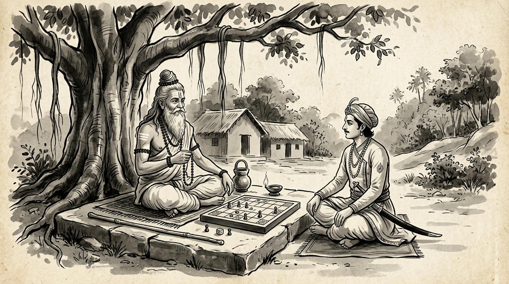

# The Corrupted Board: Vidura’s Warning on Refusing the Rigged Games of Workplace Politics

The afternoon sunlight slanted through the aerial roots of an ancient banyan tree, casting patterns of lattice and shadow over the hermitage clearing. A young court administrator named Devadatta sat before the venerable Rishi, his fingers clenched against his knees, his jaw set in rigid defiance.

"Master," Devadatta spoke, the frustration evident in his strained voice, "the senior minister has laid a trap for me in the royal council tomorrow. He has summoned an ad-hoc tribunal to inspect the accounts of my district. He hand-picked his closest allies as examiners, drafted the inquiries to distort our genuine achievements, and arranged for the hall to be filled with spectators eager to witness my fall. My deputies urge me to march in, defend our honor with fiery debate, and expose his deceit before the assembly. I know our records are clean. Should I not fight him on his floor and prove my righteousness?"

The Sage, clad in simple ascetic wraps with sacred rudraksha beads resting against his chest, sat in deep composure. Between them, upon a weathered granite slab, lay a polished wooden game board, its squares carved with meticulous precision. Beside the board rested a pair of long, ivory dice.

The Rishi gestured toward the board.

"Tell me, Devadatta," the Sage began softly, "suppose a seasoned gambler challenges you to a game of Chaupar. The dice he hands you are secretly weighted with lead to roll only odd numbers. The referees seated around the board are his kin, who applaud every false throw. The spectators have been promised a share of your wager if you lose. Tell me: if you sit at that table, armed with flawless integrity, sharp intelligence, and righteous intention, will you win?"

Devadatta blinked, his furrowed brow relaxing slightly. "No, Master. The game is lost before the first cast. Even the greatest player cannot triumph when the apparatus itself is corrupted."

"Then why," the Rishi asked, his steady gaze piercing the young man's indignation, "are you so eager to sit at tomorrow's table?"

---

## The Shakuni Pattern: The Anatomy of a Rigged Arena

In the epic *Mahabharata*, the downfall of the righteous Pandavas did not begin with military defeat on the battlefields of Kurukshetra. It began in the royal gambling hall (*Dyuta Sabha*) of Hastinapura.

The cunning prince Shakuni understood that on a fair field of battle, the Pandavas were invincible. Their martial discipline, moral authority, and competence could not be overcome through honest confrontation. Therefore, Shakuni devised a different theatre: a game of loaded dice where he dictated the rules, controlled the throws, and relied on King Yudhishthira’s misplaced sense of honor and chivalry to compel him to play.

Mahatma Vidura, the voice of pure strategic wisdom in the Kuru court, stood alone in warning King Dhritarashtra and Yudhishthira against entering the hall:

> **యత్ర ధర్మః హ్యధర్మేణ సత్యం యత్రాన్ృతేన చ |**  
> **హన్యతే ప్రేక్షమాణానాం హతాస్తత్ర సభాసదః ||**  
> *(Where righteousness is strangled by unrighteousness, and truth is trampled by deceit before the eyes of the assembly, that court is already dead, and those who sit upon its benches are consumed by their own ruin.)*

Vidura understood an immutable law of power: **When a bad-faith adversary cannot defeat you on merit, they lure you into a rigged arena where they control the arbiters, the narrative, and the rules of engagement.**

---

## The Three Hallmarks of Corporate "Rigged Boards"

In modern organizations, political saboteurs rarely attack exceptional performers through transparent, objective evaluations. Instead, they engineer psychological and procedural traps:

### 1. The Ambush Tribunal (The Stacked Meeting)
An impromptu meeting is called with vague agendas ("a quick sync" or "alignment session"), only for you to discover the room packed with the initiator's allies. The format is designed to overwhelm you with rapid-fire questions, provoke defensiveness, and create the perception of incompetence in front of leadership.

### 2. The Weaponized Public Forum (The Slack/Email Trial)
A toxic colleague initiates a caustic, multi-paragraph accusation on a wide distribution list or public chat channel. They deliberately include inflammatory distortions, hoping your ego will compel you to write a frantic, defensive manifesto—thereby validating their theatre and dragging you into petty squabbling.

### 3. The Subjective Inquisition (Moving the Goalposts)
When you achieve verifiable, documented outcomes, the adversary shifts the debate entirely into unverifiable, subjective territories—questioning your "tone," your "alignment with culture," or your "collaborative spirit"—where they hold subjective authority as the self-appointed judge.

---

## The Vidura Antidote: Refusing to Play on Corrupted Boards

The greatest mistake talented professionals make when facing political traps is believing that **innocence and hard work alone will protect them inside a biased theatre**. 

When the board is corrupted, participating in good faith does not demonstrate courage; it demonstrates foolish naivety. Vidura's counsel offers three decisive counter-strategies:

### 1. Decline the Chosen Arena
Never debate a bad-faith actor in their chosen theatre. If an ambush meeting is called without proper agenda or balanced representation, do not attend in a reactive state. Dispassionately decline:  
> *"I welcome a review of these metrics. Given the breadth of the topic, let us establish a formal agenda, include the relevant governance stakeholders, and convene once the documented data is circulated."*

### 2. Refuse the Bait of Public Defense
When attacked on public communication channels, never engage in theatrical point-by-point rebuttals. Strip the drama of oxygen with brief, icy composure:  
> *"The project data and historical sign-offs are archived in the steering portal. I am happy to address any technical questions in our weekly governance review."*

### 3. Shift from Subjective Accusations to Objective Governance
When an adversary attempts to judge you on fabricated subjective standards, immediately pivot to established, auditable contracts and milestones. Do not defend yourself against shadows; force the conversation back onto objective stone.

---

## Strategic Comparison: Reactive Engagement vs. Vidura Mastery

| Trap Pattern | The Reactive Instinct (The Shakuni Trap) | Vidura's Strategic Mastery |
| :--- | :--- | :--- |
| **Stacked Ambush Meeting** | Walk in blindly, argue passionately, and leave looking rattled and defensive. | Pause the session. Request clear terms of reference and mandate neutral representation before proceeding. |
| **Hostile Public Email / Slack** | Type a furious 10-paragraph defense at midnight, validating the adversary's accusations. | Respond with a single concise sentence directing stakeholders to the formal project audit logs. |
| **Loaded Personal Provocation** | Take the insult personally and seek to prove your worth to someone who has already resolved to undermine you. | Recognize that their opinion is not a tribunal. Anchor your leverage in demonstrable results and formal executive alignment. |

---

## The Final Reflection

The Rishi reached forward, picked up the carved ivory dice from the slab, and dropped them gently into the woven pouch at his side.

"Do you see, Devadatta?" the Sage said, meeting the young courtier’s eyes. "The dice hold power only when both hands agree to cast them. If one player stands up, folds his arms, and steps away from the corrupted mat, the game cannot take place. Do not let your pride trick you into validating an adversary's rigged courtroom. Guard your mind, document your truth, and answer only to legitimate authority."

Devadatta took a deep, steadying breath. The fire of reactive anger in his chest cooled into the quiet, unshakable clarity of the ancient Rishi. He bowed deeply to his teacher and rose with steady steps, leaving the empty board behind him in the dust.