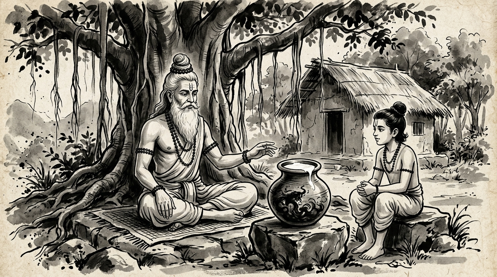

# The Poison in the Milk: Chanakya’s Warning on Two-Faced Colleagues and the Trap of Sweet Words

The morning mist still clung to the riverbank as Somadatta, a promising young administrator from the imperial secretariat, climbed the earthen path to the hermitage. His brow was furrowed, his shoulders tense with an exhaustion that came not from arduous labor, but from cognitive dissonance.

Beneath the sprawling canopy of an ancient banyan tree, the venerable Rishi sat in quiet meditation upon a woven mat of kusha grass. The sage's matted hair was gathered neatly into a traditional Vedic *jata* topknot, dark rudraksha beads rested calmly against his chest, and three clean lines of sacred ash adorned his forehead.

"You look troubled, Somadatta," the Sage observed without opening his eyes. "Has the empire faced a famine, or has an invading legion crossed the border?"

"Neither, Guruji," Somadatta sighed, bowing low before taking a seat upon the stone step. "The enemy is far closer, and far more baffling. There is a senior colleague in the treasury department—Bhadra. To my face, he is the kindest man in the secretariat. He greets me with warm compliments, inquires about my family, and praises my proposals in the hallways. Yet every time my initiatives reach the council for royal sanction, subtle delays emerge. Reports go missing. Doubts are whispered to the chief minister about my 'lack of maturity.' Yesterday, an imperial clerk privately revealed that Bhadra himself authored the memorandum questioning my integrity. I am torn. When I see him, his warmth seems genuine. Perhaps I am misjudging him? How can a man speak with such sweetness while sharpening a blade behind his back?"

The Rishi opened his eyes, calm and profound as deep waters. He reached beside his seat and lifted a heavy clay earthen pitcher (*kumbha*).

He set the vessel upon the granite slab between them. The rim was smooth, and within it, rich, fragrant white milk glistened in the morning sun.

"Somadatta," the Sage spoke softly, "dip your fingers into this vessel. Inhale the sweetness of the fresh cream. It smells pure, does it not?"

"It does, Master."

"Now look beneath the rim," the Sage instructed. With a slender bamboo quill, he stirred the bottom of the pitcher. Immediately, a dark, viscous black oil swirled upward from the depths, curling through the white liquid like serpent coils, staining the surface into an ominous grey sludge.

Somadatta recoiled.

"This vessel was filled to the brim with lethal hemlock," the Rishi said evenly. "Only a thin ladle of sweet milk was poured atop the surface to disguise the scent and mask the color. Tell me: would you drink from this vessel because the top layer tasted sweet?"

"Certainly not, Master," Somadatta replied. "A single sip would be fatal."

"Then why," asked the Rishi, "do you allow a man's honeyed speech to blind you to the ruin he works upon your life?"

---

## The Chanakyan Law: *Vishakumbham Payomukham*

In the classic treatise of statecraft and strategic realism, Acharya Chanakya captured this universal human dynamic in a verse carved from ruthless observation of imperial courts:

> **పరోక్షే కార్యహంతారం ప్రత్యక్షే ప్రియవాదినమ్ |**  
> **వర్జయేత్తాదృశం మిత్రం విషకుంభం పయోముఖమ్ ||**  
> *(Parokshe kāryahantāram pratyakshe priyavādinam |*  
> *Varjayettādrisham mitram vishakumbham payomukham ||)*  
>  
> *"Shun completely an associate who undermines your work in secret while showering you with sweet words to your face. Such an individual is nothing more than a pitcher filled with lethal poison topped with a superficial glaze of milk."*

Chanakya understood an essential truth of human nature: **The most dangerous adversaries are never the open rivals who challenge you on the battlefield. The deadliest adversaries are those who weaponize civility to disarm your vigilance.**

An overt rival signals danger. Your instincts sharpen, your defenses mobilize, and your work is double-checked. But a smiling saboteur induces psychological paralysis. Because their social presentation is warm, your conscience hesitates to label them an enemy. You second-guess your perceptions, excuse their passive aggression, and leave your flank unguarded.

---

## The Anatomy of Modern "Sweet Saboteurs"

In modern corporate and professional landscapes, open hostility is heavily penalized by HR policies and organizational norms. Consequently, workplace hostility has evolved: toxic individuals rarely scream or insult; instead, they operate through performative goodwill.

Chanakya identified the three classic behavioral signatures of the *Payomukham Vishakumbham* colleague:

### 1. The Weaponized Private Compliment vs. The Public Silence
They seek you out privately to lavish praise upon your ideas ("*You are by far the smartest engineer on this project; leadership is lucky to have you*"). Yet during critical executive reviews, when your proposal comes under scrutiny, they remain stone-cold silent—or worse, ask seemingly innocent, probing questions ("*Just playing devil's advocate here...*") designed to plant seeds of doubt in leadership’s mind.

### 2. The Calculated "Concern" Narrative
Instead of attacking your competence directly, they frame their sabotage as maternal or paternal empathy. They approach senior decision-makers under the guise of compassion:  
> *"I really care about Somadatta, but I worry he’s taking on too much stress and might burn out. Perhaps we should assign the flagship project to someone more seasoned so we don't break his spirit."*  
By framing the takedown as benevolence, they sabotage your career trajectory while maintaining the pristine reputation of a caring mentor.

### 3. The Smiling Obstructionist
They agree with all your timelines in group meetings with enthusiastic nods. Yet when project milestones depend on their deliverables or approvals, unexpected bureaucratic bottlenecks consistently arise. They apologize profusely with radiant smiles—*"I am so sorry, my team got completely swamped!"*—while systematically ensuring your initiative misses its launch window.

---

## Chanakya’s Strategic Protocol: How to Neutralize Two-Faced Dynamics

The greatest error made by capable professionals when encountering sweet saboteurs is **moral confrontation**. 

If you march into their office and accuse them of being two-faced, you walk directly into their trap. They will appear shocked, hurt, and wounded. They will feign deep sadness: *"I’ve always supported you! How could you think this of me?"* Overnight, you become labeled as paranoid, emotional, and difficult to work with, while they retain the high moral ground.

Chanakya prescribes an entirely different path: **Strategic Detachment and Structural Containment.**

### 1. Separate Speech from Velocity (Measure Only Trajectory)
Train your mind to discount verbal affirmations completely. Treat spoken flattery as background noise. Evaluate an associate solely through observable, measurable velocity:
- Did their approval arrive on time?
- Did they allocate the promised headcount?
- Did they endorse the architecture in writing?  
If their words are warm (+10) but their concrete actions are negative (-5), their true vector is **-5**. Believe the vector, never the voice.

### 2. Eliminate Private Ambiguity (Document the Perimeter)
A sweet saboteur thrives in off-the-record conversations, hallway chats, and informal phone calls where no record exists. Starve them of oxygen:
- Follow up every verbal chat with an objective summary email: *"Thank you for the quick chat, Bhadra. Confirming our agreement that your team will provide the audit dataset by Thursday 4 PM."*
- CC relevant governance leads and project trackers. A poisoned pitcher loses its deception the moment transparency turns the light on.

### 3. Starve Them of Personal Vulnerability (*Mantra Gupti*)
Never confide your frustrations, career anxieties, or personal doubts to a colleague whose alignment is suspect. Chanakya warned that a two-faced associate collects your candid confessions like dry wood, only to light a bonfire under your feet when the political season turns. Maintain cordial, polite, yet impenetrable professional boundaries.

### 4. Build Direct Alliances Beyond Their Gatekeeping
If the saboteur attempts to act as an intermediary between you and key decision-makers, systematically create independent, high-visibility touchpoints. Present data directly in steering committees. Deliver undeniable value that speaks louder than backchannel whispers.

---

## Strategic Comparison: Naive Good Faith vs. Chanakyan Mastery

| Situation | The Naive Reaction | Chanakya’s Strategic Mastery |
| :--- | :--- | :--- |
| **Effusive Unearned Praise** | Warmly reciprocate, open up emotionally, and share strategic vulnerabilities. | Smile politely, say *"Thank you,"* and remain entirely guarded. Share zero confidential plans. |
| **Backchannel Smears & Whispers** | Confront them emotionally in person; get lured into an unrecorded 'he-said-she-said' argument. | Ignore the drama; publish verifiable data dashboards and written audit logs directly to senior stakeholders. |
| **Chronic Bottlenecks with Apologies** | Accept the repeated apologies in good faith, absorbing project delays quietly. | Escalate systematically on project governance trackers: *"Project milestone blocked on Treasury approval since Oct 4."* |
| **Public 'Devil's Advocate' Ambush** | React defensively and take offense at their apparent betrayal during the meeting. | Stay calm: *"Excellent question. As detailed in Section 3 of the pre-circulated technical brief, the risk model addresses that exact scenario."* |

---

## The Rishi's Final Injunction

The afternoon breeze stirred the leaves of the banyan tree. The Sage set the bamboo quill aside and looked into Somadatta’s eyes.

"Do not hate Bhadra, Somadatta," the Rishi whispered gently. "Hatred creates emotional turbulence, and turbulence clouds judgment. Bhadra is simply acting according to his nature, just as a scorpion carries poison in its tail. The failure is not in his deceit; the failure is in your refusal to see the world as it is."

Somadatta bowed his head, feeling the fog of confusion lift from his heart.

"What must I do tomorrow, Master?"

"Tomorrow," the Rishi answered, "greet him with a serene smile. Speak with utter courtesy. Accept none of his flattery into your pride, and offer none of your secrets to his ears. Move your work onto formal paper. Let every agreement be witnessed by the council. When the poison finds no entry point, it harms only the vessel that carries it."
