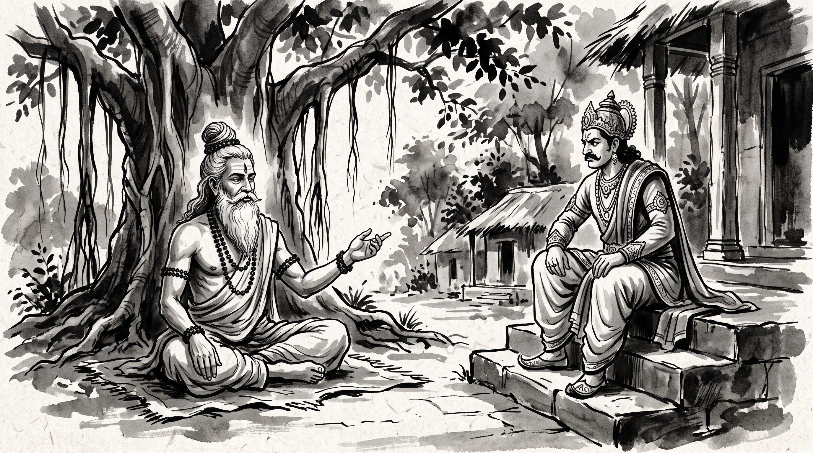

# The Arrogance That Blinds: Vidura's Warning to the King

Somadeva, a seasoned counselor from the royal court, sat in the quiet shade of the forest hermitage, rubbing his tired temples. The weight of courtly dysfunction pressed heavily upon his brow.

"Revered Master," he began, bowing before the sage, "our newly appointed chief minister is sharp-witted, yet insufferably arrogant. In the assembly, he publicly belittles the elder statesmen, dismisses every seasoned warning, and claims that he alone possesses the wisdom to guide the realm. Anyone who voices prudent restraint is banished from the council. He boasts that his harsh, unyielding conduct is the hallmark of a decisive leader. How does a truthful minister survive under someone so powerful yet so blind to his own peril?"

The venerable Rishi sat composed upon a woven reed mat beneath the sprawling banyan tree. He turned a prayer bead in his weathered hand, his eyes calm and still as deep water, before offering his counsel.

---

## The Wisdom of Vidura Niti

The Rishi recounted an immortal passage from the *Mahabharata*, preserved in the ancient counsel known as *Vidura Niti*.

King Dhritarashtra, blinded not merely in his eyes but by his deep indulgence of his arrogant son Duryodhana, asked his righteous minister Vidura how a prosperous realm is brought to ruin. Vidura replied with unflinching clarity:

> **"Intoxication of wealth, intoxication of power, and intoxication of learning—these three are intoxications for the proud, but disciplines for the noble. A man blinded by these cannot see the cliff until he has already stepped off it."**

"Vidura understood," the Rishi explained softly, "that unbridled arrogance is inherently self-terminating, though it exacts a terrible toll upon those in its shadow. A rigid, towering oak proudly defies the hurricane, refusing to sway, and is violently uprooted by the roots. The humble grass bends with the gale, survives the tempest, and rises unblemished once the storm has passed."

---

## The Duryodhana Archetype: The Dynamics of Arrogant Leadership

In every great court and modern enterprise, the **Arrogant Leader** (the Duryodhana archetype) exhibits three unmistakable behavioral patterns:

1. **The Echo Chamber**: They banish discerning advisors and surround themselves with flatterers. Honest counsel is reclassified as disloyalty, leaving the leader isolated in an artificial reality.
2. **Taking Credit, Deflecting Blame**: When an initiative prospers, they claim it as their sole genius. When calamity strikes, they blame the incompetence of their subordinates or the malice of their peers.
3. **The Fragile Ego**: Their aggressive bluster masks a profound terror of exposure. They cannot tolerate even gentle correction, because their identity rests entirely upon the illusion of infallibility.

---

## Strategic Disciplines for Navigating Arrogant Authority

How do you endure an arrogant superior without compromising your integrity or falling under their collapsing edifice?

### 1. Do Not Engage in Ego Battles
Arrogant individuals thrive on contest; opposition validates their sense of importance. When they attempt to provoke you in open council, practice detached composure. Agree with their stated objective where practical, but firmly ground your discussion in demonstrable facts and verified accounts. As the ancient sage observed, angering yourself over another's foolishness merely hands them the reins to your mind.

### 2. Document the Reality in Objective Ledgers
The arrogant leader continually revises history to match their narrative. Keep quiet, meticulous written records of instructions, decisions, and resource allocations. When their flawed directives inevitably fracture under operational pressure, their first instinct will be to seek a scapegoat. Your clear trail of documented facts will serve as an unshakeable shield.

### 3. Outlast the Storm (The Grass Strategy)
Like the grass in the hurricane, cultivate the patience to yield without breaking. Arrogant rulers inevitably forge enemies above, beside, and below them. Their abrasive posture steadily alienates the very alliances required to sustain their rule. Focus your energy on maintaining quiet craftsmanship and cultivating trusted lateral bonds across other departments. Let the storm exhaust itself against its own fury.

---

## The Rishi’s Counsel

Do not exhaust your spirit attempting to teach humility to someone intoxicated by power. Let the natural harvest of their deeds be their instructor. Your duty is to remain centered, preserve your honor, and ensure you do not stand beneath their tower when it finally crashes to the earth.

**Source:** Mahabharata, Udyoga Parva, Prajagara Parva, 34.41

> *"The giant tree that scorns the wind is shattered at the root; the supple grass that bends beneath the gale rises unbent when the morning breaks."*
