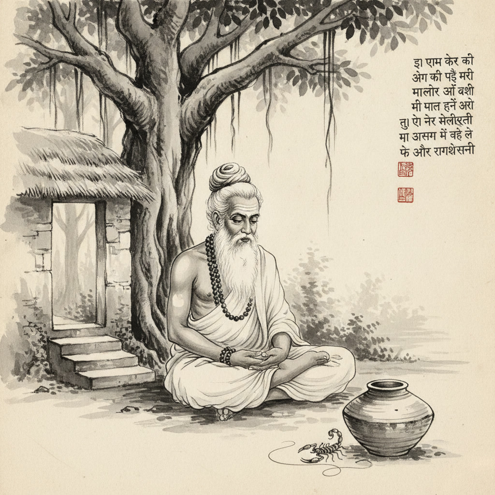

# The Scorpion’s Tail: Vemana’s Warning on the Full-Bodied Malice of Toxic Courtiers

The early morning sunlight filtered through the ancient canopy of the hermitage, casting soft, dappled shadows across the stone courtyard. Madhava, a seasoned administrator from the imperial revenue registry, ascended the path with heavy, hesitant steps. His shoulders were slumped, his face lined with the deep fatigue that stems not from long hours of labor, but from relentless, inexplicable workplace sabotage.

Beneath the sprawling branches of a massive banyan tree, the venerable Rishi sat in quiet meditation upon a woven mat of kusha grass. The sage's silver matted hair was bound securely in a traditional Vedic *jata* topknot, dark rudraksha beads rested gently over his ascetic wrap, and three calm lines of sacred vibhuti marked his forehead.

Beside the granite step rested an earthen water vessel, and nearby on the dry soil, an errant scorpion crawled slowly past the rim before settling motionless in the dust.

"You carry a heavy cloud this morning, Madhava," the Sage said softly, opening his eyes with deep calm. "Has the harvest failed, or has the treasury treasury ledger fallen into disorder?"

"Neither, Guruji," Madhava replied, bowing with clasped hands before taking a seat upon the lower stone slab. "The numbers are flawless, yet my work is unraveling. In our department, there is an official named Varun. For two years, I believed his friction with me was merely professional—a difference in style, a misunderstanding of priorities. I went out of my way to accommodate him. I credited him in joint reports, listened patiently to his grievances, and even defended him when others questioned his performance. I thought reasonable benevolence would soften his rancor."

The Rishi watched the scorpion in the dust, listening intently.

"Yet yesterday," Madhava continued, his voice tight with bewilderment, "I discovered he spent weeks orchestrating a private campaign to scuttle a critical irrigation grant I designed. When confronted privately, he did not offer constructive critiques or counter-arguments. He simply smiled coldly and looked for the next lever to sabotage. Why does someone expend such boundless vitality merely to harm another? How can a person be so consumed by hostility when no offense was ever given?"

The Rishi gestured gently toward the ground between them.

"Look at the creatures of the wilderness, Madhava," the Sage began, his voice resonant and steady. "When a serpent slithers through the high grass, where does it carry its venom?"

"In its fangs, Guruji."

"And the scorpion resting beside this earthen jar—where does its poison reside?"

"In the sting of its tail," Madhava replied.

The Rishi nodded slowly. "Precisely. The serpent’s venom is localized in its teeth; it strikes only when stepped upon, startled, or hunting for sustenance. The scorpion carries venom only in the tip of its tail; outside of its defensive sting, its shell is harmless. But the ancient poet-yogi Vemana observed a darker reality about the unrighteous, envious human mind:

> **విషము చూడు పాము విషమందుననుండు**  
> **తేలుకును విషమ్ము తోకనుండు**  
> **దుర్జనునకు విషము తోడై శరీరమౌ**  
> **విశ్వదాభిరామ వినుర వేమ!**  

*‘The serpent carries poison only in its fangs; the scorpion carries venom only in its tail. But the malicious person is poison through and through—every thought, gesture, and fiber of their being is permeated with malice.’*"

Madhava listened in silence as the weight of the verse settled into the quiet morning air.

"When you deal with ordinary colleagues who are stressed, ambitious, or insecure," the Rishi explained, "their sharp words are like the scorpion’s tail: an isolated defensive reaction to pressure. But the truly envious actor (*durjana*) does not strike out of temporary fear or legitimate self-interest. To them, venom is not a defensive weapon; it is their very atmosphere. Their malice is full-bodied."

---

## The Strategic Anatomy of Full-Bodied Malice

In contemporary organizations, the most dangerous cognitive error dedicated professionals make is projecting their own reasonable goodwill onto fundamentally malicious actors. When confronted with unprovoked sabotage, conscientious builders naturally assume:

1. *"If I explain my intentions more clearly, they will understand."*
2. *"If I concede this point or share more credit, they will feel secure."*
3. *"If I demonstrate unwavering goodwill, they will reciprocate."*

Yogi Vemana’s verse warns that this assumption is fatal. In high-stakes workplace dynamics, recognizing full-bodied toxicity requires distinguishing between ordinary conflict and ingrained malice:

| Attribute | Ordinary Difficult Colleague | The Malicious Actor (*Durjana*) |
| :--- | :--- | :--- |
| **Trigger** | Specific resource competition, misaligned incentives, or high stress. | The mere presence of your competence, autonomy, or integrity. |
| **Scope of Attack** | Confined to specific disagreements or deliverables (localized like the scorpion's tail). | Comprehensive sabotage across reputation, alliances, and initiatives (full-bodied venom). |
| **Response to Concession** | Calms down, collaborates, or seeks fair compromise. | Interprets conciliation as weakness; escalates attacks with greater audacity. |
| **Objective** | Delivering their own project or advancing their legitimate standing. | Tearing down your standing, even at the cost of damaging shared organizational goals. |

---

## 4 Strategic Rules for Dealing with Full-Bodied Toxicity

Drawing from Vemana's psychological realism and Chanakya's tactical doctrine, how must a principled professional navigate an individual whose malice is structural rather than situational?

### 1. Abandon the "Reform Illusion"
You cannot cure venom with milk, nor can you rehabilitate a malicious competitor through unilateral appeasement. Attempting to charm or pacify someone who is fundamentally threatened by your competence merely hands them ammunition. Accept their character as an objective environmental hazard—like a monsoon storm or rugged terrain—and cease emotional bargaining.

### 2. Radical Documentation & Boundary Isolation
Because the malicious actor’s poison is dispersed across all interactions, verbal agreements and casual hallway conversations are vulnerabilities.
- **Transcribe Commitments:** Follow up every interaction with concise, neutral written confirmations.
- **Narrow the Surface Area:** Never engage in informal, off-the-record debriefs where your words can be weaponized out of context.
- **Maintain Procedural Rigor:** Keep all project reviews anchored in indisputable metrics and visible, transparent repositories.

### 3. Starve the Drama Loop (Stoic Detachment)
The primary objective of a toxic political actor is emotional destabilization. When they provoke you into an indignant outburst, they successfully drag you onto a corrupted board where optics supersede facts. 
As Mahatma Vidura taught, the mark of true wisdom is remaining unperturbed on the surface while securing your position underneath. Treat their provocations with flat, unreactive professionalism. When you refuse to provide emotional fuel, their attacks fail to achieve internal leverage.

### 4. Build Multi-Node Coalition Defenses
A lone operator who relies solely on the quality of their work is uniquely vulnerable to whispered campaigns. Ensure your contributions are directly visible to cross-functional stakeholders, sponsors, and leadership circles. When your reputation and output are corroborated across multiple independent nodes, an isolated saboteur's venom cannot contaminate the wider ecosystem.

---

## The Rishi’s Parting Counsel

The morning breeze rustled the leaves of the banyan tree as the Rishi rose and placed a reassuring hand on Madhava’s shoulder.

"Do not poison your own spirit trying to understand why venom tastes bitter, Madhava," the Sage said gently. "The scorpion does what is in its nature, and the envious courtier does what is in his. Your duty is not to transform their soul, but to preserve your dharma and accomplish your mission."

"Step around the scorpion. Guard your boundaries. Let your quiet mastery be the granite rock upon which their malice exhausts itself."

Madhava bowed deep to the Sage, the cloud of confusion lifted from his mind. He turned back toward the secretariat, not with bitterness or naive hope, but with clear-eyed vigilance and unshakable resolve.