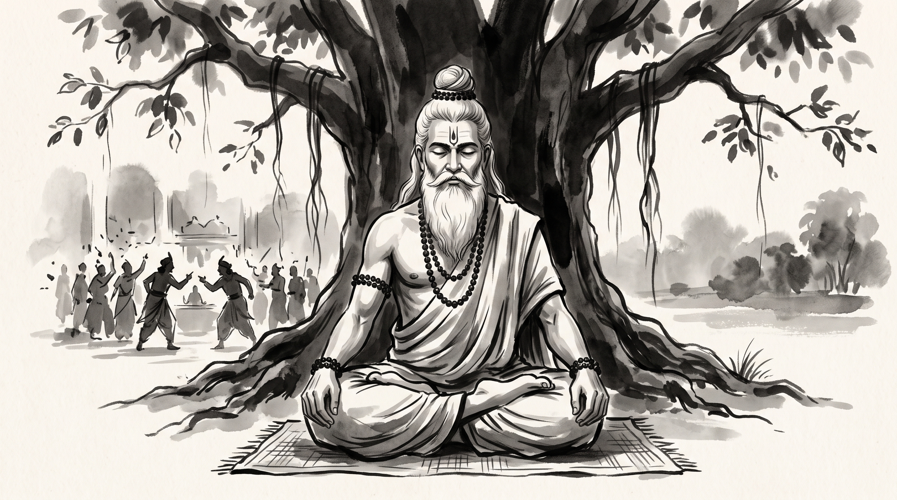

# Vidura's Silence: Navigating the Toxic Court and Corrupt Leadership

The evening dusk settled slowly over the forest clearing outside the quiet ashram hermitage. Devadatta, a seasoned engineering director at an enterprise technology firm, walked with heavy, weary steps down the dusty footpath toward the shade of the grand banyan tree. His shoulders were tense and his eyes bore the exhaustion of months spent fighting losing battles.

He bowed low before the venerable Rishi, who sat calmly upon a deer skin, his fingers resting gently on a string of dark rudraksha beads.

"Revered Master," Devadatta spoke, his voice trembling with quiet frustration, "for six months I have sat in the weekly executive committee watching our vice president endorse reckless, dishonest commitments. The product roadmap has become a theater of deceit. When I voice the reality of our infrastructure limits, sycophants interrupt and the VP smiles condescendingly, brushing aside every warning. Yesterday, they voted to commit to an unachievable delivery date for our largest client. My integrity burns within me. If I shout, I am branded difficult and insubordinate. If I nod along, I become complicit in their fraud. Tell me, how does an ethical professional survive inside a toxic court where falsehood has already been crowned king?"

The Rishi looked upon the troubled leader with deep, unhurried compassion.

"Tell me, Devadatta," the sage replied softly, "when a house is engulfed in flames and the master of the house pours oil upon the hearth thinking it to be water, will the shouting of a truthful bystander douse the fire?"

"It will not, Master. The fire consumes regardless."

"Indeed," said the Rishi. "Hear then the counsel of Mahatma Vidura, who sat at the very heart of the most corrupt assembly in ancient history."

---

## The Assembly of Hastinapura and Vidura's Stated Dharma

In the *Mahabharata* (Udyoga Parva, *Prajagara Parva*), King Dhritarashtra summoned his prime counselor and half-brother, Vidura, late into the night. Tormented by sleeplessness and anxiety over the impending destruction of his dynasty, the blind king sought comfort and validation for his refusal to restrain his malevolent son, Duryodhana.

Vidura did not flatter the sovereign, nor did he erupt into useless fury. He delivered the immortal verses known to posterity as the *Vidura Neeti*. With crystalline clarity and uncompromising dignity, he laid down the laws of governance, character, and self-restraint. He warned the king:

> *"One alone commits an evil deed, but many partake in its fruit; the partakers escape the consequence, while the author of the deed alone is consumed by the fault."*

Yet when the royal sabha assembled and Duryodhana brazenly orchestrated the humiliation of the Pandavas, Vidura spoke his warning once with absolute precision, placing truth clearly on record. When the assembly willfully refused the truth, Vidura did not scream or wage a brawl in the royal hall. He withdrew his counsel and folded his hands into solemn, resolute silence. 

Vidura knew the exact boundary of human responsibility: duty demands that truth be stated clearly once; wisdom demands that one ceases arguing when vanity and greed have shuttered the ears of listeners.

---

## The Corporate Court and the Trap of Combat

Modern corporate governance often mirrors the doomed court of Hastinapura. When senior leadership succumbs to willful blindness, employees frequently stumble into three self-destructive traps:

### 1. The Martyrdom Delusion
Conscientious professionals often mistake endless arguing for moral courage. They believe that if they just push harder, prepare twenty more slides, or raise their voice during all-hands meetings, they can force irrational leaders to become rational. In reality, hostile leaders view persistent argument not as helpful insight, but as rebellion. You exhaust your political capital while leaving the flawed decision entirely unchanged.

### 2. The Contagion of Frustration
When truth is rejected, resentment naturally breeds cynicism. Engineers and managers retreat into corridor whispers, venting in private chat channels, and poisoning their own temperament. By adopting the bitter frequency of the corrupt environment, they surrender their peace and become spiritual casualties of a battle they cannot win.

### 3. The Complicity of Flattery
To survive, many choose the opposite error: craven sycophancy. They praise flawed decisions to protect their bonuses and job security. Yet history and corporate postmortems show that when catastrophe inevitably strikes, sycophants are tossed aside first. Vidura refused both flattery and futile agitation; he chose principled detachment.

---

## The Three Disciplines of Strategic Silence

When trapped in a dysfunctional organization or reporting to leaders who actively resist the truth, apply the three disciplines practiced by Vidura:

### 1. Place the Truth on Record Without Anger
Do not withhold your technical and operational counsel. State the risks, dependencies, and timelines crisply in writing and in meetings—exactly once, devoid of emotion, sarcasm, or personal accusation. When asked, deliver the unvarnished facts like a physician giving a diagnosis. Once the diagnosis is entered into the record, stop.

### 2. Guard Your Energy and Set Internal Boundaries
Refuse to attend informal sessions dedicated to gossip or backroom maneuvering. When colleagues attempt to draw you into toxic debates or emotional venting over executive failure, hold a calm, neutral silence. Do your core craft with uncompromising craftsmanship, preserve your mental health, and refuse to carry the guilt of decisions made over your objections.

### 3. Prepare Your Silent Departure
Vidura ultimately walked away from Hastinapura, laying down his bow and staff to embark upon pilgrimage when conflict became inevitable. Recognize when an organization has reached moral and strategic bankruptcy. Quietly build your network, update your portfolio, and transition on your own terms before the structure collapses.

**Source:** Mahabharata, Udyoga Parva, Vidura Neeti (chapters 33–40)

Devadatta listened in stillness. The restless knot in his chest began to ease, replaced by the cool clarity of mountain stone. He bowed to the sage, knowing that his duty was not to rescue the king from his folly, but to guard his own virtue and truth.

> *"When truth is spoken to blind vanity, words become merely fuel for the blaze; the silence of the wise counselor is the only mirror that outlasts the kingdom's ruins."*
