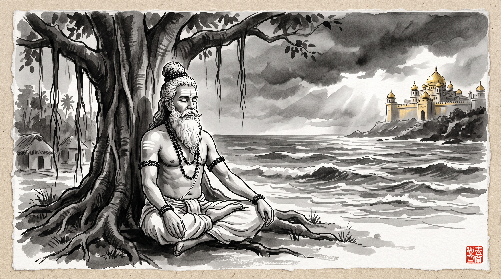

# Vibhishana’s Threshold: Knowing When to Walk Away from Toxic Leadership

The forest hermitage was quiet save for the rhythmic murmur of the sacred river and the rustling leaves of the ancient banyan tree. Somadeva, a chief administrator from the provincial capital, sat upon a flat river stone with his head resting in his trembling hands. His eyes bore the hollow, dull exhaustion that comes not from hard labor, but from long months of internal moral compromise.

Beneath the banyan's canopy sat the venerable Rishi, his matted silver locks bound securely in the traditional Vedic *jata* topknot, dark rudraksha beads gracing his neck, and subtle lines of sacred vibhuti gleaming on his brow. The sage poured clear water from his copper kamandalu onto a small sapling before turning his gaze toward the grieving visitor.

"Master," Somadeva spoke softly, his voice strained with guilt. "I have served the governor for seven years. When we began, the vision was grand and the goals were noble. But power has intoxicated him. He tolerates no disagreement. Those who speak the unvarnished truth are humiliated or stripped of responsibility, while sycophants who flatter his vanity are rewarded with titles. He is steering the entire province into ruinous conflict."

Somadeva drew a sharp, agonizing breath. "I have drafted another memorandum detailing the financial leakages and strategic folly of his latest decree. Yet every time I prepare to submit it, fear grips me—not fear of his wrath, but fear of my own conscience. If I give up and walk away, am I a coward? Am I betraying the organization I helped build? When does loyalty to a mission become betrayal of oneself?"

---

## The Assembly in the Golden Citadel

The Rishi picked up a fallen dry leaf, watching it drift along the swift current of the stream before speaking.

"In the epic of the *Ramayana*, there is no scene more psychologically intense than the final council in the golden assembly hall of Lanka. The king, Ravana, was possessed of unmatched intellect, immense boons, and extraordinary valor. Yet his unbridled desire and arrogance had blinded him. He had seized another man's wife and invited an annihilating war upon his people."

"While the court courtiers and sycophantic generals puffed up Ravana's ego—promising that his supreme might would crush any opposition—one counselor stood in total, quiet opposition: his younger brother, Vibhishana."

"Vibhishana did not whisper conspiracies in shadowed corridors, nor did he nurse hidden ambitions. He stood in the open court, looked the terrifying monarch in the eye, and spoke with flawless clarity:

> *'A man may easily find courtiers who speak words that please the ear. But rare is the speaker—and rarer still the listener—of words that are bitter to hear, yet wholesome in their truth.'*

"Vibhishana laid out the facts without malice, without flattery, and without cowardice. He demonstrated that Lanka’s current course was unsustainable, unjust, and suicidal. And what was the monarch's reply?"

The sage paused, his gaze piercing. "Ravana, consumed by wounded pride, rose from his throne, struck his brother with his foot, and roared that any brother who counselled restraint was a traitor who deserved death."

---

## Crossing the Threshold of Irretrievability

"It was at that exact second," the Rishi continued, "that Vibhishana crossed what ancient masters of statecraft call the **Threshold of Irretrievability** (*Anivartana-seemā*)."

"Up until that moment, duty demanded that Vibhishana advise, caution, and exhaust every ethical avenue to redirect the leader. That was his dharma as a minister and a brother. But once the leader publicly declared truth to be treason, the nature of Vibhishana's presence transformed entirely."

"To stay after that threshold is crossed is no longer loyalty. It is **complicity**."

"Why?" Somadeva asked quietly.

"Because a megalomaniacal leader who has banished truth relies upon the reputation of his ethical counselors to disguise his decay. By remaining in your seat, continuing to file softened reports, and absorbing the shockwaves of his catastrophic decrees, you lend your honor as a shield to his madness. You become the quiet shock-absorber that delays the natural reckoning of bad decisions."

"Vibhishana understood this with absolute detachment. He did not beg. He did not retaliate with physical violence. He rose, gathered four steadfast companions who shared his vision of righteousness, and walked out of the assembly gates forever. He crossed the ocean to align his capabilities with Rama—not out of cowardice, but because his ultimate allegiance was to *Dharma*, not to the person of an unrepentant king."

---

## The Three Signals of the Threshold

The Rishi gestured to Somadeva and outlined the three definitive signals that reveal when a professional has reached Vibhishana’s threshold in any modern organization:

### 1. Truth is Reclassified as Insubordination
In a healthy organization, rigorous debate and dissenting data are welcomed as risk mitigation. In a decaying organization, objective reality is treated as a personal slight against executive intuition. When questioning a premise brands you as 'not a team player', you are no longer in an enterprise; you are in a court of vanity.

### 2. Sycophancy Becomes the Primary Currency
Observe who gets promoted. If promotions flow to those who parrot executive opinions and conceal bad news rather than those who deliver enduring results, the institutional immune system is dead. You cannot heal an organism whose survival mechanism has turned against its own vital organs.

### 3. Conscientiousness is Weaponized as Leverage
Narcissistic leaders instinctively prey upon the high conscientiousness of ethical subordinates. They know you care about the users, the junior engineers, and the project deadlines. They will pile impossible demands upon your shoulders, knowing you will sacrifice your health and boundaries rather than allow failure on your watch.

---

## The Strategic Art of the Clean Departure

"Master," Somadeva whispered, the burden visibly shifting from his shoulders. "If I depart, how should one leave without burning the ground beneath one's feet?"

"Emulate Vibhishana's departure," the Rishi advised:

1. **Speak the Truth Once, Fully and Without Anger:** Deliver your final assessment with clinical precision, in writing, without personal resentment or passive aggression. Let the record show that reality was laid plainly on the table.
2. **Refuse the Sunk-Cost Trap:** Do not sacrifice the next seven years of your career to validate the past seven. Time spent building a sinking ship does not make the ship seaworthy.
3. **Leave Without Sabotage:** Vibhishana did not set fire to the palace as he walked away. He simply removed his presence, his counsel, and his moral sanction. When you leave, preserve your dignity. Do not gossip, do not badmouth, and do not rejoice in the inevitable fall.
4. **Realign with Higher Principles:** Direct your energy toward teams, projects, and leaders whose foundational ethics match your own. Your competence is a sacred asset; do not spend it fueling an engine that produces only poison.

Somadeva bowed low, touching the dust at the Rishi's feet. The gnawing anguish in his chest had dissolved, replaced by the cool, unflinching serenity of clarity.

> *"When a king chooses blindness, the righteous counselor must not pluck out his own eyes to keep him company. He must walk toward the dawn."*
