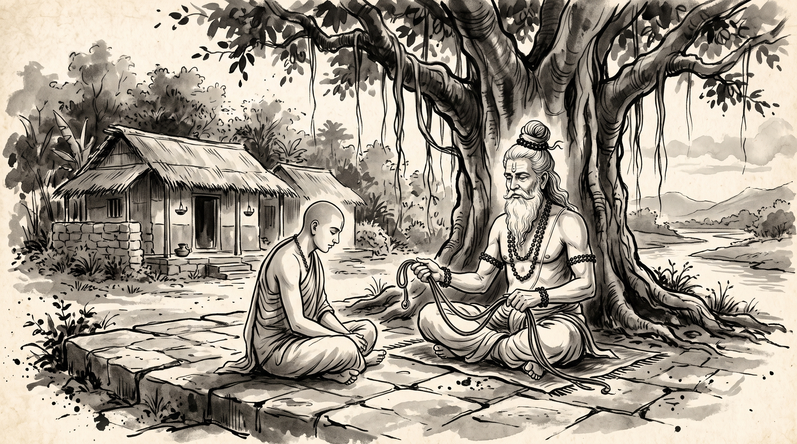

# The Whispering Charioteer: Overcoming Subtle Demoralization and Shalya-Vritti

The afternoon sun filtered through the dense foliage of the sacred banyan tree, casting intricate lace-like shadows across the ashram courtyard. Devadatta, an ambitious guild master overseeing a flagship architectural commission for the imperial capital, sat with his shoulders slumped and hands clenched in frustration.

Beside the granite veranda sat the venerable Rishi, calm and centered. His silver hair was gathered neatly into a traditional Vedic *jata* topknot, dark rudraksha beads rested against his ascetic linen wrap, and three crisp lines of sacred vibhuti marked his brow. In his hands, the sage held a slender length of woven flax—the kind used by charioteers to guide spirited horses.

"You look as though an arrow pierced your armor before the duel even began, Devadatta," the Rishi observed quietly.

"Master," Devadatta spoke with bitter weariness. "The project is on the cusp of delivery. Our engineering is sound, our stonework is flawless, and the imperial inspection takes place in three days. Yet my spirit feels hollowed out. The drain comes not from our competitors, nor from the demands of the emperor, but from the man who stands beside me: my deputy and co-lead, Varuna."

Devadatta exhaled sharply. "Varuna is brilliant, yet whenever we approach a crucial milestone, he begins his subtle drip of doubt. Yesterday, as we reviewed our final structural plans, he sighed and remarked: *'The imperial inspectors were trained under the legendary master architects of Mathura. They have torn far greater designs than ours to shreds. Let us hope they show mercy to our provincial efforts.'* When I proposed our innovative vaulting technique, he muttered that failure would ruin our reputations forever. He doesn't openly rebel; he simply bleeds my confidence drop by drop. By the time I enter a presentation, my palms are cold and my voice wavers. How do I fight an adversary who shares my own chariot?"

---

## The Epic Duel and the Charioteer from Madra

The Rishi laid the woven rein upon the stone table and nodded with solemn recognition.

"In the annals of the *Mahabharata*, on the seventeenth day of the great Kurukshetra war, the destiny of nations hung upon a single clash: the duel between the sun-child Karna and the third Pandava, Arjuna.

Karna was an archer of incomparable talent, armed with celestial weapons and an unyielding will. Yet Duryodhana knew that Arjuna possessed an unmatched advantage: his chariot was driven by Krishna himself, the embodiment of supreme poise and divine alignment. To balance the scales, Duryodhana persuaded King Shalya of Madra—a veteran warrior of peerless skill in equestrian maneuvers—to steer Karna’s chariot.

Shalya agreed, but under one sinister condition: he reserved the unbridled right to speak his mind freely throughout the battle. Duryodhana consented, believing words could never blunt a warrior’s steel."

The sage leaned forward, his gaze intense. "That concession proved deadlier than ten thousand celestial arrows.

Throughout that fateful day, as Karna took aim at Arjuna, Shalya did not raise a physical weapon against him. Instead, he waged an unrelenting psychological war. Every time Karna notched a devastating arrow, Shalya scoffed:

> *'Do you truly believe, Karna, that your provincial bows can match the celestial Gandiva? Arjuna is invincible; the three worlds tremble before his presence. You are merely a moth flying into a raging bonfire. Prepare yourself for death.'*

When Karna shot an arrow that nearly took Arjuna's crown, Shalya minimized the feat, attributing it to mere chance. When Arjuna retaliated, Shalya magnified the threat, declaring that defeat was inevitable. With every phrase, Shalya chipped away at Karna's focus, poisoned his self-trust, and induced subtle tremors of hesitation. When the decisive moment arrived and Karna’s chariot wheel sank into the mud, his psychological stamina had already been drained by the voice whispering in his ear."

---

## The Syndrome of *Shalya-Vritti*

"In ancient statecraft," the Rishi continued, "this phenomenon is termed **Shalya-Vritti** (the conduct of the demoralizing charioteer).

An open enemy on the battlefield is easy to address. You face them with shield raised and weapon drawn. But a *Shalya* sits inside your own vehicle. They share your banner, sit at your planning table, and draw from the same charter. Because they are ostensibly on your team, you drop your psychological defenses and allow their commentary to penetrate your subconscious."

The Rishi identified the three unmistakable marks of modern *Shalya-Vritti* in professional life:

### 1. The Pre-Battle Chill
Observe when the commentary occurs. A true advisor brings constructive critiques early—during planning sessions when designs can be adjusted. A *Shalya* delivers their demoralizing forecasts immediately prior to high-stakes execution—in the corridor moments before the council convenes, minutes before a critical presentation, or during the final inspection walk. Their timing is designed not to improve the work, but to rattle your composure.

### 2. The Weaponized "Devil's Advocate"
When confronted, practitioners of *Shalya-Vritti* invariably seek refuge behind the noble mask of pragmatism: *"I'm only being realistic; someone has to play devil's advocate."* But there is a profound distinction between rigorous risk assessment and chronic demoralization. Rigorous risk analysis pairs problems with solutions; *Shalya-Vritti* pairs problems with fatalism and helplessness.

### 3. Backhanded Reassurances
They master the art of the poisoned concession:  
> *"Don't take it too hard if the council rejects our designs; everyone knows the high ministers rarely approve initiatives from our guild anyway."*  
By lowering the bar before you have even jumped, they provide a toxic permission structure for failure, quietly eroding the fierce standard of excellence required to win.

---

## How to Neutralize the Whispering Charioteer

"Master," Devadatta asked, his eyes intent. "If I cannot replace Varuna before the inspection, how do I protect my work and maintain my focus?"

The Rishi held up four fingers, delivering the timeless counsel of strategic mastery:

### 1. Erect a Cognitive Firewall
"When Shalya speaks, remember that his words describe his own inner state, not your capabilities. Recognize the pattern immediately: *'This is Shalya-Vritti.'* The moment you label the psychological tactic, you decouple your emotions from their bait. Do not argue. Do not attempt to convince them of your greatness; arguing with a demoralizer only validates their platform."

### 2. Impose the Rule of 'Constructive Closure'
"Establish an operational boundary: *'If you identify a structural flaw, bring the engineering calculation that remedies it. If you bring only a prediction of doom, keep it for your private memoirs.'* Refuse to indulge unanchored pessimism. When they voice an unsubstantiated fear, ask calmly: *'What specific data point supports that conclusion, and what is your proposed mitigation?'* Without substance, their doubt evaporates under the light of logic."

### 3. Seal the Pre-Launch Hours
"In the crucial twelve hours leading up to a major council review or critical delivery, restrict communications strictly to logistical facts. Isolate your mental space. Do not permit casual debriefs or unstructured hallway chatter with cynical partners. Protect your psychological altitude as fiercely as a surgeon guards their sterile tools."

### 4. Choose Your True Charioteer
"Finally, Devadatta, reflect on the greatest contrast of the epic. Arjuna had Krishna; Karna had Shalya. A true charioteer does not flatter your ego, but they align your spirit with purpose, sharpen your clarity, and remind you of your duty when doubt creeps in. As you build your career and your teams, choose partners whose presence deepens your stillness, not those whose whispers stir the dust."

Devadatta stood, bowing deeply to the venerable sage. The nervous tension that had gripped his throat was gone, replaced by the quiet, immovable resolve of a warrior who knows that victory is won within the mind long before the first arrow leaves the bow.

> *"The enemy in front can only wound your flesh; the doubtful charioteer beside you can disarm your soul. Guard the passenger seat of your chariot as fiercely as your own heart."*
