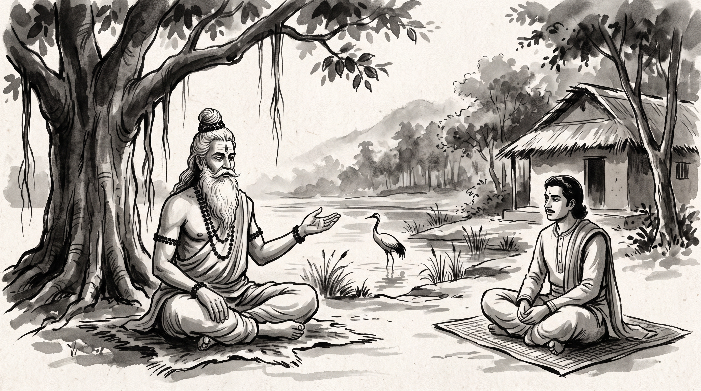

# The Pious Predator: Unmasking the False Rescuer in a Season of Upheaval

The forest hermitage rested in the quiet embrace of the afternoon breeze. Dry leaves rustled beneath the ancient banyan tree, whose aerial roots dropped like pillars of weathered bronze into the fertile earth. Anil, a master builder of the imperial merchant guild, sat upon a woven reed mat with his head lowered and his jaw tightly set. His eyes burned with the stinging disbelief of a man who had not been defeated by an enemy, but betrayed by an apparent savior.

Across from him sat the venerable Rishi, centered and tranquil. His silver beard flowed over an ascetic cotton wrap, his matted hair was bound in a traditional Vedic *jata* topknot, and natural rudraksha beads circled his wrists. Subtle lines of sacred vibhuti traced the calm expanse of his brow.

"You carry the silence of one who walked willingly into a trap because the snare was wrapped in silk, Anil," the Rishi remarked softly.

Anil let out a ragged breath. "Master, our merchant guild has been shaken to its roots these past two seasons. Royal charters were revoked, treasuries were audited, and fear ran rampant through the workshops. In that chaos, a senior court syndic named Mukunda stepped forward as our self-appointed protector. He gathered my craftsmen and told us: *'The high council of overseers is ruthless and seeking to dissolve entire artisan guilds. But do not worry—I will shield you from their wrath. Entrust all your architectural plans, trade registers, and appeals exclusively to me. Keep your heads down and focus on your stonecraft and designs; let me fight your battles in the closed council chamber.'*"

Anil's fists tightened against his knees. "We revered him. We labored through the nights to complete our grand aqueduct and granary designs, believing he was shielding us from ruin. We gave him total custody over our accounts, our designs, and our access to the council. Yesterday, the royal decree was announced."

"And what did the decree reveal?" the sage asked quietly.

"Mukunda was appointed grand chancellor of works," Anil said, his voice trembling with bitter clarity. "Our grand aqueduct design was credited entirely to his personal architectural genius. Meanwhile, he told the high council that our guild was 'skillful with stone but unruly, volatile, and incapable of governance.' To demonstrate his ruthless discipline to the court, he stripped three of my finest master masons of their royal guild licenses and cast them into exile, while absorbing the rest of our workshop under his personal household monopoly. He posed as our savior while carrying us to the slaughterhouse. How does one defend against malice that wears the mask of holy benevolence?"

---

## The Weeping Crane of the Panchatantra

The Rishi smiled with deep, sorrowful recognition. He raised his hand and gestured toward the tranquil pond shimmering beyond the hermitage hut, where water lilies floated and a solitary gray crane waded along the shallows.

"Your sorrow is fresh, Anil, but the creature who caused it is as ancient as the sands of the Ganga. In the *Panchatantra* of Pandit Vishnu Sharma, in the foundational book of *Mitra-Bheda*—the Loss of Friends and False Alliances—there is preserved the timeless parable of *Baka-Karkataka Katha*: the Crane and the Crab."

"Beside a tranquil lake rich with fish and water creatures, there once lived an old crane. With age, the bird grew frail, his reflexes slowed, and he could no longer dart through the water to seize swift fish. Facing starvation, the crane devised a cunning strategy based not on strength, but on the exploitation of fear."

"He stood motionless on one leg at the water's edge, his head bowed, tears streaming from his eyes, chanting quiet prayers like a holy ascetic who had renounced the world. The fish and water creatures gathered at a distance, astonished to see their ancient predator weeping."

"A great fish swam to the bank and asked: *'Uncle, why do you stand like a penitent hermit, weeping instead of hunting?'*"

"The crane sighed with heartbreaking sorrow: *'Alas, my heart breaks for you, my dear children of the lake. This morning, as I rested near the village well, I overheard the fishermen preparing their nets and wicker baskets. They plan to drain this pond entirely next month and catch every living creature within it. I have lived beside you for many years; though I am an ascetic who eats only fallen moss, I cannot bear to witness your impending doom.'*"

"Panic seized the lake," the Rishi continued. "Fear is a poison that paralyses critical reason. The fish did not question why an old predator had suddenly become their spiritual protector. They swam around his legs, weeping and pleading: *'Is there no escape? You who have wings and wisdom, save us!'*"

"The crane feigned deep hesitation. *'It is not my place to interfere with fate... yet compassion compels me. Beyond the eastern mountain lies a deep, pristine lake fed by subterranean springs, surrounded by lotus blooms and hidden from all human fishermen. I can carry you there in my beak, two or three at a time, and deposit you safely into paradise.'*"

"The fish rejoiced, competing fiercely with one another to be the first to be carried. Day after day, the crane lifted naive fish in his beak, flew over the crest of the mountain, and landed upon a flat, sun-baked slab of black rock. There, far from the eyes of the pond, he smashed them against the stone and devoured them at his leisure. Each evening he returned to the pond, sighing about the heavy burden of his mercy, while the bleached bones of his victims piled high upon the mountain."

---

## The Crab’s Grip: The Anatomy of Awakening

"For weeks," the sage continued, "the pious predator prospered. But eventually, the fish in the pond grew scarce. A wise, ancient crab noticed the dwindling waters and approached the bird: *'Uncle, you have saved all my scaled companions. Have you no mercy for me? Carry me to this mountain paradise, for I too desire life.'*"

"The crane looked down at the crab and thought greedily: *'I have grown tired of fish flesh; a meal of tender crab will be a welcome change.'* He agreed, and lifting the crab upon his broad back, soared high above the forest canopy."

"As they crested the eastern ridge, the crab craned his stalked eyes, searching eagerly for the emerald springs of the promised lake. But as they circled lower, the crab saw no water. He saw only the jagged black rock, and upon it, a ghastly mountain of glistening fish bones."

"In that single heartbeat, the illusion vanished. The crab did not cry out in panic. He did not plead for mercy from a creature whose very nature was predation. Instead, the crab extended his hard, razor-sharp pincers, reached around the crane’s long, unprotected throat, and seized it with unyielding force."

"The crane gagged and choked in mid-air, screaming: *'Spare me! I will carry you back!'* But the crab knew that mercy shown to a treacherous predator is suicide for the righteous. He squeezed his pincers until the crane's neck snapped, and the bird plummeted lifeless to the valley floor. The crab crawled down the mountain and returned to the pond, carrying the severed head of the false ascetic to awaken the remaining creatures to reality."

---

## What the Crane Teaches

The Rishi turned his gaze from the pond to Anil.

"Every court has its weeping cranes, Anil. When a kingdom shakes, watch whoever steps forward wearing the robe of the rescuer. The crane works in four moves, and Mukunda made every one of them."

### 1. He Owns the Danger
The crane did not just warn of fishermen. He made sure he was the only one who had seen them. The false rescuer does the same: *'You cannot know how dark it is in the council chamber; the overseers want blood.'* The bigger and vaguer the danger, the faster frightened people reach for any hand that is offered.

### 2. He Becomes the Only Road
Remember what Mukunda told your craftsmen: *'Bring everything to me alone; keep your heads down.'* That is the crane's beak. Once he stood between you and the council, the elders never saw your work, and you never heard what the elders said. Whoever holds the only road decides what travels on it.

### 3. He Sighs About His Burden
Each evening the crane came back complaining of how tiring his mercy was. Mukunda did the same: *'I took an arrow for you in the council today.'* *'I risked my own seat to keep your workshops open.'* An honest man feels he owes a debt to such sacrifice, and a man in debt does not ask to see the ledger.

### 4. He Feasts on the Rock
When the work is finished, the crane lands on his black stone. The aqueduct becomes his genius. The blame, the exiles, the broken licences fall on the craftsmen. He eats the harvest and leaves the bones.

---

## The Crab's Grip: The Rishi's Counsel

"Master," Anil asked, sitting straighter now. "When the next upheaval comes, how does an honest builder guard himself? How do I grow the crab's grip?"

The Rishi held up four fingers.

### 1. Never Let One Man Be Your Only Bridge
You would never raise an arch that rests on a single stone. Do not let your standing rest on a single syndic either. Before the next season of change, go yourself to two other elders of the council and show them the aqueduct drawings with your own hands. Present your progress at the open assembly, where many eyes can see it. When many have watched you carry the stones, no bird can claim he carried you.

### 2. Go and Look at the Fishermen Yourself
When a patron tells you the danger outside is terrible, check before you obey. Send a trusted man to the treasury, ask a friend at the royal registry, sit with the masters of the neighbouring guilds. Often you will find the doom was swollen on purpose, so that you would hand over the keys without asking why.

### 3. Keep Your Pincers Sharp
The crab was safe in the sky because he had a hard shell and sharp claws. A builder's claws are his records:
- Every design sheet signed and sealed by the craftsmen who drew it, with the day and month written beside the seal.
- After any private agreement, a short letter sent the same evening: *'As we agreed today, our guild's charter stands unchanged…'* Keep a copy.
- Ledgers and stores laid open before the assembly, not held in one man's house.

A false ascetic eats only those who cannot bite back. When he sees that swallowing you will leave his bad faith written in a dozen hands, he will look for easier prey.

### 4. When You See the Bones, Act Without Fuss
The crab did not stop to argue about loyalty while the crane circled. He saw the rock, understood, and closed his claws. If you learn that a patron has traded away your people, do not waste breath on angry speeches. Take your drawings and seals into your own keeping, go directly to honest elders, and leave the man's household calmly.

**Source:** Panchatantra, Book 1 (Mitra-bheda), "The Crane and the Crab" (Baka-Karkataka Katha)

Anil bowed low. The knot of betrayal in his chest had loosened. In its place sat something cooler and harder: the crab's patience.

> *"Do not let a weeping crane carry you over the mountain on the promise of a safer pond; keep your pincers sharp, look at the water yourself, and never give up the ground beneath your feet."*
