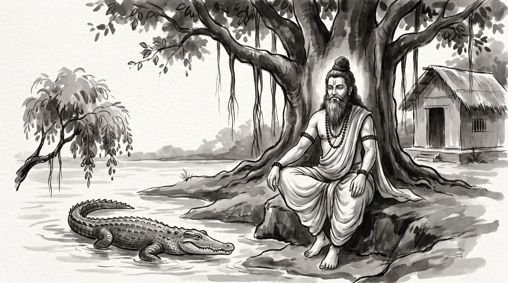

# The Jambu Branch: Presence of Mind When a Trusted Ally Betrays You

The morning sun filtered through the dense canopy of the forest hermitage, casting long patterns of light across the roots of the ancient banyan tree. Raghav, a seasoned platform architect from an expansive merchant enterprise, sat motionless upon a grass mat near the threshold of the thatched hut. His hands were clenched upon his knees, his jaw set tight, and his gaze fixed upon the dusty ground. The quiet hum of cicadas filled the clearing, but inside him churned the acute exhaustion of a sudden, calculated betrayal.

Across from him sat the venerable Rishi, still and observant. The sage's silver beard rested against an unstitched cotton dhoti, his matted locks were bound in a traditional Vedic *jata* topknot, and beads of natural rudraksha encircled his wrists. A faint line of sacred ash rested across his brow. He watched the younger man for several minutes before speaking.

"You sit like an archer whose closest companion stepped behind him and cut the bowstring," the Rishi said softly.

Raghav raised his eyes, breathing heavily. "Master, for two years I treated Vivek, our vice president of product, as my most trusted confederate. We built our shared roadmap over private lunches, solved political disputes before executive sessions, and shared candid engineering concerns that never touched formal minutes. Three days ago, he insisted I accompany him to a closed audit with the board of directors, claiming we needed to present a united front to secure additional headcount for our platform."

Raghav swallowed the bitterness rising in his throat. "The moment the boardroom doors clicked shut, Vivek produced a dossier of my own private engineering retrospectives—documents I had shared in confidence to explain our technical debt. He presented them to the executive chairman as evidence of chronic architectural negligence and systemic delay on my part. He argued that the entire platform engineering group should be stripped of independent governance and subordinated directly under his product org. I sat there in stunned silence while the board nodded along. The ambush was total, and I have seventy-two hours to respond before the decree becomes permanent. How does one survive when the very ally who carried you into deep water turns around to drown you?"

---

## The Crocodile's Crossing in the Panchatantra

The Rishi listened with calm equanimity. He pointed with an open hand toward the slow-moving river that curved past the ashram bank, where the dark silhouette of an armored reptile slipped beneath the surface without a ripple.

"Your grief is sharp, Raghav, but your circumstance has played out along riverbanks since the dawn of memory," the Rishi said. "In the fourth book of the *Panchatantra*, titled *Labdhapranasham*—the Loss of What Was Gained—Pandit Vishnu Sharma preserved the ancient account of Raktamukha the monkey and Karalamukha the crocodile."

"High upon the banks of the great ocean grew an enormous jambu tree, heavy with succulent, rose-apple fruits. In its branches lived Raktamukha, an agile monkey who spent his days eating the sweet harvest. One afternoon, a crocodile named Karalamukha crawled out of the surf and rested beneath the shade of the tree. Taking pity on the tired reptile, Raktamukha plucked the ripest fruits and dropped them down. The crocodile ate gratefully, and within weeks, a deep daily companionship took root. They spent hours conversing about the world, sharing thoughts and laughter."

"Karalamukha took some of the sweet jambu fruits home to his wife, who lived in a cave on a distant island. After tasting the exquisite sweetness, she questioned her husband closely. When she learned that a monkey ate these fruits every single day, her heart filled with unnatural covetousness. *'If this monkey lives entirely on such nectar,'* she declared, *'his heart must be the sweetest delicacy in existence! Bring him to our home, for I must eat his heart. If you refuse, I will starve myself to death.'*"

"The crocodile protested in horror," the sage continued. "*'He is my loyal brother; he feeds me daily and trusts me completely. How can I murder a friend who has never done me harm?'* Yet his wife remained obstinate, weeping and threatening suicide until Karalamukha yielded to her pressure. He swam back to the shore with a treacherous intention masked beneath warm words."

"Karalamukha greeted the monkey with exaggerated enthusiasm. *'My friend, you have fed me sweet fruits for months, yet my wife scolds me for neglecting hospitality. She has prepared an elaborate feast in our home to honor you. Climb upon my back; I will carry you across the waves to our island.'* The monkey, having never known malice from his friend, descended from the branches and climbed onto the broad armor of the crocodile's back."

"Out into the ocean they went. But when they reached the midpoint of the channel, where the water grew black and fathomless, the crocodile's swimming slowed. Heavy guilt weighed upon him, and his movements faltered. The monkey noticed the change and asked: *'Brother, why do you swim so heavily, and why is your countenance darkened?'*"

"Unable to bear the silence, the crocodile confessed the grim reality: *'Forgive me, Raktamukha. There is no feast. My wife demands to eat your heart, believing it to be sweeter than all fruits. I am carrying you to your death.'*"

"Consider the monkey's position," the Rishi remarked. "He was in the middle of a vast ocean, unable to swim, clinging to the back of an apex predator. If he had screamed in terror, the crocodile would have submerged and drowned him on the spot. If he had attacked the crocodile with teeth and claws, the armored beast would have rolled and devoured him in seconds. Blind rage and paralyzed panic both meant immediate death."

"Instead, Raktamukha summoned the highest virtue of statecraft: *pratyutpannamatitva*—instantaneous presence of mind. He did not flinch, weep, or accuse. He burst into an affectionate laugh."

"*'My dear brother!'* the monkey exclaimed with effortless cheer. *'Why did you not speak of this while we were still on the riverbank? If your noble wife desires my heart, it would be my highest honor to offer it to her. But we monkeys do not keep our hearts inside our ribs when leaping between heavy branches—they would be bruised and torn by our movements! We keep our hearts stored safely in a hollow high up in the jambu tree. Turn back immediately, so I may fetch my heart from the tree and bring it along for your wife's banquet.'*"

"The crocodile, blinded by his own simple greed and relieved by his friend's apparent compliance, turned his snout around and swam with all his strength toward the shore. The instant his claws touched the shallow silt of the riverbank, the monkey leaped from the reptile's back like a loosened arrow, scrambled up the trunk of the jambu tree, and vanished into the high foliage."

"When the crocodile called out from the shallows, asking him to retrieve his heart and return, the monkey looked down from the branches and laughed in scorn: *'You foolish creature! Does any living being keep their heart outside their chest? Your treachery has destroyed the bridge between us. Return to your home empty-handed, for you will never taste the fruit of my tree again.'*"

---

## The Anatomy of the Midstream Ambush

The Rishi turned his piercing gaze upon Raghav.

"The corporate arena is filled with executives who behave precisely like the crocodile, Raghav. They forge intimate alliances during periods of peace, accept your technical expertise and good faith, and then discover an external pressure or personal ambition that demands your sacrifice. When an ally turns on you, they invariably execute the maneuver through four distinct phases:"

**1. The Extraction of Vulnerability:**
The predator seeks proximity under the guise of mutual support. They encourage you to lower your guard, share informal grievances, and disclose architectural vulnerabilities that have not been vetted for public scrutiny. *"Speak freely with me; we need complete transparency between product and engineering if we are to protect each other."*

**2. The Deep Water Isolation:**
The ambush is never sprung on your native terrain. It happens in an unfamiliar environment where your technical documentation, your team, and your historical allies are absent—in a closed board executive review, a private compensation committee, or a restricted steering meeting. *"I took the liberty of summarizing our platform status for the board so we would not get bogged down in technical nuance."*

**3. The Lethal Leverage Squeeze:**
Once you are midstream, the true motive is revealed. The predator uses your own confidences as weapons to strip your autonomy, reassign your resources, or position your work under their personal dominion. Because you are on their ground, they assume your shock will guarantee compliance.

**4. The Illusion of No Return:**
The predator relies entirely on your instinct to either panic or fight on their terms. If you lose your temper in an executive setting, you validate their claim that you are unstable. If you freeze in despair, their narrative becomes the uncontested record.

---

## Three Rules for Surviving a Strategic Ambush

Raghav leaned forward, his breathing measured and his posture upright. "Master, the decree will be written in three days. What must I do to reach the shore?"

The Rishi held up three fingers.

### 1. Freeze Your Reaction and Buy Forty-Eight Hours
When the ambush strikes in an executive setting, never counter-attack or litigate details while sitting in deep water. Offer a calm, unprovocative holding statement that acknowledges the strategic discussion without validating the criticism: *"These operational observations merit thorough examination; let us table any organizational restructuring until our Wednesday formal session when the full data can be reviewed."* Send an email immediately after the session confirming this postponement to all attendees.

### 2. Retrieve Your Artifacts to Native Ground
The monkey saved his life because he knew his true power resided on the jambu tree, not in the sea. Immediately export your timestamped architecture RFCs, pull-request histories, and roadmap sign-off emails into a structured audit log. Assemble a crisp, two-page executive briefing that maps each documented delivery milestone against the verbal allegations, demonstrating that every architectural trade-off was previously approved by product leadership.

### 3. Sever the False Alliance Permanently
Once you have safely disembarked from the ambush, eliminate every informal, off-the-record channel with the treacherous colleague. Route all future communications exclusively through public tracking tickets, shared sprint reviews, and documented project channels. When invited to informal one-on-one sessions, decline politely or insist on bringing a senior staff architect as a co-witness.

**Source:** Panchatantra, Book 4 (Labdhapranasham)

Raghav bowed his forehead to the edge of the reed mat, the bitter fog of betrayal replaced by cool, calculating clarity. He rose to his feet with his back straight, ready to return to the city and anchor his defense upon the unshakeable ground of documented truth.

> *"Never wrestle the crocodile in deep water; invent the reason that brings him back to your shore."*
