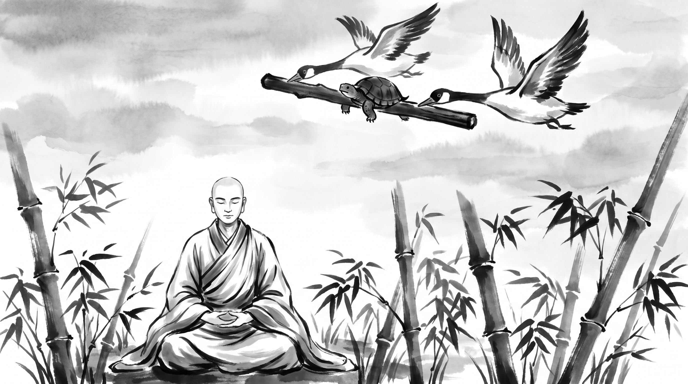

# The Clamped Jaw: How Speaking at the Wrong Moment Destroys a Strategic Rescue

The morning mist drifted quietly through the bamboo grove, parting around the stone meditation platform of the monastery. Tall green stalks swayed in the cool mountain wind, whispering against one another in gentle rhythm. Rohan, a senior infrastructure architect from an enterprise cloud logistics firm, sat upon the smooth granite step with his shoulders slumped and his hands trembling in his lap. The hollow ache of self-inflicted ruin shadowed his eyes.

Across from him sat the Monk, peaceful and composed in his saffron Kasaya robe draped over one shoulder. His head was cleanly shaved, his posture upright and effortless, free of any ornament or ostentation. He observed the turmoil radiating from the young engineer before speaking in a low, resonant tone.

"You bear the grief of a traveler who was carried across an abyss by wings, only to leap into the canyon by his own choice, Rohan," the Monk remarked gently.

Rohan pressed his knuckles into his forehead, exhaling a shuddering breath. "Master, three days ago, our distributed payment cluster suffered a catastrophic cascading failure during peak transaction hours. The financial loss was immense, and the executive steering council called an emergency inquisitorial review. I was directly in the crosshairs. But two respected leaders—our vice president of infrastructure, Arjun, and the head of security, Nandita—stepped in to champion my cause. They spent the entire night auditing the logs, realized the failure stemmed from upstream vendor instability, and agreed to escort me through the hearing."

Rohan swallowed the dryness in his throat. "Before entering the boardroom, Arjun took me aside and gave me one absolute command: *'Rohan, keep your jaws clamped shut. Nandita and I have pre-aligned the committee. We will answer every question, absorb the political heat, and present the technical remedy. No matter what provocation or insult is thrown into the room, do not utter a single syllable. Let us carry you across.'*"

"And did they carry you?" the Monk asked.

"They carried me with total mastery," Rohan confessed, his voice breaking with shame. "For forty minutes, Arjun and Nandita deflected every hostile inquiry. The board was nodding; the remediation budget was on the verge of being approved. Then Kunal, a rival director who wanted to absorb my engineering group, leaned forward with a mocking smirk. He looked around the table and scoffed: *'It is touching to see two executives holding Rohan's hand like a helpless child. If his architecture was competent, he would not need senior patrons to do his talking.'*"

Rohan's fingers dug into the granite step. "My pride flared like dry straw caught in wildfire. I forgot Arjun's instruction. I forgot the agreed strategy. I leaned into the microphone and snapped: *'At least my systems handle real scale, Kunal, unlike your disastrous billing service which leaks customer records every quarter!'* The room fell dead silent. The board chairman slammed his ledger shut in disgust at my unprofessional outburst. Arjun looked at me with profound sorrow and lowered his eyes. The meeting disintegrated into bitter personal recriminations. The remediation funding was revoked, my engineering charter was dismantled, and this morning I was placed under formal disciplinary review. I was in the air, flying to safety, and my own tongue dropped me into the rocks. Why is silence so unbearable when our ego is provoked?"

---

## The Flight of the Geese in the Jataka

The Monk smiled with deep, compassionate understanding. He picked up a slender bamboo twig from the stone path, holding it horizontally between his fingers.

"Your tragedy is modern, Rohan, but the weakness that caused it is chronic to human nature. In the *Jataka Tales*, in the ancient record preserved as the *Kacchapa Jataka*, there is told the story of a creature who met his doom through the very same folly."

"In a deep pool situated in the Himalayan foothills lived a tortoise named Bahubhani. In that same pool dwelt two wild geese, who became fond companions of the slow-moving reptile. But there came a year of severe drought. The rains ceased, and the mountain pool shrank day by day until the muddy bed cracked under the scorching sun."

"The two geese saw that their friend would soon perish. They approached the tortoise and said: *'Friend, this pool is dying. High upon Mount Cittakuta lies a vast, deep lake covered with lotus blooms, where the water never dries. If you wish, we can carry you there with us.'*"

"The tortoise looked at the sky and then at his heavy shell. *'How can you carry me? You have wings to ride the wind, but I am bound to the earth.'*"

"The geese replied: *'We can transport you through the clouds, provided you master your speech. We will hold the two ends of a stout wooden stick in our beaks. You must bite firmly into the middle of the stick with your jaws. Whatever happens, whatever you hear, you must not release your grip or speak a single word until we set you upon the shore.'*"

"The tortoise agreed readily. The geese took the ends of the stick between their strong bills, the tortoise bit tightly into the center, and with powerful beats of their wings, the great birds rose above the mountain trees and soared into the high sky."

"They flew over forests, rivers, and cultivated fields, carrying their heavy burden toward the northern peaks. But as their flight path crossed directly over the bustling city of Benares, the citizens in the streets looked up in astonishment."

"A crowd gathered, pointing fingers and shouting in derision: *'Look above! Two clever geese are carrying an ugly tortoise on a stick! Look at that stupid creature hanging like a sack of turnips!'*"

"The children laughed and clapped, while men mocked loudly: *'What a ridiculous sight! That slow-witted shell-bearer has to be carried like luggage by birds!'*"

"High in the air, the tortoise heard the mockery. His temper flared. The laughter of strangers wounded his vanity beyond endurance. He felt a burning urge to shout down at the crowd, to assert his dignity, to tell them that these geese were his personal friends."

"Blind with indignance, the tortoise unclamped his jaws and shouted: *'If my friends carry me, what business is it of you miserable fools?!'*"

"The moment his teeth parted from the wood, his words were swallowed by the wind. The geese could not hold him. The tortoise tumbled headlong through empty air, spinning down from the clouds until he struck the paving stones of the royal courtyard, shattering his shell into a hundred pieces."

"The Bodhisatta, serving as the chief counselor to the king of Benares, stood in the courtyard and witnessed the creature's fall. Turning to the king, he uttered this solemn truth: *'A man of loose tongue who speaks without measure meets destruction precisely like this tortoise. By a single untimely utterance, he threw away his salvation and smashed himself upon the stone.'*"

---

## The Anatomy of the Broken Rescue

The Monk set the bamboo stick down upon the granite surface.

"Notice with clarity the architecture of your collapse, Rohan. When allies offer you a strategic escort through a political storm, the dynamic mirrors the flight of the geese. An executive rescue operates through four distinct vulnerabilities:"

### 1. The Asymmetric Burden of the Escort
Carrying another person through an executive inquiry requires immense political capital. Arjun and Nandita expended their credibility and board goodwill to lift you out of the crisis. When sponsors carry you, their grip is strained. They rely on your absolute steadiness so that their energy can focus entirely on navigation.

### 2. The Calculated Provocation of Detractors
Kunal's scoff was not an argument; it was a deliberate stone thrown into the sky. Political adversaries understand that when a defense is airtight and sponsors are winning, the only way to puncture the rescue is to provoke the rescued party. They attack your vanity, betting that your ego is larger than your discipline.

### 3. The Delusion of Immediate Vindication
The urge that opened your mouth was the illusion that a retort settles the score. In high-stakes arenas, words uttered in defense of pride never vindicate the speaker; they reveal an undisciplined mind. When the tortoise shouted at the crowd, the villagers did not marvel at his wit—they watched him crash. When you attacked Kunal's billing service, the board did not respect your fire; they witnessed an erratic engineer incapable of emotional governance.

### 4. The Betrayal of the Escort
The deepest cost of your outburst was not Kunal's victory, but the demoralization of your protectors. Arjun and Nandita put their reputations on the line based on the premise that you were a mature professional worthy of rescue. The moment you opened your mouth, you made fools of your allies. You forced them to drop the stick.

---

## Four Rules for Maintaining Discipline Under Political Pressure

"Master," Rohan said, bowing his head toward the stone floor. "The damage is done, but my career is not yet finished. How does one cultivate the discipline to keep the jaw clamped when every nerve screams to strike back?"

The Monk held up four fingers.

### 1. Establish an Explicit Pre-Meeting Silence Contract
Before stepping into any contentious executive review, mediation, or project post-mortem where an ally is representing you, formally agree on who holds the floor. Explicitly designate your role as passive technical witness. Write down on the top of your notepad before the session starts: *"My only job today is silence."* When hostile remarks occur, look down at that sentence and keep your hands flat on the table.

### 2. Count Ten Slow Exhalations Before Engaging Any Adversary
If direct questioning forces you to speak, never answer on the immediate rebound of the insult. Take a slow, measured breath through your nose, pause for five full seconds, and strip every adjective, personal pronoun, and defensive emotion from your reply. Respond only to factual inquiries regarding system telemetry or architectural design, refusing to acknowledge sarcastic commentary or personal jibes.

### 3. Channel Counter-Evidence into Timestamped Written Records
The tortoise opened his mouth because he had no other medium through which to assert himself. In the enterprise, speech is the weakest tool for self-defense. If an adversary makes misleading claims about your systems, do not litigate them in open forum. Wait until the session concludes, compile the verified operational metrics and architectural sign-offs, and transmit a dispassionate two-paragraph memorandum to the committee leads within twenty-four hours. Let immutable data dismantle the accusation while your composure remains intact.

### 4. Send an Immediate Restitution Note to Your Sponsors
When you compromise a rescue through untimely speech, your first moral obligation is to the people who held the stick. Do not hide in defensive shame or attempt to justify your emotional lapse. Send a direct, unvarnished apology to your sponsors this afternoon. Acknowledge your failure of discipline, state the exact lesson learned, and ask how you can support their ongoing mitigation efforts without demanding further political cover.

**Source:** Jataka Tales, Kacchapa Jataka, No. 215 (UNVERIFIED)

Rohan sat motionless as the cool breeze stirred the bamboo grove. The chaotic chatter of pride and panic in his chest had fallen quiet, replaced by the profound stillness of the mountain air. He bowed his forehead to the stone step in deep gratitude, stood up with measured composure, and prepared to begin the slow, deliberate work of rebuilding trust.

> *"The sky belongs to those who bite the stick in silence; the pavement waits for the tortoise who cannot endure a fool's laughter."*
