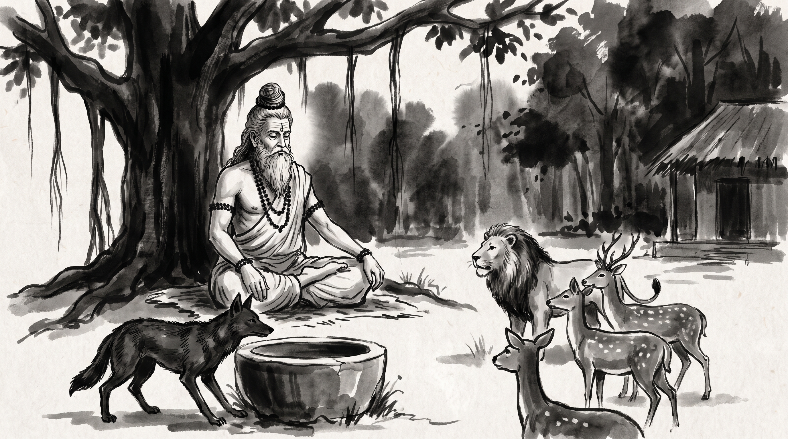

# The Indigo Coat: How Borrowed Authority Crumbles When Instinct Takes Over

The late morning sunlight drifted through the canopy of the forest hermitage, tracing intricate webs of gold upon the earthen courtyard. Beneath the sprawling limbs of an ancient banyan tree, the air carried the sharp fragrance of dry leaves and sacred samidha wood. Varun, a master stone-mason and chief builder of the capital's royal guild of masons, sat upon a coarse grass mat with his shoulders hunched and his hands clenched tightly against his knees. The tight, bitter lines around his mouth betrayed the exhaustion of someone who had watched an unqualified peer seize absolute command through theatrical deception.

Across from him sat the venerable Rishi, still and observant as deep water. His silver beard flowed over an unstitched cotton dhoti, his matted hair was gathered in a disciplined Vedic *rishi jata* topknot, and beads of dark rudraksha encircled his wrists. A faint mark of sacred ash touched his forehead. He observed the tension in Varun's breathing before breaking the silence.

"You carry the silent rage of a craftsman forced to bow to an idol carved from hollow clay, Varun," the Rishi said softly.

Varun let out a long, shuddering breath. "Revered Sage, three seasons ago, the imperial court appointed an outsider named Devraj to oversee the grand architectural works of the province. He arrived carrying the reputation of a renowned master builder from distant imperial provinces. He possessed none of the practical knowledge required to calculate vault stresses or foundation depths, yet he spoke with an extraordinary vocabulary of ornate, philosophical theories. He wore the spotless robes of a great seer of building, and the royal ministers were completely mesmerized."

Varun leaned forward, his voice tightening. "Devraj immediately banished every veteran builder who questioned the safety of his drawings, excluding us from planning councils while surrounding himself with subservient apprentices who dared not challenge him. He demanded unquestioned obedience, claiming his authority came directly from the crown's private seal. We bowed our heads, swallowed our pride, and labored through the nights to shore up his impossible arches before they collapsed upon the workers. Then, during yesterday's formal inspection before the king's ministers, a main aqueduct pier fractured under water pressure. Devraj panicked, blamed a trembling young apprentice for the catastrophe, and shrieked incoherently about treachery before the entire royal council. The mask fell, yet our guild remains demoralized and broken. How does a charlatan build absolute dominion upon sheer illusion, and how do we protect our craft when false majesty reigns?"

---

## The Jackal in the Indigo Vat

The Rishi smiled gently, picking up a fallen banyan leaf and turning it between his weathered fingers.

"Your grief is sharp, Varun, but the spectacle you witnessed is ancient. Pandit Vishnu Sharma recorded this very pattern thousands of years ago in the *Panchatantra*, in the foundational book of *Mitra-Bheda*, through the famous tale of Chandarava—the Blue Jackal."

"In a dense jungle there lived an ordinary jackal named Chandarava. Thin, hungry, and driven by an empty stomach, he prowled into the outskirts of a human city in search of food. The fierce city dogs caught his scent and chased him relentlessly through the narrow alleys, snapping at his heels and tearing at his flesh. In desperate panic, fleeing for his life, Chandarava leapt over a low mud wall and plunged headlong into a massive stone vat filled with deep blue indigo dye at a dyer's house."

"When the barking hounds lost his trail and moved away, Chandarava dragged himself out of the vat. When he looked down at his paws and belly, he was astonished. From the tip of his snout to the tail of his coat, the indelible dye had soaked through his fur, turning him a brilliant, otherworldly shade of deep indigo. When he returned to the forest, the wild creatures looked upon him with sheer terror. The mighty lions, the swift tigers, the panthers, wolves, and wild elephants had never beheld such a creature. Believing him to be a terrible new monster endowed with supernatural power, the beasts turned and fled in panic."

"Seeing the apex predators cower before him," the Rishi continued, "Chandarava's cunning awakened. He called out in a loud, commanding voice: *'O beasts of the forest! Why do you run in fear? Lord Brahma himself saw that this kingdom lacked a sovereign protector, and with his own hands he anointed me Kakudruma, the monarch of all four-legged beings. Lay down your dread and dwell peacefully under my supreme command!'*"

"The wild beasts rejoiced, blinded by his startling coat. They prostrated themselves before him and surrendered their sovereignty. Chandarava handed out royal posts with grand ceremony: he appointed the majestic lion as his prime minister, the fierce tiger as his master of the royal bedchamber, the leopard as keeper of the gate, and the elephant as his personal guard. The finest game hunted by the predators was laid at his feet."

"Yet Chandarava knew a secret fear: those of his own kind possessed the memory of his true origins. To protect his grand illusion, the Blue Jackal issued an immediate royal decree expelling every ordinary jackal from the forest, forbidding them from ever entering his royal presence under penalty of death. For a time, he reigned without dispute, puffed up with borrowed grandeur."

"Then came an evening when the monsoon mist gathered over the hills. Sitting upon his high rock among the reverent lions and tigers, Chandarava heard a distant pack of common jackals howling in unison under the rising moon. The sound pierced through his borrowed majesty. The primal instinct of his blood surged through his veins. His throat swelled, his whiskers twitched, and despite all his desperate effort to maintain royal silence, he could not suppress the nature stamped into his marrow. Throwing back his head, he let out a piercing, ragged howl: *'Phee-ooh! Phee-ooh!'*"

"The lion and the tiger stiffened. They looked down at the howling creature beside them, and the truth struck like lightning. *'This is no divine emissary,'* the lion roared. *'It is merely a common jackal dressed in stolen blue dye!'* Before Chandarava could take a single step toward the bushes, the outraged predators fell upon him and tore him to shreds."

---

## What the Indigo Vat Teaches

The Rishi set the banyan leaf upon the mat. "The vat changes the coat, Varun, but it leaves the blood as it was. In the halls of men, the indigo vat takes familiar shapes."

**The Lucky Dye.** An ordinary schemer lands in a famous guild, or wins royal favour by standing near the throne rather than by his craft. He learns the grand words of the masters without ever learning their hands. Those who look at his titles see a strange and splendid beast, and take the colour for the creature:
> *"He served at court during the great temple commission; whatever he orders must be done without question."*

**The Exile of Those Who Know.** As Chandarava drove out the jackal pack, the false master drives out the craftsmen who can see what he is. He cannot keep old builders at the drawing table, because a true master sees through the dye in a single glance. He replaces men who question with men who admire the coat and never inspect the stone:
> *"The old builders are too set in their ways; send them to the far quarries so they do not hinder our grand design."*

**The Howl Under Pressure.** Borrowed majesty holds only while the day goes as planned and the court nods along. But a real crisis comes without warning. When a pier cracks, the king's auditors arrive, or an inspector asks a precise question about a load, the grand words vanish. The pretender falls back on his true nature: pointing fingers, shrill excuses, blame:
> *"This disaster is the fault of the apprentice who misunderstood my design!"*

**The Reckoning of the Skilled.** Once the true nature slips out, the turn is swift. The master craftsmen who did the real work see that they bowed to a painted shadow. Respect, once gone, cannot be restored by royal decree. The court casts the pretender down as quickly as it once raised him.

---

## The Rishi's Counsel: Living Under a Painted Master

Varun sat quietly, the tension in his shoulders beginning to ease. "Revered Sage, if such a man holds rank over our guild, how do we endure him without sacrificing our people or our dignity?"

The Rishi leaned forward.

### 1. Pin Every Order to the Written Record
Do not argue with his reputation in open debate; hold his orders up against written measure. When he commands some grand change in vague words, write it out as a clear order: the foundation's depth, the stone's weight, the cost in silver, the margin of safety. After every drawing council, send him a short sealed note of what was agreed and who will carry each task. False authority lives in loose talk; it withers when pinned to the record.

### 2. Keep the Old Builders Together
A fearful overseer always tries to keep veteran craftsmen apart, so no one can check his claims. Meet the master builders of the neighbouring workshops yourselves, each new moon, and compare your measurements and your stone. When the old hands share one true account of the work, no pretender can divide you or invent a story of your failure.

### 3. Never Hand Over the Safety of the Stone
Never give up your own tests of mortar, load, and foundation to a showy decree. If he orders a dangerous shortcut, do not obey sullenly in silence. Write the danger plainly on a palm leaf, set out how the arch may fail, and ask for his seal on the order before a single stone is laid that way. When the flaw appears, your masons will be shielded by proof of their care.

### 4. Wait for the Howl
Do not rise against him while the court still favours him. An open attack on his name will only make you look disloyal and send the ministers to his side. Put your strength into sound work and into guarding your young apprentices. Do your duty calmly. Under the steady weight of real work, his own nature will expose him more surely than any accusation of yours.

**Source:** Panchatantra, Book 1 (Mitra-bheda), "The Blue Jackal" (Chandarava Katha)

Varun bowed low before the Rishi. The burning grievance in his chest had cooled into patience. He gathered his palm-leaf notes, rose, and set out along the sunlit path toward the city, ready to hold his masons steady while time tested the dye.

> *"A bath in indigo may dazzle the forest for a season, but when the distant pack cries out, the jackal must howl."*
