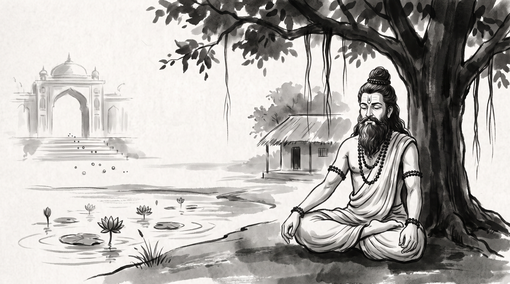

# The Hunchback's Whisper: How a Bitter Confidant Corrupts Strategic Judgment

The forest ashram rested in the golden light of the late afternoon. High above the packed earth courtyard, the broad canopy of the sacred banyan tree cast long, cooling shadows across the hermitage. Vikram, a senior engineering director who led enterprise infrastructure across three continents, sat upon a coarse grass mat. His hands were clasped tightly in his lap, and his face was marked with the exhaustion of a commander who had dismantled his own fortress from within.

Before him sat the venerable Rishi, still as the granite stones lining the riverbank. The sage's silver beard fell in soft waves over his unstitched cotton ascetic wrap, his matted hair was bound in a dignified Vedic *jata* topknot, and beads of dark rudraksha circled his wrists. Upon his forehead, three lines of sacred vibhuti marked a mind untouched by the turbulence of the merchant cities.

"You sit like a king who has burned his own granaries in the middle of winter, Vikram," the Rishi observed quietly. "What poison entered your gates?"

Vikram released a long, trembling breath. "Master, two months ago, our organization prepared for the largest operational merger in its history. My infrastructure division was set to unify with our counterpart platform team, led by my peer Devrat. It was a partnership we had planned for three quarters. The executive committee was delighted, our senior architects were energized, and the joint roadmap promised stability for hundreds of engineers. I returned to my office that evening feeling that our collective future was assured."

The director paused, looking down at the red earth. "Waiting in my office was Somesh, my chief of staff and personal advisor for over seven years. While the rest of the company celebrated, Somesh sat in the shadows with an expression of profound grievance. He closed the heavy oak door and spoke in hushed, urgent tones: *'You are rejoicing at your own execution, Vikram. Devrat has spent months charming the board behind your back. This unification is not a partnership; it is a hostile absorption designed to strip your authority. Look at the architecture governance committee—Devrat's deputies hold the majority of seats. Once the signatures dry, you will be reduced to an advisory spectator while your loyal engineers are reassigned to maintenance duties.'*"

Vikram's shoulders sagged. "He did not shout; he whispered with such absolute certainty, such counterfeit devotion to my welfare, that doubt took root in my chest. Over the next three weeks, every routine email from Devrat began to look like an ambush. Every joint design review seemed like an attempt to diminish my standing. Somesh fed this fire daily, bringing selective hallway gossip, highlighting imagined slights, and urging me to strike before I was sidelined. Convinced that I was acting out of righteous self-defense, I invoked an emergency veto clause in our technical charter. I declared the merger dead, locked Devrat's group out of our core repositories, and escalated an adversarial dossier to the board."

"And the harvest of this strike?" the Rishi asked.

"Total catastrophe," Vikram confessed, his voice breaking. "The board was appalled by my sudden obstruction. Devrat's division severed all operational coordination. The engineering organization fractured into warring factions, two of my most brilliant principal architects resigned in disgust, and the market punished our platform for missing its rollout window. Yesterday, the chief executive informed me that my governance powers are being rescinded. In trying to defend my status from a phantom threat, I destroyed the very empire I built. How does an experienced leader become so utterly blinded by the whisper of a single confidant?"

---

## The Corrupted Heart of Kaikeyi in Ayodhya

The Rishi looked upon the distressed director with profound compassion. He dipped a wooden ladle into an earthen jar, pouring clear stream water over the roots of a nearby tulsi shrub before speaking.

"Your tragedy is ancient, Vikram. The walls of royal palaces and corporate offices change their materials, but the human ear remains vulnerable to the same venom. In the *Valmiki Ramayana*, within the verses of the *Ayodhya Kanda*, lies the account of how strategic unity was shattered by the whisper of a bitter confidant."

"King Dasharatha had announced to his assembly that Rama, the eldest prince, virtuous and beloved by all, would be crowned regent prince (*Yuvaraja*). Ayodhya erupted in joy. Banners were raised over every doorway and flowers carpeted the streets. When the news reached Queen Kaikeyi, the youngest and most favored wife of the king, her delight was boundless. She considered Rama dearer than her own biological son, Bharata, and rewarded the messenger with a radiant necklace of gems."

"Into this celebration entered Manthara," the Rishi said. "Manthara was Kaikeyi's lifelong nurse and confidant, a hunchbacked woman who carried deep personal grievances. Where others saw virtue and celebration, Manthara saw only rivalry and threat. Seeing the queen rejoicing, Manthara cast the necklace to the floor in bitter fury."

"She cried out: *'You foolish queen! King Dasharatha's sweet words cover deadly poison. He sent your son Bharata away so that he could crown Rama in secret. When Rama ascends the throne, Queen Kausalya will rule supreme. You will become a discarded handmaiden, and Bharata will live as a servant or perish in an imperial dungeon!'*"

"At first," the sage continued, "Kaikeyi rejected the venom. She reprimanded Manthara, declaring that Rama was the rightful heir and loved Bharata as his own soul. But Manthara did not retreat. She understood that fear, planted in the soil of insecurity, can be cultivated into panic."

"The hunchback leaned close, weeping theatrical tears and repeating her dark warnings through the night. She reminded Kaikeyi of the two boons King Dasharatha had granted her years earlier on the battlefield of Dandaka, when the queen saved his life. *'Demand now that Bharata be crowned king,'* Manthara urged, *'and demand that Rama be banished to the Dandaka forest for fourteen years. Fourteen years in the wilderness will cement your son's rule and eliminate all challenge to your supremacy.'*"

"Under the relentless drip of this counsel, Kaikeyi's wisdom crumbled," said the Rishi. "The love she held for Rama turned into paranoid terror. She cast off her garments, scattered her royal ornaments across the dust, and retreated into the *Krodha Griha*—the Chamber of Wrath. There, lying on the bare floor, she extracted those catastrophic boons from the heartbroken king. Dasharatha died of grief, Rama walked barefoot into exile, and Ayodhya was plunged into mourning, while Kaikeyi earned only eternal contempt."

---

## The Anatomy of the Modern Whispering Confidant

The Rishi looked intently at Vikram, whose face reflected the sorrow of the ancient tale.

"Manthara is not merely a figure from antiquity, Vikram. She represents a psychological archetype that inhabits every high-stakes organization. When ambitious leaders rise, they attract lieutenants whose influence depends upon privileged intimacy rather than demonstrable merit. These modern whisperers operate through four recognizable maneuvers:"

### 1. The Monopolized Grievance Filter
The toxic confidant survives by acting as a self-appointed gatekeeper to the leader's emotional reality. They bring unsolicited hallway intelligence and psychoanalysis of colleagues: *'Everyone is pretending to be on board, but I heard what they really said by the elevators after your presentation.'* By portraying themselves as the only person willing to tell the harsh truth, they systematically isolate the leader from genuine peer relationships.

### 2. The Inversion of Collective Triumphs
Whenever the broader organization achieves a unifying milestone—a successful merger or a shared platform launch—the whisperer experiences existential dread. In a harmonious organization, the backroom influencer becomes irrelevant. Therefore, they invert the triumph into a threat: *'They are celebrating today because your architecture did the heavy lifting, but notice how their vice president took the main stage.'*

### 3. The Weaponization of Latent Insecurity
Kaikeyi was a formidable queen, yet beneath her dignity lay a latent fear of losing her status. Manthara did not create Kaikeyi's insecurity; she merely drove a chisel into the hairline fracture. In the corporate arena, the confidant studies the leader's hidden anxieties—fear of obsolescence or dread of being outshone—and frames every strategic compromise as personal humiliation.

### 4. Incitement to the Chamber of Wrath
Manthara did not advise Kaikeyi to hold a candid council with the ministers. She instructed her to enter the Chamber of Wrath, reject all dialogue, and execute an irrevocable strike. The toxic advisor pushes the leader toward scorched-earth tactics—emergency vetos or abrupt project cancellations. Once the bridge is burned, the leader has no choice but to rely entirely upon the whisperer who instigated the blaze.

---

## Restoring Strategic Clarity: Four Guardrails for Leaders

"Master," Vikram said softly, his brow furrowed with resolve. "The damage to my current platform is already done, but I must learn how to protect my judgment from ever falling prey to such deception again. How does an executive maintain trusted counsel without inviting Manthara into their chamber?"

The Rishi raised four fingers, speaking with measured cadence:

### 1. Mandate Multi-Node Debriefing
Never permit any single lieutenant, chief of staff, or advisor to hold a monopoly on post-meeting analysis. When concluding high-stakes negotiations or cross-functional alignment sessions, hold open retrospectives with three or more diverse team members present. This week, make it a standard practice: when an advisor approaches you with private assessments of a peer's motives, invite a second senior engineer or director into the room and ask the advisor to restate their observations openly. Sunlight instantly dissolves the shadows where paranoia flourishes.

### 2. Demand Objective Artifacts Over Emotional Narrative
When an internal confidant claims that another department is actively plotting against your roadmap, refuse to act on sentiment alone. Require verifiable evidence before altering your posture. This week, enforce an explicit operational rule: whenever a colleague warns you of political malice, answer them directly with this phrase: *'Show me the recorded pull request, the written project charter, or the budget ledger that demonstrates this intent.'* A true problem will be supported by verifiable data; a whisperer's invention will collapse into stuttering generalities.

### 3. Establish a Mandatory 48-Hour Escalation Buffer
The most lethal feature of the Chamber of Wrath is sudden, irreversible action taken in a state of emotional contagion. When an emotional confidant urges you to deploy an emergency veto, revoke permissions, or send an accusatory memorandum to executive management, enforce an unyielding moratorium. This week, commit to a mandatory forty-eight-hour cooling-off window between receiving an alarming warning and executing any formal political or technical veto. During those two days, sleep, walk in the open air, and consult a neutral mentor outside your immediate reporting hierarchy.

### 4. Subordinate Personal Turf to Enterprise Purpose
Kaikeyi demanded the exile of Rama because she prioritized her son's narrow dynastic claim over the moral and strategic welfare of the kingdom. A leader who measures success solely by the perimeter of their personal fiefdom will always be vulnerable to fear-based manipulation. This week, examine every contentious project decision through a single standard: ask whether your proposed course of action serves the long-term resilience of the platform and its users, or merely protects your personal administrative boundary. True leadership sovereignty is found not in guarding power, but in advancing the collective mission.

**Source:** Valmiki Ramayana, Ayodhya Kanda

Vikram bowed low, touching his forehead to the edge of the woven mat. The heavy fog of suspicion and grief that had gripped his mind lifted into the clean evening air. He stood with renewed composure, prepared to return to the city not to fight phantom enemies, but to offer an honest reconciliation to those he had wronged.

> *"The kingdom rarely falls to the army at the gates. It falls when a leader opens their ear to Manthara's bitter whisper, mistaking the counselor's personal poison for loyal protection."*
