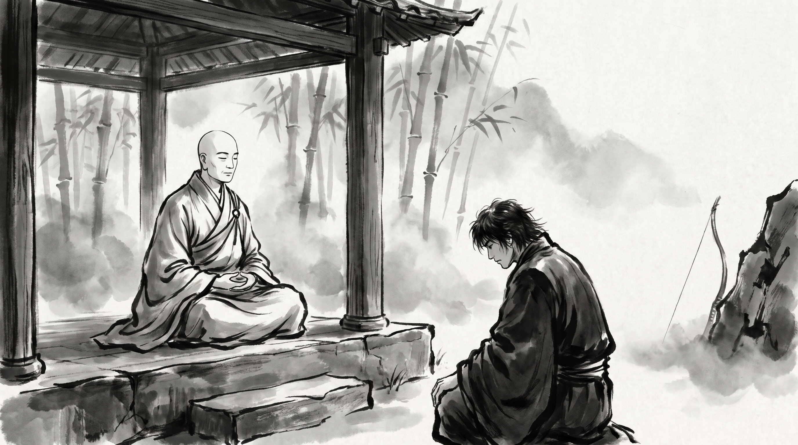

# The Poisoned Arrow: Why Theoretical Debates Must Yield to Crisis Triage

The morning mist drifted through the bamboo grove, trailing thin white veils across the flags of the monastery terrace. Karthik, who directed operations for a nationwide commercial supply firm, sat upon the stone bench with shoulders hunched and fists pressed hard against his knees. The dark hollows beneath his eyes spoke of forty hours without sleep, but the tremor in his voice was born of frustration rather than fatigue.

Across the low tea table sat the Monk, draped in coarse ochre robes, his shaven head tilted in quiet attention. He poured hot spring water over fresh mint leaves, offering the steeping bowl without a word.

"Yesterday morning, our primary transport grid collapsed," Karthik began, his voice taut. "A sudden cold snap iced the mountain passes, three central transit hubs ground to a halt, and perishable shipments began rotting across six provinces. The emergency procedure was unambiguous: activate local secondary depots, release contingency reserves, and reroute cargo through southern rail corridors before noon."

Karthik swallowed, staring bitterly into the swirling leaves. "Yet the moment I assembled the executive committee, our chief strategy officer halted every operational order. For four hours, while supplier contracts expired and warehouse managers begged for direction, he forced the committee to debate whether our long-term regional logistics framework was philosophically flawed, who authorized the depot consolidation two years ago, and whether emergency rerouting would distort our quarterly supply forecasts. By dusk, suppliers had cancelled their contracts and we suffered catastrophic financial losses. The crisis could have been contained in twenty minutes, yet we bled to death while clever men debated theory. How does one silence the pedants who refuse to stop arguing while the enterprise burns?"

---

## The Wounded Soldier and the Curious Philosopher

The Monk set his tea bowl down upon the slate, listening to the creak of bamboo in the mountain wind.

"Your grief is sharp, Karthik, but the vanity that prefers debate over salvation is an ancient human frailty. Twenty-five centuries ago, among the disciples who followed the Blessed One, there lived a monk named Malunkyaputta. He was an earnest student, yet his mind was perpetually seduced by abstract speculation."

The Monk gathered his robe and continued. "One afternoon, while meditating in solitude, Malunkyaputta became possessed by resentment. He said to himself: *'There are profound cosmic questions that the Master has refused to settle. Is the universe eternal or transient? Is the cosmos finite or infinite? Is the soul identical with the physical body, or are they distinct? Does an enlightened one exist after death, or does he vanish entirely? The Master leaves these matters unexplained. I shall confront him. If he resolves these questions, I will remain. If he refuses, I will cast off these robes and depart.'*"

"Malunkyaputta approached the Teacher, bowed, and laid down his aggressive ultimatum. The Buddha looked upon him not with anger, but with sorrow for a man who had confused cleverness with wisdom."

"'Malunkyaputta,' the Buddha replied, 'suppose a man were pierced deep in the flesh by an arrow thickly smeared with virulent poison. His kin and companions rush to his side and summon a skilled surgeon to draw out the barb.'"

"'Now imagine that the wounded man pushes the physician's hands away and declares: *I will not permit this arrow to be removed until I know the man who shot me. What is his caste? What is his clan? Is he tall, short, or of middling stature? Is his skin dark, golden, or fair? Which village does he inhabit? And I will not have this barb extracted until I know the nature of the bow—was it fashioned from mountain reed or seasoned ash wood? Was the bowstring braided from sinew, hemp, or bark? Were the feathers bound to the shaft plucked from a vulture, a peacock, or an eagle? Was the point forged of common iron or tempered steel?*' What would happen to such a man, Malunkyaputta?"

"The monk replied in shame: *'Master, he would die before a single answer could be brought to him.'*"

"'Just so,' the Buddha answered. *'The holy life does not depend on whether the cosmos is eternal or finite. Whether the world had a beginning or not, there remains birth, aging, illness, death, sorrow, and despair. I teach what is essential to relieve suffering here and now. What is speculative and unhelpful to your survival, I leave aside.'*"

---

## The Seductive Escape of Intellectualizing Disaster

The Monk turned to Karthik, his eyes steady.

"When disaster strikes an enterprise, Karthik, intellectual debate is rarely a search for truth. It is a psychological refuge for cowards. Drawing the arrow requires physical courage: it produces blood, it causes immediate pain, and the surgeon must accept the terrible responsibility if the patient falters under his hands. But asking who manufactured the feathers carries zero personal hazard. It feels intellectual. It sounds sophisticated. It allows an insecure executive to assert dominance without risking the stigma of a failed tactical decision."

"Notice the cunning inversion that occurs in executive committees during a breakdown," the Monk remarked. "The leader who proposes an imperfect emergency containment is attacked for procedural sloppiness, while the spectator who demands an exhaustive theoretical review appears thoughtful and prudent. In reality, the theorist is the saboteur. He demands certainty in a realm where only swift action can preserve life."

---

## Three Rules for Crisis Triage

"If you are to lead through crisis without bleeding to death," said the Monk, "you must carve an iron boundary between emergency triage and retrospective analysis."

### 1. Extract the Arrow First (Sever the Source of Harm)

When operational hemorrhaging begins, establish an absolute mandate: no discussion regarding origin, blame, or structural doctrine is permitted until the bleeding is arrested. Define the single emergency measure that halts the immediate loss—whether isolating a compromised distribution channel, pausing outward shipments, or releasing emergency credit—and execute it without awaiting consensus. The question in a crisis is never *'Why did this system fail?'* The only legitimate question is *'What action stops the wound from deepening this minute?'*

### 2. Quarantine the Metaphysicians (Suspend Retrospective Debate)

Identify the individuals in your council who instinctively reach for theoretical purity when pressure rises. When a colleague attempts to derail emergency containment with systemic critiques or historical finger-pointing, cut the intervention short with a formal injunction: *'That question belongs to the post-incident inquiry. Right now, we are containing the breach.'* Do not debate their premise; debate grants their distraction legitimacy. Assign them a silent observation role or remove them from the tactical bridge entirely.

### 3. The Postmortem Belongs to the Living

A comprehensive inquiry into architectural flaws, vendor integrity, and long-term doctrine is vital, but it must be scheduled only when the patient is stable and resting in the recovery ward. Reserve thorough analysis for a separate session forty-eight hours after the crisis has passed. At that table, examine the bowstring, inspect the fletching, and interrogate the supply contracts with unrelenting rigor. But remember: an autopsy performed upon a dead business is useless to the customers who depended upon it.

---

**Source:** *Majjhima Nikaya*, Sutta 63 (*Cula-Malunkyovada Sutta*)

> *"When the house is burning, the man who demands to inspect the lineage of the arsonist will suffocate in the ash. Extinguish the flame first; the court of inquiry may sit in daylight once the embers are cold."*
