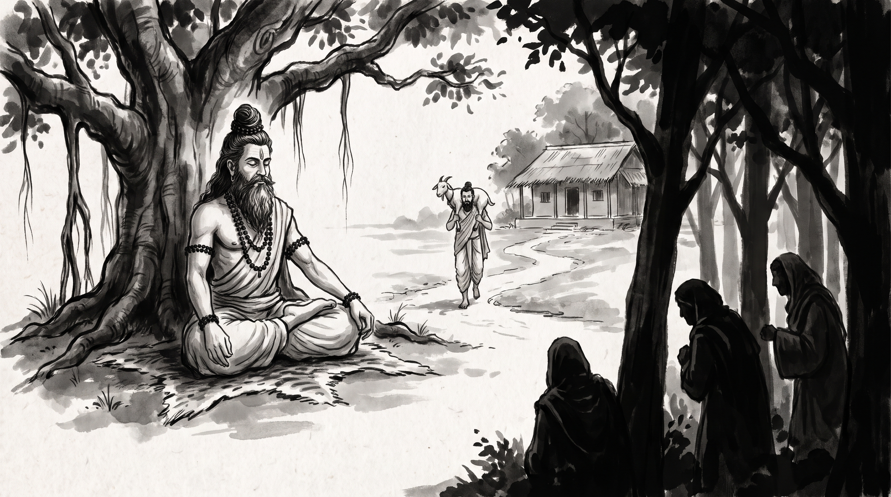

# The Brahmin and the Three Thieves: Holding to the Truth When Many Voices Agree on a Lie

The forest hermitage lay bathed in the late-afternoon amber glow filtering through the canopy of the sacred peepal and banyan trees. A dry northern wind rustled the dried palm leaves above the hermitage veranda. Devendra, chief reckoner and senior scribe of the grand merchant syndicates, sat upon a woven darbha grass mat before the stone seat of the Rishi. His hands gripped his knees, his knuckles white with tension, his brow furrowed with the exhaustion of someone whose own mind had been turned against him by subtle persuasion.

Across from him, the venerable Rishi sat motionless in quiet contemplation. His silvery beard cascaded down over an unstitched ascetic wrap, his matted hair was coiled in a formal Vedic *rishi jata* topknot, and dark rudraksha beads encircled his wrists and neck. Three sacred strokes of vibhuti crossed his broad brow, serene and untouched by the anxieties of courtly intrigue.

"You sit before me like a traveler who set out carrying pure water, yet dropped his vessel because strangers told him it held poison," the Rishi observed in a calm, steady cadence.

Devendra exhaled heavily, bowing his head in bitter confession. "Master, three weeks ago, my scribes completed a thorough inspection of our syndicate's trade routes and grain depots. The account books and warehouse receipts proved beyond doubt that our guild was leaking immense wealth through corrupt intermediary toll-keepers and forged cargo tallies. The figures were indisputable. The sealed ledgers were in my hands. I prepared to deliver the findings directly to the governing council of elders."

Devendra swallowed hard, his voice wavering with remembered doubt. "The next morning, a junior warehouse overseer stopped by my chamber, glanced casually at the ledgers, and laughed dismissively: *'Devendra, why are you wasting energy on these minor caravan discrepancies? Everyone knows such a gap is ordinary seasonal wastage.'* I dismissed his remark as mere ignorance. But by midday, the guild's chief examiner of customs intercepted me near the central courtyard and looked upon me with solemn concern: *'Devendra, your reckoning methods appear dangerously flawed. If you present these accusations to the council of elders, you will brand yourself a reckless troublemaker and ruin your standing.'* By late afternoon, the prime syndic of the syndicate summoned me into his private gallery and sighed: *'Devendra, three different warehouse masters have already warned me that your accounts are alarmingly erratic. Are you feeling well? Perhaps you need a long retreat in the country.'*"

Devendra lowered his gaze to the soil. "Master, the physical tallies in the ledger had not changed by a single copper coin. Yet by dusk, surrounded by three separate, self-assured voices all asserting the exact same falsehood with absolute confidence, I crumbled. I doubted my own eyes. I convinced myself that my reckoning was faulty, that my senses were failing me. I locked the ledgers in my chest, shelved the inquiry, and allowed the crooked contracts to renew. How does a truthful person defend reality when an entire assembly of confident voices tells him he is seeing visions?"

---

## The Sacrificial Goat and the Three Thieves of the Panchatantra

The Rishi gazed across the quiet ashram clearing, where a soft breeze rustled the grass. He gestured toward the dusty path that wound past the forest tree line into the distant plains.

"Your affliction is ancient, Devendra. The human mind seeks safety in the agreement of the crowd. When three independent voices repeat the same distortion, the intellect begins to betray its own senses. In the ancient *Panchatantra* of Pandit Vishnu Sharma, in the third book known as *Kakolukiyam*, there is recorded the famous tale of the Brahmin and the Three Thieves."

"In a fertile village lived a pious scholar named Mitrasharma. Having performed a sacred rite for a patron, he was rewarded with a plump, white sacrificial goat. Delighted with this noble gift for his sacred fire, Mitrasharma lifted the goat onto his broad shoulders and began his journey home through a desolate stretch of forest road."

"Along the route lived three cunning thieves who spent their days swindling travelers. Watching Mitrasharma march past bearing the fat goat, the rogues plotted to take it. One said to his companions: *'The Brahmin is sturdy and carries a heavy staff; force will raise an alarm. We must win the animal not through steel, but through his own mind.'*"

"The three thieves devised a coordinated plot. They separated and stationed themselves along the solitary road at intervals of half a league, appearing as completely unrelated travelers."

"Mitrasharma walked briskly along the dusty road, his shoulder carrying the warm, living weight of the goat. Soon, the first thief emerged from the bushes, dressed as an upright villager. He looked up at the scholar, threw his hands into the air, and cried out in feigned horror: *'Revered sir! What terrible sacrilege is this? You wear the sacred thread of a holy Brahmin, yet you carry an unclean, mangy dog upon your shoulders! Have you abandoned all dharma and decency?'*"

"Mitrasharma flared with immediate anger. *'Are you blind, you fool?'* he barked. *'Do you possess no eyes in your skull? This is a pure sacrificial goat for my altar, not a dog!'* The rogue bowed mockingly and walked away, murmuring: *'Be not angry with me, pandit. If it pleases you to carry a mangy hound, carry it to your heart's content.'*"

"Mitrasharma scoffed and walked onward. Yet an invisible seed of discomfort had been planted in the soil of his thoughts. He shifted the animal's weight, muttering to himself that the traveler was simply an ignorant peasant."

"Half a league further, as the afternoon heat mounted, the second thief approached from a crossroad. The rogue stopped dead in his tracks, stared at the scholar with profound bewilderment, and exclaimed: *'Alas, holy master! What madness has overtaken you? Why are you carrying a dead calf across your shoulders? The stench is unholy, and the sight desecrates this public thoroughfare!'*"

"Mitrasharma felt a sudden chill clutch his spine. He stopped. He swung the goat down from his neck, set its four hooves upon the dirt, and felt its soft ears, its cold wet nose, and its little horns. It was undeniably a goat. He looked at it with his own two eyes. Yet his mind began to spin: *How could two independent men, leagues apart, both mistake a living goat for an unclean beast? Could some bizarre enchantment have fallen upon my eyes?* Trembling slightly, he hoisted the goat back onto his shoulders and continued his journey, but his step was no longer firm."

"Before the forest path reached the village boundary, the third rogue stepped out from beneath a dense tamarind grove. He pointed his finger at the scholar, shook his head in pity, and shouted to the empty road: *'Woe unto our times! A learned pandit walking down the highway carrying a diseased donkey upon his back! What will the elders say when you arrive in this disgraceful state?'*"

"At that third pronouncement," the Rishi said quietly, "the Brahmin's faith in his own direct senses shattered completely. He reasoned within himself: *'One stranger may be blind. A second stranger might be mischievous. But when three separate, unrelated observers all tell me this beast is an unholy monster, the fault cannot be theirs. This creature must be a shape-shifting demon, a rakshasa that morphs its form to ruin my spiritual merit!'* Overcome with sheer terror, Mitrasharma cast the goat into the ditch, turned his heels, and fled toward his home as fast as his legs could carry him. The three thieves emerged from the brush, laughing uproariously, roasted the prize over an open fire, and enjoyed a hearty feast."

---

## What the Three Thieves Teach

The Rishi turned his dark eyes upon Devendra.

"You see, Devendra, the thieves did not defeat the Brahmin with clubs or arrows. They defeated him with a chorus. They used his humility, his respect for what others think, against him. In every court and every guild hall, the same trick is played with more polish. Watch for its four steps."

### 1. One Voice at a Time
The three thieves never came at the traveller together. Had three rogues walked up side by side, the Brahmin would have seen the plot at once. Their skill lay in spacing: one voice at the gate, one in the courtyard, one in the private gallery. Those who wish to bury a true account rarely attack it in open council. They spread their words across the day, a remark at the well, a sigh on the stairs, so that the doubt seems to rise from everyone at once, unplanned and natural.

### 2. Attack the Man, Not the Goat
Listen to the first thief: he did not say *'Your goat is small.'* He said *'You carry an unclean dog. What of your sacred purity?'* The schemer rarely argues with the evidence itself. Instead, he makes your honest inquiry sound like a danger to the peace of the guild: *'Why must you stir up trouble?'* *'This hard manner of yours is tearing the syndicate apart.'* By attacking your good name instead of your ledger, he makes you afraid to defend what is true.

### 3. The Hands Stop Trusting What They Feel
When the Brahmin set the goat down, his own fingers felt its horns and its fleece. His own eyes saw a living animal. Yet he trusted the words of strangers over his own hands. When one examiner after another tells you that your counting is wrong, that your tallies are erratic, that your memory of an agreement is false, a deep weariness tempts you to give in. You tell yourself so many confident voices cannot all be mistaken.

### 4. The Prize Is Dropped, Not Taken
Once the victim doubts his own senses, the thieves do not need to steal anything. He throws the goat into the ditch himself. You lock away the ledgers. You let the inquiry fall. You give up your charge, and the schemers divide the spoils without lifting a hand.

---

## The Rishi's Counsel: Keeping Your Goat

"Master," Devendra asked softly, sitting straighter as the fog cleared. "When many voices at court repeat the same falsehood, how do I keep my footing without becoming a man who suspects everyone?"

The Rishi raised four fingers.

### 1. Put the Ledger on the Table, Not the Rumour
When others attack your work, do not argue with impressions and sweeping words. Bring out the account books, the sealed contracts, the warehouse receipts. Lay them on the table and say calmly: *'Here are the twenty contracts, each with its seal. Show me which tally is wrong.'* Ask them to point at a line, not to repeat what someone else has said.

### 2. Ask Who Walks the Same Road
When two or three men who seem to have no tie to each other bring you the same warning within a single day, do not call it chance. Find out whose bread they share: which toll-keepers they deal with, which patron favours them, whose debts they hold. Ask yourself one question: *Who gains if this inquiry dies?* Very often the travellers who seemed to meet you by accident were standing at their posts by arrangement.

### 3. Ask for Every Doubt in Writing
Never halt an inquiry or give up your charge because of spoken warnings in a corridor. After each discouraging word, send a short letter by your own messenger: *'Thank you for your concern about the reckoning. Please set down your exact objections in writing before the next market day, so I may lay them before the council beside my own account.'* A schemer loves the spoken word. Ask him to put his name and seal to a written claim, and the chorus falls silent.

### 4. Never Drop the Goat in the Dark
When doubt creeps in, remember Mitrasharma on the road. Touch the animal yourself. Count your figures again alone, at night, far from the noise of the court. If they hold, hold your course without fuss. Let the thieves shout from the roadside; carry your goat straight into the council chamber and let the ledgers speak.

**Source:** Panchatantra, Book 3 (Kakolukiyam)

Devendra bowed low before the Rishi, pressing his palms together. The fog had cleared from his eyes. He would not again let strangers talk him out of what his own hands could feel.

> *"When three thieves shout that your sacrificial goat is a mangy hound, do not drop your prize in terror; trust the animal breathing on your shoulders, and let the rogues go hungry."*
