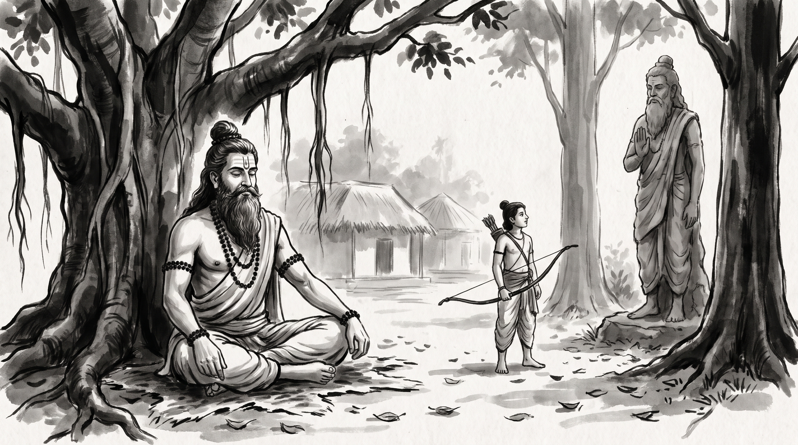

# Ekalavya's Thumb: The Tribute Demanded by Established Gatekeepers

The courtyard of the royal armory lay quiet beneath the harsh glare of the midday sun. Varuna, master artificer of the southern provinces, sat upon a low stone bench with his weathered hands resting heavily upon his knees. His brow was furrowed with the bitter realization of a craftsman whose unblemished excellence had suddenly become a political hazard. Across the stone-paved floor, the senior ministers of the central council had just issued a royal decree: no independent maker could supply bows to the imperial regiments unless they surrendered their proprietary tempering methods to the central guild house as a customary tribute of allegiance. Varuna had spent decades perfecting his craft in isolation, only to find that the established gatekeepers viewed his very proficiency as an unauthorized threat to their monopoly.

He bowed his head toward the venerable Rishi, who sat in silent contemplation beneath the spreading branches of a ancient banyan tree. "Holy one," Varuna murmured, his voice tight with frustration, "I built my reputation through solitary labor and unbroken devotion to the forge. Yet the grand masters demand that I hand over my finest techniques and bow before their council before I am permitted to practice my trade. If I refuse, they bar my apprentices from every market square. If I comply, I surrender the very edge that set me apart. How does one deal with established gatekeepers who demand your hard-earned skill as tribute?"

The Rishi opened his eyes, calm as a deep forest pool, and gazed upon the artificer. "A master's bow is drawn in silence, but the gatekeeper hears every string vibrate across the kingdom," the Rishi replied softly. "Have you forgotten the youth of the forest who practiced before an earthen likeness until the woodland animals themselves learned his discipline?"

Varuna shook his head slowly. "Tell me the tale, Sage, that I may understand what price is exacted when raw skill meets an entrenched lineage."

---

## The Clay Image and the Forest Archer

In the ancient days when the Kuru princes trained under the royal preceptor Drona, a young hunter named Ekalavya, son of Hiranyadhanus, came forth from the dark woods seeking instruction in the supreme art of archery. Drona, bound by caste laws and the solemn oaths of the royal court, looked upon the forest youth and turned him away, declaring that instruction was reserved exclusively for princes of royal blood. 

Ekalavya did not rail against the decree nor dispute the council's edict. Instead, he retreated deep into the thick forest. With patient devotion, he gathered clay from the riverbank and shaped a lifelike image of Drona, placing it beneath a tall tree as his silent preceptor. Before this earthen guru, Ekalavya practiced day and night, stringing his heavy bow through heat and monsoon rain. His discipline surpassed all expectation; he learned to shoot by sound alone, sending his shafts unerringly through the dark night into the mouths of howling hounds.

One day, while the royal princes hunted in that same forest, a hound ran barking into the thicket, its muzzle miraculously sealed by seven rapid arrows shot simultaneously without a single drop of blood being drawn. Astonished by this display of peerless mastery, the Kuru princes searched the woods and discovered the dark archer, skin smeared with ash and hair matted in ascetic fashion, loosing arrows with supernatural speed.

When Arjuna reported this feat to Drona, the royal preceptor felt the cold shadow of displaced authority. Drona sought out the forest clearing and found Ekalavya practicing with absolute devotion. Recognizing the youth's boundless skill, Drona demanded his price: *gurudakshina*. 

"If thou art truly my pupil," Drona commanded, his voice measured and resolute, "give me thy right thumb as my fee."

Without a moment's hesitation, without anger or lamentation, Ekalavya drew his blade, severed his right thumb, and laid it at the feet of the master. The master's monopoly remained intact, and the royal lineage was preserved from the challenge of an unheralded outsider.

---

## Patterns of the Central Gatekeeper

The Rishi closed his eyes for a brief moment before naming the truths hidden within the forest encounter.

**The Monopolist's Decree**
When an institution holds exclusive dominion over a craft or a domain, any unvetted excellence that arises outside its walls is perceived not as a triumph, but as a challenge to its authority. The gatekeeper does not test the outsider's capability; they test whether the outsider belongs to the established order. If the skill cannot be co-opted, it must be neutralized through procedural tribute.

**The Earthen Teacher**
True mastery often develops far from the halls of power, forged in isolation through relentless self-correction. The seeker who builds their own foundation without official sanction creates something authentic, but unprotected. That very independence makes them a target for those who claim ownership over excellence itself.

**The Tribute of Excellence**
Established authorities rarely destroy a rival outright; instead, they demand a symbolic tribute that strips the rival of their distinct advantage—be it a proprietary technique, a key ledger, or an unhindered weapon. By demanding the thumb, the gatekeeper ensures that the outsider can no longer outperform those who hold the royal charter.

---

## The Counsel

Varuna looked up from the reed mat, his hands resting open upon his knees. "What must I do when the council demands my edge as their price of admission?"

### 1. Separate Your Forge from the Royal Courtyard
Build your craft and test your innovations in quiet isolation, far from the watchful eyes of institutional rivals. Do not display your finest work in public squares until your foundation is unshakable and your skill is too deeply rooted to be casually dismantled by a council decree.

### 2. Recognize the Demand for Tribute Early
When senior administrators ask for your proprietary methods, your private tallies, or your core techniques under the guise of 'standardization' or 'customary allegiance,' recognize that they are attempting to neutralize your competitive edge. Do not mistake an institutional shakedown for an honorable partnership.

### 3. Cultivate Inner Mastery That No Decree Can Sever
Develop knowledge and adaptability that reside entirely within your own discipline and character. While an external authority can demand your tools or restrict your contracts, true proficiency of mind and hand remains your own, operating even when the formal instruments of power are temporarily withheld.

**Source:** Mahabharata, Adi Parva

Varuna bowed deeply to the sage, the bitterness in his heart replaced by the quiet resolve of a master artificer who understood both the value of his craft and the nature of those who would claim it.

> *"The master who demands your thumb as tribute fears the bow that shoots without his permission."*
