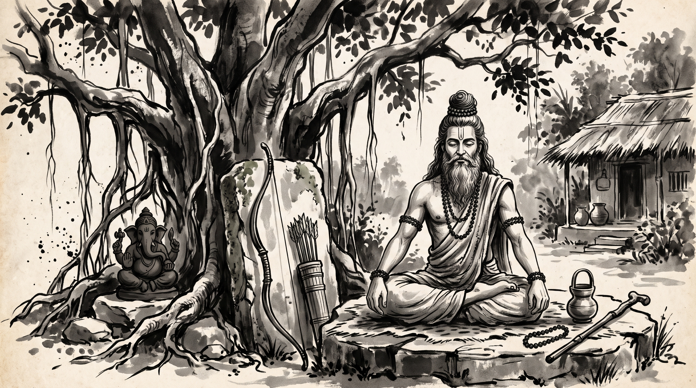

# Ekalavya's Thumb: When the Patron Demands Your Edge as Tribute

The morning mist still clung to the canopy of the forest hermitage as Devadatta, a master bowyer and weapons instructor of the northern provinces, settled upon a woven reed mat. His bow cases rested beside him, but his shoulders were slumped with the bitter weight of disillusionment. For three seasons, Devadatta had trained the youth of the merchant clans, crafting bows of seasoned bamboo and horn that flew straighter and faster than any forged in the royal armory of Hastinapura. Yet, when his apprentices sought recognition and enrollment in the royal martial guild, the high preceptor of the court barred their entry, declaring that true mastery could only be certified under the direct, exclusive tutelage of the palace masters.

Across from him sat the venerable Rishi, calm and centered beneath the sprawling branches of a sacred banyan tree. The sage's silver beard flowed over an ascetic cotton wrap, his hair was bound in a traditional Vedic *jata* topknot, and natural rudraksha beads circled his wrists. Subtle lines of vibhuti marked his serene forehead.

"You speak with the sorrow of a craftsman who built a weapon of peerless power, only to find the castle gates locked against those who wield it," the Rishi remarked softly.

Devadatta let out a heavy sigh. "Master, we poured our years into perfecting the art of archery in the quiet forests, far from court politics. We believed that supreme skill would speak for itself before the throne. Instead, the royal preceptor summoned me to the outer courtyard yesterday and delivered an ultimatum. He told me: *'Your bows are wondrous, and your archers hit every mark. But our kingdom recognizes only those who hold commissions from our lineage. If your students wish to shoot in the royal arena, you must surrender your secret bamboo-seasoning formulas, bow-binding techniques, and vow formal fealty solely to the palace armory, relinquishing all independent craft.'* When I refused to surrender our trade secrets into their single monopoly, they barred my students from every tournament in the realm. How does an independent guild survive when the gatekeepers demand your unique edge as tribute for mere permission to exist?"

The Rishi closed his eyes for a moment, listening to the distant rustle of leaves, before opening them with piercing clarity.

---

## The Outcast Archer of the Mahabharata

"Your burden is old as the kingdom of Bharata itself, Devadatta," the Rishi said, his voice resonant and steady. "In the Adi Parva of the great epic *Mahabharata*, compiled by the sage Vyasa, there is recorded the legendary encounter between the forest hunter Ekalavya and the royal preceptor Drona.

"In those days, the Kuru princes trained under Drona, the master of martial science appointed by the throne. Drona held a strict royal monopoly over advanced archery, teaching only princes of royal blood and favored nobles. One day, a young prince of the Nishadha forest tribes, Ekalavya, approached Drona in the forest encampment, yearning to learn the supreme secrets of celestial weaponry.

"Drona looked upon the tribal youth and refused him flatly. *'You are born of the forest tribes, not the royal house,'* Drona declared. *'The secrets of the divine bow belong to the court. Go back to your woods.'*

"Ekalavya did not despair, nor did he riot at the gates of Hastinapura. He possessed an indomitable will. He returned to his dense forest, carved an image of Drona from dark clay beneath a great tree, and established it as his silent preceptor. Treating the clay image with profound reverence, Ekalavya practiced day and night by the light of dawn and fire. Through relentless self-discipline and solitary rigor, his skill surpassed even that of the royal princes. He could shoot arrows by sound alone and weave a net of shafts through the air before a beast could spring.

"One day, while the Kuru princes and Drona hunted in that very forest, their royal hounds wandered into Ekalavya's grove. Hearing the strange barking of the dogs, Ekalavya let fly a rapid series of seven arrows that locked the hound's jaws together without drawing a single drop of blood, filling their mouths with a seamless cage of reeds.

"When the royal princes found the hound and marvelled at the impossible precision of the archery, they traced the feat back to the lonely forest clearing. There they found Ekalavya, worshiping his clay image of Drona, declaring himself the preceptor's humble pupil.

"Drona, standing before the forest archer, felt a cold chill run through his royal pride. He had promised his favored royal disciple, Arjuna, that no archer in the world would ever equal or surpass him. Here, in the unmonitored woods, an uninvited outsider had achieved peerless mastery without a royal commission or court endorsement.

"Drona stepped forward with a gentle, calculated smile that masked a ruthless intent. *'If you are truly my disciple, Ekalavya, and I am your preceptor, then where is the customary fee of the pupil—the guru-dakshina?'*

"Ekalavya dropped to his knees with joyful devotion. *'Master! Name whatever you desire. My life, my bows, my forest are at your feet.'*

"Drona looked down at the young archer's right hand and uttered the devastating demand: *'Give me your right thumb as my fee.'*

"Without an instant of hesitation, driven by absolute devotion to his chosen teacher, Ekalavya drew his hunting knife, severed his right thumb, and laid it bleeding at Drona's feet. With his thumb gone, his peerless speed and supreme mastery were broken forever, securing the royal monopoly of the palace archers without a single arrow being drawn in battle."

---

## The Anatomy of the Tribute Gate

The Rishi leaned forward, resting his hands upon his knees.

"Drona did not defeat Ekalavya in an archery contest in the royal arena. He defeated him by weaponizing the very bond of reverence Ekalavya had offered to him. When an institution or a senior patron realizes that your independent skill has surpassed their guarded borders, they do not challenge your craft—they demand your edge as a tribute.

"Every royal court and established guild operates by this law when threatened by independent excellence. They execute four distinct maneuvers to reclaim what you built outside their walls.

### 1. The Monopoly of Legitimacy
The institution first declares that skill acquired outside official halls is illegitimate. If you master your craft in the forest, through self-taught rigor or independent workshops, they refuse to recognize your work. They frame your independence as amateurism, forcing you to seek their validation before you can ever present your craft to the realm.

### 2. The Demand for Homage in Disguise
When independence proves too potent to ignore, the gatekeeper shifts tactics. They approach you not as an enemy, but as an elder or a patron seeking a formal 'connection.' They demand that you bow to their lineage, pay homage to their council, or submit your innovations for their official inspection before publication. They turn your natural respect for tradition into a leash.

### 3. The Extraction of the Core Advantage
Once you enter their inner courtyard or swear fealty to their standard, they exact the true price. They do not want your companionship; they want your thumb. They extract your core trade secrets, your unique formulas, your client registers, or your distinctive design methods. They absorb your innovation into the institutional storehouse and distribute it under the seal of the senior masters.

### 4. The Reduction to Dependency
With your unique edge severed and absorbed by the hierarchy, you are permitted to remain—not as a peer or a master craftsman, but as a crippled auxiliary who must rely entirely on their patronage for scraps of work. The gatekeeper secures his monopoly not by matching your excellence, but by removing your capacity to stand alone."

---

## The Rishi's Counsel: How to Guard the Thumb

Anil, who had listened in breathless silence, leaned forward. "Master, if the court or the council demands my formulas as tribute for my guild's survival, how do I protect my work without bowing to the gatekeeper?"

The Rishi raised four fingers, his gaze steady and clear.

### 1. Never Surrender Your Core Anchor to Any Single Patron
A master bowyer does not hand over the seasoned horn and bamboo core to the royal armory for safekeeping. Keep your core innovations, your precise manufacturing ledgers, and your primary design templates in your own workshop, distributed among trusted craftsmen who hold mutual oaths. Never centralize your intellectual heritage in the hands of a single patron or institutional committee that can hold your livelihood hostage.

### 2. Build Your Market Beyond the Royal Gates
Drona could demand Ekalavya's thumb because the royal court was the only arena recognized across the provinces. If your craft relies entirely on a single royal patron, a single merchant guild, or a single institutional buyer, you are already cornered. Take your wares directly to independent merchant caravans, provincial assemblies, and regional councils. A craftsman with a diversified network of patrons never needs to kneel for a royal license.

### 3. Recognize the Trap in 'Official Endorsement'
When an established authority suddenly offers to endorse your independent workshop in exchange for exclusive distribution rights or secret formulas, recognize it for what it is: the demand for your thumb. Real authority does not require you to maim your own capability; it seeks collaboration among peers. If a partnership requires you to surrender your autonomy or your proprietary edge, decline the alliance before you cross their threshold.

### 4. Guard Your Independence Above Royal Recognition
Ekalavya sought the validation of a master who viewed him as a threat to his royal favorites. Do not spend your life seeking the seal of approval from institutions built to exclude you. Master your craft in the quiet forests of your own discipline, build alliances with those who value the work itself rather than the lineage badge, and let your results speak so clearly that no court can ignore them—even with an empty hand.

**Source:** Mahabharata, Adi Parva, Sambhava Parva

The morning sun broke fully through the banyan canopy, casting sharp, clean shadows across the hermitage floor. Devadatta rose, bowed deeply to the sage, and picked up his bow cases with a firm, unyielding grip.

> *"Do not surrender your thumb to the gatekeeper who demands your edge as tribute; keep your craft within your own keeping, build your fires far from the royal courtyard, and let your work stand unbroken."*
