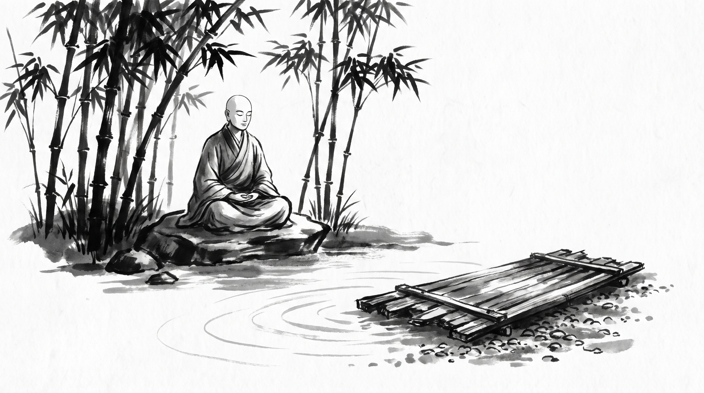

# The Parable of the Raft: Letting Go of the Methods That Brought You Across

The bamboo grove swayed softly in the evening breeze, casting delicate patterns of light and shadow upon the packed earth. Sudatta, a veteran caravan leader of the northern trade routes, sat cross-legged on a woven rush mat. His shoulders were bowed, not from physical exhaustion, but from the crushing weight of institutional inertia. His weathered hands gripped his knees as he looked across at the serene Monk seated in quiet contemplation.

"Master, our merchant guild is strangling itself with its own success," Sudatta murmured, his voice tight with frustration. "Three seasons ago, when the great mountain pass flooded and bandits choked every valley trail, we instituted a strict emergency protocol. Every wagon had to travel in a rigid forty-cart convoy, guarded by armed spearmen at front and rear, with every route pre-approved by the central council three weeks in advance. That rigid process saved our caravans from ruin. It brought us safely across the most dangerous pass in the realm."

"Now," Sudatta continued, shaking his head bitterly, "the mountain pass is clear of bandits, the valley roads are wide and peaceful, and trade has shifted to swift, independent couriers. Yet the guild elders refuse to abandon the forty-cart convoy rule. They cite our past survival as proof that the rigid process is sacred law. Every merchant who wishes to send a small, agile cart of spices must wait weeks, pay triple guard fees, and crawl at a snail pace behind forty empty wagons. When I tell the elders that the river of conditions has changed, they look at me as if I were proposing treason. They worship the timber that carried us across the flood, even though we are now walking on dry stone. How do you shatter a sacred methodology without breaking the caravan itself?"

The Monk opened his eyes, gazing calmly at the swaying bamboo stalks before answering.

## The Parable of the Raft in the Alagaddupama Sutta

"Your struggle is as old as the rivers of Jambudipa, Sudatta," the Monk said softly. "In the *Majjima Nikaya*, in the foundational teachings of the *Alagaddupama Sutta*, the Blessed One perceived this very delusion and offered the parable of the traveler and the raft."

"Imagine a man traveling on a journey who comes to a vast, terrifying body of water," the Monk related, his voice steady and rhythmic. "The near shore is fraught with danger, beasts, and snares, while the further shore is safe and secure. But there is no bridge across the flood, and no boat available for hire. What is the traveler to do?"

"Realizing the peril of staying behind and the safety of the other side, the traveler gathers grass, twigs, branches, and poles from the forest. With diligent labor, he lashes them together into a sturdy raft. Relying upon that raft, and using his hands and feet as paddles, he safely crosses the turbulent flood to the further shore."

"Having reached the dry, secure land, what should that traveler do?" the Monk asked. "Should he hoist the heavy timber raft upon his shoulders, lift it onto his back, and carry it miles inland as he walks through villages and forests, simply because the raft saved his life?"

Sudatta blinked in surprise. "That would be sheer madness! The raft served its purpose upon the water. Once on dry ground, carrying it would only crush his back and slow every step he takes."

"Precisely so," the Monk nodded. "Yet men do this every day in councils and merchant guilds. They cling to the raft long after the river has ended."

## The Weight of the Timber Frame

The Monk observed four patterns in the traveler who refuses to drop his burden.

### 1. The Terror That Gave Birth to the Tool
When a great crisis strikes—a famine, an audit, a bandit wave—a community builds a rigid tool to survive. Because the terror was real, the tool feels sacred. People confuse the panic of the storm with the virtue of the rope that tied the logs together.

### 2. The Gratitude That Turns to Bondage
Because the raft saved the traveler from drowning, gratitude hardens into dogma. The elders declare: *'Without this exact forty-cart convoy, we would have perished.'* They honor the vessel of yesterday so deeply that they refuse to look at the open road of today.

### 3. Hoisting the Timbers on Dry Ground
Once a process is institutionalized, people carry it into places where it has no function. They bind themselves to complex approvals, redundant guards, and endless waiting periods, marching across dry mountain paths with massive logs strapped to their shoulders, wondering why their feet bleed and their trade lags behind.

### 4. Punishing Those Who Swim Free
When a merchant leaves the heavy raft behind to travel swiftly with a light pack, the carriers of the raft become enraged. They view lightness as disrespect to the past. They demand that everyone carry the timber, not because the river requires it, but because their own aching shoulders demand comradeship.

## The Monk's Counsel

"Master," Sudatta asked, leaning forward earnestly. "When the elders treat yesterday's makeshift raft as eternal truth, how does a prudent merchant act?"

The Monk raised four fingers.

### 1. Separate the Water from the Wood
When the guild council meets, distinguish clearly between the crisis that forced the rule and the rule itself. Write upon a palm leaf: *'The forty-cart rule was built for the bandit flood of year three; it is a tool of transit, not a pillar of the law.'* Show the council the date of its birth so they see it as timber, not scripture.

### 2. Land Your Cargo Before You Argue
Do not start by demanding that the entire guild burn its rafts. Instead, lead one small, swift test caravan through the valley route under a separate register. Let the merchants see the faster delivery and lower cost with their own eyes. Results on dry land speak louder than debates on the riverbank.

### 3. Unlash the Logs One by One
If the elders will not discard the entire system at once, dismantle it piece by piece. First remove the redundant guard fees for short runs; next relax the rigid spacing between carts; finally let small traders travel independently. A raft taken apart piece by piece harms no one, whereas a sudden wreck alarms the timid.

**Source:** Majjhima Nikaya, Alagaddupama Sutta, MN 22

Sudatta bowed his head, feeling the heavy burden lift from his shoulders. The river was crossed; it was time to leave the logs behind.

> *"Praise the raft that bore you safely across the turbulent flood, but never be foolish enough to hoist the heavy timber upon your shoulders once your feet touch dry ground."*
