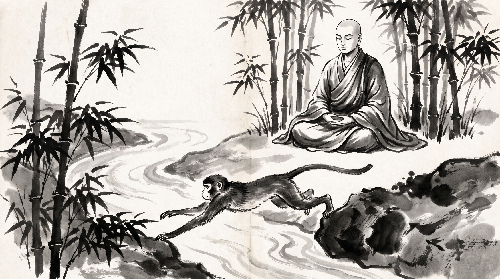

# The Monkey Kings Bridge: Surviving the Siege of the Royal Orchard

The bamboo grove swayed softly in the morning mist, filtering golden light across the damp earth and smooth grey stones. Subhadra, a senior caravan master and guild treasurer of the northern trade routes, sat upon a woven mat with his shoulders bowed and his hands resting heavily on his knees. His expression was etched with the quiet exhaustion of a leader who had carried his caravan through treacherous mountain passes, only to find betrayal waiting within the inner council chambers.

Across from him sat the venerable Monk, centered and tranquil. His robes were draped simply over his shoulders, and his shaved head reflected the quiet clarity of the grove.

"You carry the weight of an entire merchant guild upon a broken axle, Subhadra," the Monk observed softly. "When the royal treasury demanded exorbitant levies last season, you stepped between the tax syndics and your junior artisans. You took the full force of the council's anger upon yourself, believing your sacrifice would secure their safety. Yet yesterday, when the royal decree reallocated the trade routes, those same junior merchants petitioned the high court to strip you of your treasury seat, claiming your leadership was too heavy-handed."

Subhadra let out a ragged breath. "Master, I spent twenty years building our trade syndicates, securing every contract, shielding every workshop from the king's tax collectors. I stretched my own resources thin to keep their ledgers balanced through the famine. When the royal inspectors threatened confiscation, I stood in the doorway alone. And now, at the first whisper of royal favor, they turned their backs to appease the new syndics. How does a leader bear the weight of people who step across his spine the moment the river is crossed?"

"A bridge does not ask the travelers who cross it whether they carry gratitude or indifference," the Monk replied gently. "It only asks whether it is strong enough to reach the other side."

Subhadra looked up, his brow furrowed in bitter sorrow. "Is leadership merely an exercise in self-destruction? Must the one who builds the span always be crushed beneath the feet of those he saves?"

"Listen to the ancient tale of Mahakapi," the Monk said, his voice carrying the steady resonance of the Dhamma.

---

## The Great King of the Macaques

The Monk raised his hand toward the rustling bamboo canes. "In the previous ages, long before the kingdoms of men built stone fortresses along the Ganges, there lived a great leader among the macaques known as Mahakapi. He was endowed with the strength of an elephant, boundless wisdom, and a compassionate heart that watched over a troop of eighty thousand monkeys who inhabited the dense forests along the riverbank."

"At a great bend in the mighty river stood a magnificent mango tree, towering and ancient. Its roots sank deep into fertile soil, and its spreading branches hung heavy over the rushing waters. The fruit it bore was celestial in sweetness—golden, fragrant, and larger than any mango grown in mortal orchards. Mahakapi constantly warned his troop: 'Guard every branch, and let no sweet fruit fall into the river current. If even a single mango drifts downstream and reaches the human settlements, the greed of kings will destroy our sanctuary.' For seasons, the troop obeyed, and peace reigned in the forest."

"One day, however, despite all vigilance, a ripe mango detached from a high bough, slipped past the foliage, and plunged into the river. Carried swiftly by the current, the golden fruit drifted down the river until it floated directly into the royal bathing ghat of Benares, where King Brahmadatta was bathing with his retinue."

"The king tasted the divine fruit and was filled with wonder. He summoned his royal foresters and ministers, demanding: 'Find the tree that bears this nectar, no matter how deep in the wilderness it lies.' Guided by the floating fruit, the king's archers and guards marched upstream through the dense jungle until they surrounded the great mango tree on every side."

"Seeing the royal host encamped below with drawn bows and poisoned arrows, panic seized the eighty thousand monkeys. They scrambled up the highest branches, screaming in terror: 'Mahakapi! The royal archers surround us! We are doomed to perish beneath their arrows!'"

"Mahakapi climbed to the topmost bough and looked down upon the terrified troop. He saw the ring of steel, the leveled bows, and the king watching eagerly from below. Instead of despairing, the great leader surveyed the raging river separating the mango tree from the opposite bank. He calculated the distance, measured his own strength, and resolved upon a course of action that would save his people at the cost of his own safety."

---

## The Span Across the Chasm

"Mahakapi climbed swiftly to a high bough overhanging the river. Finding a sturdy bamboo reed on the opposite bank that stood within a desperate leap, he gathered his strength and hurled himself across the chasm, grasping the bamboo stalk with fierce determination. But the distance was vast, and his hind legs fell just short of the riverbank."

"Undeterred by the tearing pain in his muscles, Mahakapi reached down, seized a thick liana vine hanging from the tree, and tied it securely around his waist, anchoring his body taut across the roaring torrent like a living suspension bridge. He called down to his terrified troop: 'Cross over quickly! Walk across my back to the safety of the eastern forest! Do not look back; run until you reach the bamboo sanctuary!'"

"Without hesitation, eighty thousand monkeys streamed across the living bridge. Mothers carrying their young, young scouts, and elderly macaques rushed across his straining spine. Mahakapi held his position, every sinew trembling under the ceaseless pounding of thousands of feet, enduring the agony of torn muscles and searing pain as the troop evacuated the tree."

"Among the fleeing troop, however, was a malicious rival monkey—a cunning creature who had long envied Mahakapi's leadership and plotted to usurp his place. As this rival crossed the bridge, instead of leaping swiftly to safety, he paused directly over Mahakapi's heart, gathered his strength, and delivered a vicious leap upward, shattering Mahakapi's spine with spiteful malice before bounding safely to the other side."

"King Brahmadatta, watching from the royal boat below, witnessed the entire sacrifice with profound astonishment. He saw the selfless endurance of the monkey king, and he saw the cruelty of the ungrateful follower. When the last monkey had crossed, Mahakapi lay dying upon the bough, his body broken and bleeding."

"The king ordered his ministers to lower silk ropes and hoist the dying monkey king up onto a royal couch. He bathed Mahakapi's wounds with warm water, dressed him in fine garments, and asked with deep reverence: 'You carried thousands of ungrateful creatures across the river, yet one among them broke your spine as he fled. Why did you endure such agony to save them all?'"

"With his final breath, Mahakapi whispered: 'O king, I bore the weight of the unworthy not for their gratitude, but for my duty as their leader. He who assumes the responsibility of the troop must span the chasm, whether the travelers are noble or base.'"

---

## The Teachers Counsel: Spanning the Chasm Without Breaking

The Monk looked across the quiet courtyard at Subhadra, whose gaze was fixed on the smooth stones.

"Every guild and council has its river crossings, Subhadra. When crisis strikes, the true leader does not calculate who deserves safe passage; he builds the span. But he must build with wisdom, lest he be broken by the ungrateful."

### 1. Bear the Weight, But Guard the Core
A leader must carry his people across the crisis, but he must never surrender his vital reserves to those who resent his strength. When the royal tax syndics demanded surrender, you offered your entire treasury control as collateral. Next time, share the structural burden with a council of senior elders; do not let the entire weight rest upon a single spine.

### 2. Recognize the Rival on the Bridge
In every guild, there are those who cross your bridge only to strike a blow at your leadership the moment they reach safety. Do not be surprised by betrayal from those you saved; their malice is born of inadequacy. When you build a remedy for a struggling team, keep your most vital trade ledgers and strategic contracts locked in a separate chest where ungrateful hands cannot tamper with them.

### 3. Anchor Your Authority in Written Charters
Mahakapi anchored his bridge with a sturdy liana vine. A guild master must anchor his position in formal, sealed agreements approved by the assembly elders. When you shield junior artisans from royal levies, write the terms of protection on palm leaves and have both parties seal them before the council. Do not rely on informal goodwill that evaporates the moment the danger passes.

**Source:** Jataka Tales, Mahakapi Jataka, No. 407 (UNVERIFIED)

Subhadra bowed his head in deep contemplation. The bitterness in his heart receded, replaced by the quiet, unyielding strength of a leader who understood both his duty and his boundaries.

> *"Do not measure your leadership by the gratitude of those who cross your bridge; span the chasm when your people are in peril, but keep your vital anchors secured in stone and sealed in writing."*
