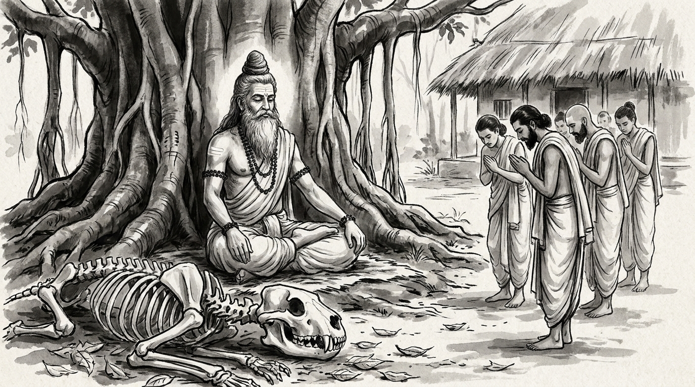

# The Scholar's Folly: When Technical Brilliance Constructs Your Own Destruction

The forest hermitage rested in the quiet embrace of the afternoon breeze. Dry leaves rustled beneath the ancient banyan tree, whose aerial roots dropped like pillars of weathered bronze into the fertile earth. Varsha, chief architectural scholar of the imperial treasury, sat upon a woven reed mat with his head lowered and his hands trembling. His eyes burned with the stinging realization of a man whose unmatched intellect had been turned against him by his own creations.

Across from him sat the venerable Rishi, centered and tranquil. His silver beard flowed over an ascetic cotton wrap, his matted hair was bound in a traditional Vedic *jata* topknot, and natural rudraksha beads circled his wrists. Subtle lines of sacred vibhuti traced the calm expanse of his brow.

"You bring the heavy weight of unexamined cleverness to the hermitage, Varsha," the Rishi remarked softly.

Varsha let out a ragged breath. "Master, our royal academy spent three seasons perfecting the grand automata—defensive mechanical engines capable of guarding the city gates without human guards. My fellow scholars and I mastered every formula of motion, every gear ratio, and every mantra of animation. We possessed supreme technical mastery. But when we presented our triumph to the high council, junior ministers seized control of the engines before field testing their stability. They deployed the automata without restraint during a guild riot. The machines turned upon our own workshops, crushed the artisans' quarters, and scattered our guild in ruin. Now the council blames our brilliance for the chaos. How do we defend ourselves when our own craftsmanship becomes a monster?"

"And what did you say to the ministers when they demanded your brilliant machines?" the sage asked quietly.

"I told them we had perfected the science," Varsha said, his voice trembling with bitter clarity. "And they replied that science without judgment is a weapon pointed at its maker. How does a scholar learn to weigh the outcome before awakening the beast?"

---

## The Four Scholars of the Panchatantra

The Rishi smiled with deep, sorrowful recognition. He raised his hand and gestured toward the tranquil clearing beyond the hermitage hut, where the shadows stretched long across the dry earth.

"Your sorrow is born of a very ancient error, Varsha," the Rishi said. "In the *Panchatantra* of Pandit Vishnu Sharma, in the fifth book of *Aparikshitakarakam*—Action Without Reflection—there is preserved the timeless parable of the four companions known as the Lion Makers."

"In a prosperous provincial town, four young brahmins grew up together. Three of them were oceans of scholarship: they had mastered every sacred text, every philosophical treatise, and every intricate science known to the sages. Yet they possessed not an ounce of practical judgment or common sense. The fourth companion lacked their book-learning, but he possessed a sharp, discerning eye for reality and the ways of the world. His companions constantly mocked him as an unlettered peasant."

"One day, the four young men resolved to travel together to distant lands to test their knowledge and win royal favor. As they journeyed through a dense, trackless forest, they came upon a clearing strewn with the bleached, dry bones of a massive beast."

"The first scholar examined the skeletal remains with glowing pride. 'Here is a rare opportunity,' he declared. 'My scholarship is complete. By the power of my mantras, I can assemble these scattered bones into a perfect skeletal frame.' He chanted his spells, and instantly the bones leaped together, locking into the anatomy of a gigantic lion."

"The second scholar stepped forward, his eyes shining with intellectual vanity. 'That is mere carpentry,' he boasted. 'Watch true science. By my sacred formulas, I shall clothe this skeleton with flesh, blood, and hide.' He recited his verses, and skin, muscles, and a mane spread over the bones until a massive, lifeless lion lay breathing heavily upon the earth."

"The third scholar smiled with supreme arrogance. 'Behold the summit of learning,' he cried. 'I shall breathe the breath of life into this creature.' As he prepared to utter his supreme mantra of animation, the fourth companion—the one blessed with practical judgment—leaped forward and grabbed his arm."

" 'Stop! For the sake of the gods, do not awaken this creature!' the fourth man cried. 'This is a lion! If you give him life, he will spring up and tear every one of us to pieces.'"

"The three scholars laughed aloud with supreme contempt. 'Ignorant fool!' the leader sneered. 'Would you have our vast scholarship lie idle and useless? You are merely jealous of our supreme learning because you know no mantras.'"

"The fourth companion shook his head in sorrow, and realizing that intellect without judgment is suicide, scrambled swiftly up the trunk of a tall banyan tree, clinging safely to the high branches."

"Below, the third scholar chanted his final verse. The great lion shuddered, opened its fierce amber eyes, and roared with terrifying power. In a single bound, the resurrected beast sprang upon the three brilliant scholars, tore them limb from limb, and devoured them before the sun could set."

"When the forest grew silent once more, the fourth companion climbed down from the tree and walked home alone, alive because he possessed the judgment that scholarship alone cannot buy."

---

## The Anatomy of Technical Hubris

The Rishi turned his gaze from the clearing back to Varsha.

"Every royal court has its lion makers, Varsha. When scholars fall in love with their own cleverness, they commit four fatal errors."

### 1. Mistaking Mastery for Wisdom
The three scholars knew every mantra of bone and breath, but they never asked the simplest question: *What happens when this creature wakes?* Technical mastery tells you what *can* be built; wisdom asks whether it *should* be built. A brilliant design without foresight is merely a trap set by your own hands.

### 2. Mocking Practical Discernment
The scholars mocked their fourth companion because he lacked book-learning. In every guild and treasury, brilliant specialists dismiss those who ask basic questions about consequences, calling them unrefined or timid. Yet when the crisis strikes, the scholar falls prey to the monster while the practical mind climbs out of reach.

### 3. Awakening What Cannot Be Controlled
Once the mantra was chanted, the lion could not be reasoned with. When you release a complex system, a raw policy, or an unvetted mechanism into a fragile environment simply to prove your capability, you surrender control to the beast. Power does not care how brilliant the mind was that unlocked the cage.

### 4. Failing to Measure the Cost
The brilliant scholars died believing their superior intellect would protect them. They measured their worth by the complexity of their craft rather than the safety of the outcome. A project that destroys its creators is a monument to folly, not genius."

---

## The Sage's Counsel: How to Build with Judgment

"Master," Varsha asked, his voice steadying. "How does a scholar anchor his intellect in reality? How do we build without summoning the lion?"

The Rishi held up four fingers.

### 1. Test the Purpose Before You Perfect the Craft
Before you approve a new design, an automated registry, or a radical policy, write down its worst possible outcome on a palm leaf. If the system fails or falls into the wrong hands, who dies first? If you cannot answer that question with absolute clarity, halt the project until the risks are weighed by experienced elders.

### 2. Honor the Practical Critic
Never dismiss the craftsman or administrator who asks uncomfortable, unpolished questions about how a system will behave in the dust of the daily market. Their common sense is often the only thing standing between your brilliance and a catastrophe. Listen to the man who looks at the bones before you look for the mantra.

### 3. Build Safe Ascents
Never construct a mechanism or policy that leaves no escape route if things go wrong. Every complex project must have an emergency valve—a way to disconnect, dismantle, or halt the operation before it gains its own momentum. If a system cannot be stopped once started, it is a monster, not a tool.

### 4. Separate Cleverness from Prudence
Keep a clear boundary between what you *can* do and what you *should* do. When the council demands rapid innovation to satisfy their political ambitions, slow the pace with rigorous evaluation. Let your reputation rest not on how many complex systems you can awaken, but on how well you protect the commonwealth from uncalculated risks.

**Source:** Panchatantra, Book 5 (Aparikshitakarakam), "The Lion Makers" (Simha-Samutpadaka Katha)

Varsha bowed low. The fever of pride in his mind had cooled. In its place remained the quiet strength of true discernment.

> *"Do not awaken a sleeping beast merely to prove the brilliance of your mantras; technical mastery without practical judgment is simply crafting the weapon that consumes its creator."*
