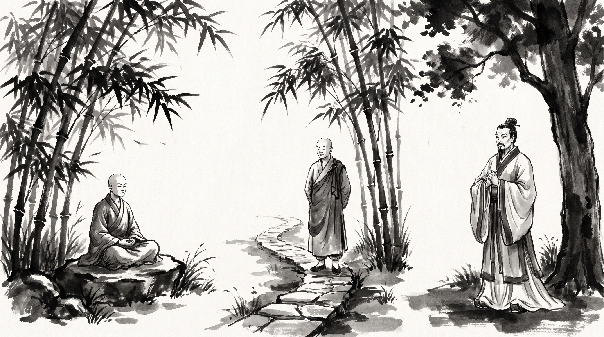

# Angulimala: "I Have Stopped" — How a Destructive Career Reaches Its Final Boundary

The morning mist hung low over the bamboo grove near Savatthi, casting long, silvery shadows across the damp earth. The rustle of green stalks sounded like whispering counsels in an imperial court. Upasaka Jotipala, senior steward of the royal granaries, sat upon a flat stone bench with his hands clasped tightly in his lap. His brow was furrowed with the profound exhaustion of a man whose aggressive restructuring strategy had spun out of control, threatening to consume not only his rivals but his entire department and his own standing in the realm.

Across from him sat the venerable Monk, draped in a simple kasaya robe, his head clean-shaved and his expression completely untroubled by the turmoil of the capital.

"You carry the fever of relentless pursuit in your footsteps, Jotipala," the Monk observed softly.

Jotipala let out a ragged breath, staring at the dust between his sandals. "Master, I set out to reform our supply allocation system to eliminate waste and outmaneuver the corrupt merchant guilds. At first, my aggressive tactics worked. We stripped away old monopolies and seized control of regional depots. But the momentum became a monster. My deputies began fabricating charges against every regional magistrate who hesitated, slashing budgets without mercy, and ruining honest families just to meet our aggressive expansion targets. Now the royal council fears my ambition, my subordinates are sharpening daggers for my position, and I cannot stop the machine I built without losing everything I fought for. How does a man halt a destructive career trajectory when stopping means total ruin?"

"And what did you say to your deputies when they demanded further escalation?" the Monk asked quietly.

"I told them we must press forward until every competitor is crushed," Jotipala murmured, his voice trembling. "And they replied that retreat is death in the arena of power. How does one step off the wheel of relentless conquest before it tears us apart?"

---

## The Bandit of Jeta's Forest

The Monk smiled with deep, compassionate stillness, raising his hand toward the quiet clearing where the sun began to filter through the emerald bamboo canopy.

"Your dilemma is as old as the dusty roads of Kosala, Jotipala," the Monk said. "In the sacred records of the *Majjhima Nikaya*, in the renowned *Angulimala Sutta* (MN 86), there is preserved the harrowing account of the bandit Angulimala, whose career of violence became a cage from which he could find no escape."

"In those days, the realm of Kosala was terrorized by a fierce robber named Angulimala. Born into a Brahmin family of Savatthi, he had been a brilliant scholar of great promise, but through palace intrigues and malicious whispers planted by envious rivals, he was driven into a psychotic delusion by a corrupt teacher. To prove his absolute devotion and settle a blood debt of vengeance, he took a dreadful vow: he would slay a thousand human beings and gather their right-hand fingers into a necklace to wear across his chest."

"Village after village was depopulated. Merchants refused to travel the royal highways. Even King Pasenadi of Kosala mobilized his royal army, riding out with armed chariots and cavalry to hunt down the dreaded murderer who had already slain nine hundred and ninety-nine souls. The entire kingdom lived under a shadow of perpetual terror, trapped in an escalating cycle of violence that no one knew how to terminate."

"One morning, the Buddha walked alone along the perilous forest path leading straight into Angulimala's territory. Villagers and herdsmen implored him to turn back, warning him that even ten or twenty armed men together could not survive an encounter with the beast of the woods. The Buddha walked on in complete silence, his steps measured and serene."

"Angulimala, lurking among the dense thickets with sword drawn and bow strung, spotted the lone ascetic approaching. A cruel, triumphant grin crossed his face. Here was the thousandth victim—the final finger needed to complete his macabre garland. Roaring with fury, Angulimala sprang from the thicket and gave chase."

"Yet, a strange and baffling thing occurred. Though Angulimala possessed the explosive speed of a desperate predator, running with all his might across the uneven terrain, he could not close the distance. The Buddha walked at his usual, unhurried pace, neither running nor turning his head. Sweat poured down the bandit's face; his breath grew ragged; his legs burned with exhaustion. Yet, try as he might, a fathomless gap remained between them."

"Frantic, breathless, and infuriated beyond endurance, Angulimala screamed at the top of his lungs: 'Stop, ascetic! Stop!' "

"The Buddha halted, turned his gaze upon the armed murderer with infinite gentleness, and answered in a clear, resonant voice: 'I have stopped, Angulimala. You too have stopped. But you have not ceased your striving.' "

"The words struck the violent robber like a thunderbolt. He froze in his tracks, his sword trembling in his hand. For the first time in years, the headlong rush of his bloody career came to an abrupt halt. He stared at the tranquil monk in utter bewilderment. 'Ascetic, you are walking, yet you say you have stopped. While I am standing still—or running—you say I have not stopped. Explain this mystery.' "

"The Buddha spoke softly: 'I have stopped, Angulimala, because I have laid down violence toward all living beings once and for all. You, however, have not laid down your weapon; you remain unrestrained, cruel, and relentless in your slaughter. Therefore, I have truly stopped, while you are still driven by unbridled compulsion.' "

"In that instant, the heavy scales of delusion fell from the bandit's eyes. The crushing weight of nine hundred and ninety-nines lives rushed over his soul. He dropped his bloody sword to the earth, let his bow fall into the dust, and bowing low at the Buddha's feet, begged for the monastic ordination. The relentless career of terror was ended not by greater violence, but by the absolute courage to stand still."

---

## The Anatomy of Endless Pursuit

The Monk turned his gaze from the bamboo shadows back to Jotipala.

"Every royal court and treasury has its Angulimala, Jotipala. When ambition loses its anchor in moral clarity, ambition becomes a relentless bandit that consumes its own master."

### 1. The Trap of Momentum
When you embark on an aggressive campaign of restructuring or corporate conquest, the sheer speed of the operation creates its own brutal momentum. You stop evaluating the human cost because stopping feels like failure. The terror of losing control pushes you to run faster, even as your methods grow more destructive.

### 2. Confusing Speed with Progress
Angulimala ran with immense physical power, but every stride carried him deeper into spiritual bondage. In administration, rushing from crisis to crisis, launching audit after audit, and slashing budgets without reflection is not leadership; it is flight. Motion without stillness is merely panic disguised as strategy.

### 3. The Illusion of the Final Milestone
The bandit believed that one final victim—the thousandth finger—would bring him absolute fulfillment and release. In modern councils, ambitious leaders constantly sacrifice their integrity for 'one last merger,' 'one final restructuring,' or 'one ultimate target,' believing that completion will justify the devastation. The finish line is a mirage; the compulsion only deepens.

### 4. The Courage to Drop the Weapon
True strength is never measured by how many rivals you outrun or how many budgets you crush. True strength is demonstrated in the exact moment you drop the sword of compulsion, admit that the trajectory is corrupt, and accept the temporary vulnerability of standing still to re-examine your path.

---

## The Master's Counsel: How to Halt a Destructive Trajectory

"Master," Jotipala asked, his voice trembling with newfound resolve, "how do I halt this machinery before it destroys my department and my soul?"

The Monk raised his hand, holding up three fingers.

### 1. Separate Motion from Direction
Halt all new retaliatory audits and aggressive policy expansions immediately. Issue a formal written decree across every departmental ledger requiring a seven-day pause on all punitive measures. Sit in council with your senior scribes and examine whether your current speed serves the public trust or merely feeds your fear of losing control.

### 2. Stand Still When the Pressure Accelerates
When junior ministers and rival factions demand faster results and harsher crackdowns, refuse to accelerate. Plant your feet firmly on the stone floor of the council chamber. Answer their demands for blood with calm, unyielding patience, forcing the entire administration to confront the reality of its own overreach rather than hiding behind frantic motion.

### 3. Renounce the Metrics of Conquest
Audit your personal ambitions on a palm-leaf scroll. Cross out every metric based on dominance, destruction of rivals, and forced submission. Replace them with standards of institutional health, fairness, and calm stewardship. Lay down the sword of retaliation just as Angulimala laid down his blade in the forest.

**Source:** Majjhima Nikaya, Angulimala Sutta, MN 86

Jotipala bowed low, touching his forehead to the cool earth of the grove. The feverish panic in his chest had dissolved into a profound, grounding stillness.

> *"I have stopped, Angulimala, and you too have stopped. Lay down the sword of compulsion, abandon the frantic chase of ambition, and find true sovereignty in the absolute courage of stillness."*
