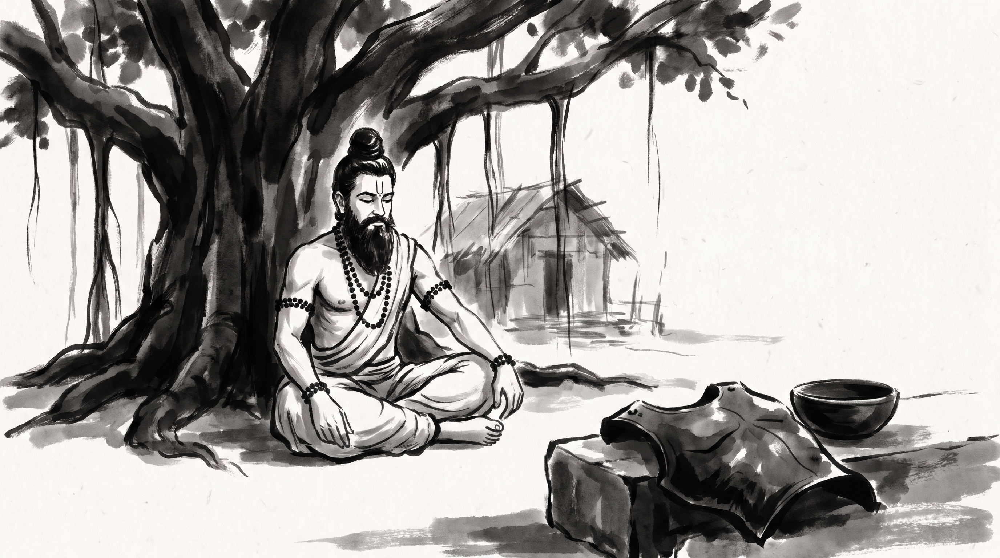

# The Invincible Kavacha: When Generosity is Weaponized by a Calculated Supplicant

The morning mist hung heavy over the forest hermitage, curling around the aerial roots of the ancient banyan tree. Somadatta, chief treasurer of the imperial court, sat cross-legged upon a woven reed mat, his fingers nervously tracing the hem of his cotton uttariya. His eyes were shadowed with the exhaustion of a man who had given everything demanded of him, only to find ruin waiting at the finish line.

Across from him sat the venerable Rishi, centered and tranquil. His silver beard flowed over his chest, his matted hair was bound in a traditional Vedic jata topknot, and natural rudraksha beads circled his wrists. Subtle lines of white vibhuti marked his calm forehead.

"You carry the burden of a man who mortgaged his fortress because the petitioner praised his benevolence," the Rishi observed softly, his voice cutting through the silence of the ashram.

Somadatta let out a heavy sigh. "Master, my honor has always been my shield. When the regional satraps and noble syndics came to the treasury pleading for emergency grants to feed their starving provinces, I opened the reserves. When they asked for my personal estate deeds as collateral to secure merchant convoys, I signed them away without a second thought. I believed that unyielding generosity was the highest virtue of a statesman."

The treasurer's jaw tightened. "Yesterday, the imperial council audited the royal vaults. Every reserve I surrendered to those pleading nobles had been quietly diverted into their private family accounts. Worse, when the supreme council asked why the treasury lay bare, those same nobles stood before the throne and declared that the shortfall was due to my reckless mismanagement and vanity. They used my virtue as the ladder to scale the citadel wall, and now I stand stripped of station, honor, and authority. How does a steward protect his trust when righteousness itself is weaponized against him?"

The sage closed his eyes for a quiet moment, listening to the distant call of a forest bird. "You gave away your armor because you feared the shame of saying no more than the ruin of saying yes," the Rishi replied.

---

## Indra’s Request in the Vana Parva

The Rishi raised his hand toward the clearing where the morning sunlight struck the earth. "Your confusion is bitter, Somadatta, but the trap you walked into was laid long before our kingdom was founded. In the great epic of the *Mahabharata*, within the forest teachings of the *Vana Parva*, there is recorded the encounter between Karna and the lord of the gods, Indra."

"Karna came into this world bearing a divine armor and earrings—a *kavacha* and *kundalas*—forged into his very flesh at birth. So long as he wore them, no weapon forged by gods or men could pierce his skin; he was invulnerable, destined to triumph in any battle he chose to enter."

"Knowing this divine protection stood as an insurmountable barrier to victory, Indra resolved to strip Karna of his shield before the great war upon the plains of Kurukshetra. But Indra did not come as an open enemy with drawn sword. He came disguised as a humble Brahmana ascetic, frail, dusty, and walking with a begging bowl."

"Karna, famed throughout the lands for his absolute vow never to turn away a suppliant who asked in the name of righteousness, sat by his morning fire when the disguised god approached."

"The false ascetic looked upon the warrior and spoke with calculated humility: *'O Karna, known for unmatched charity, I have traveled from a distant hermitage. I ask of you a supreme gift. Cut the divine kavacha from your chest and strip the kundalas from your ears, and give them unto me.'*'"

"Surrounding advisers gasped in horror," the Rishi continued. "Salya, Karna’s chariot driver and counselor, cried out in warning: *'Do not do this, Karna! This is no ordinary Brahmana; this is Indra himself, scheming to strip you of your life's protection. If you give away your armor, you leave yourself naked to your enemies.'*'"

"Karna smiled, untouched by fear, blinded by the absolute pride of his vow. He understood even then that the petitioner before him was divine trickery. Yet his pride in being known as the ultimate giver outweighed his duty to self-preservation. With a steady hand and a sharp blade, Karna sliced the divine armor from his own flesh, tore the earrings from his bleeding ears, and handed them to the disguised god."

"Indra took the divine *kavacha*, vanishing into the heavens with the prize that left Karna vulnerable to the final stroke of fate. The vow of boundless generosity had been turned into the instrument of his own undoing."

---

## The Geometry of the Calculated Supplicant

The Rishi leaned forward, his gaze piercing. "Every court and guild has its Indras, Somadatta. When a man builds his reputation on never saying no, he erects a beacon for every operator who wishes to harvest what he has sown. The calculated supplicant works in four distinct movements."

### 1. He Demands Your Core Protection First
Indra did not ask for horses or grain; he asked for the *kavacha*—the inner armor. A false petitioner in your guild or council chamber will not ask for minor favors. He will target your foundational assets: your proprietary designs, your direct access to the council, your exclusive charter, or your unblemished signature. He asks for the core because that is what protects you from being replaced.

### 2. He Exploits the Trap of Your Own Vow
Karna could not refuse because he had chained himself to a public reputation: *the man who never turns away a suppliant*. The manipulator studies your public identity—your pride in being the helpful master builder, the accommodating elder, the selfless mentor. He backs you into a corner where refusing him means betraying the very image you spent years cultivating.

### 3. He Comes Dressed in Righteous Need
Indra wore the rags of a humble Brahmana. The manipulative supplicant wears the guise of crisis: an urgent restructuring, a failing guild workshop, a desperate fellow merchant who 'will lose everything' unless you hand over your project notes, your budget control, or your credit. The urgency is manufactured to bypass your critical reflection.

### 4. He Collects the Armor to Secure His Own Ascendancy
Once the *kavacha* is surrendered, the supplicant does not thank you; he ascends. The power that protected you now adorns your rival. You are left bleeding and defenceless in the arena, while the one who took your armor sits in judgment of your weakness.

---

## The Restoration of Boundaries: The Rishi's Counsel

Somadatta bowed his head, the weight of the lesson settling into his bones. "Master, how does a steward or a counselor protect his charge without hardening his heart into stone?"

The Rishi raised four fingers, outlining the discipline of boundaries.

### 1. Separate Charity from Core Preservation
You cannot give away the foundation upon which others depend. Before you grant any major resource, access, or design to a petitioner, ask yourself: *does this sacrifice my core operational safety?* If the answer is yes, charity must stop. A steward who gives away the fortress gates to look generous has betrayed the city.

### 2. Test the Petitioner’s Motives Before You Yield
When a noble or guild brother approaches with an urgent plea for your backing or your records, do not grant it on the spot. Require a written petition submitted to the open council. If the petitioner demands secrecy or insists that only you can help him outside official channels, treat the demand as a trap and refuse.

### 3. Maintain a Written Ledger of All Concessions
An honorable man relies on memory; a wise man relies on records. Every time you lend support, share resources, or surrender authority in an emergency, write the terms upon a palm leaf and have two neutral witnesses seal it with their signet. When the transaction is transparent, manipulative supplicants cannot rewrite history later.

### 4. Practice the Discipline of the Refusal
Saying no is not a failure of character; it is the maintenance of order. Practice declining unreasonable demands calmly and without apology. A tree that yields every branch to passing strangers soon has no shade left for its own roots.

**Source:** Mahabharata, Vana Parva (UNVERIFIED)

Somadatta rose slowly from the reed mat, his posture no longer bowed by guilt, but braced with quiet clarity. The sting of betrayal had transformed into the unyielding strength of a steward who knew the true price of his own armor.

> *"Never surrender your inner kavacha to a petitioner who praises your virtue while stripping your defenses; true generosity protects the collective well-being, but blind compliance leaves the righteous naked upon the battlefield."*
