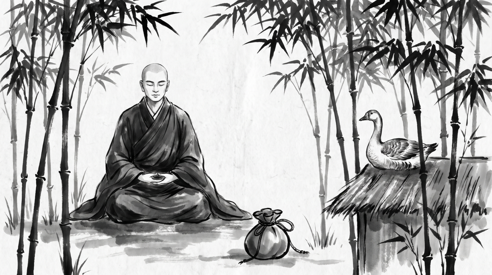

# The Golden Lake: When Greed Turns a Sustainable Asset into a Barren Loss

The morning breeze rustled through the dense bamboo grove of Veluvana, casting soft, dappled shadows across the stone meditation seat. Sudatta, a senior royal treasurer of the kingdom of Kosala, sat upon a woven reed mat with his head bowed and his hands resting heavily upon his knees. His fine woolen tunic was travel-stained, and his ledger pouch lay unfastened on the grass. The distant chants of the bhikkhus drifted softly from the monastery hall, but Sudatta's mind was consumed by the sudden collapse of the kingdom's most productive merchant guild.

Across from him sat the venerable Monk, draped in a simple kasaya robe of monastic yellow, his head clean-shaven and his countenance serene. He looked upon the treasurer with deep equanimity, offering no hollow consolations, only a steady, patient silence.

"You carry the weight of a ruined harvest, treasurer," the Monk said softly.

Sudatta lifted his head, his eyes troubled. "Master, for three years our royal treasury partnered with the guild-master of the northern copper mines. Under our agreement, his artisans delivered a steady, measured quota of refined metal every month, providing a reliable surplus for our public storehouses while leaving his miners ample time to rest and maintain their shafts. It was a flourishing arrangement that sustained our kingdom without friction."

Sudatta exhaled a long, bitter breath. "Yesterday, a junior minister urged the royal council to seize absolute control of the mines and demand the entire year's projected output in a single month to fund a grand palace pavilion. When the guild-master protested that such frantic extraction would flood the lower shafts and break the support timbers, the minister accused him of hoarding wealth and threatened to confiscate all his properties. Driven by panic and greed, the minister sent royal bailiffs to strip the mines bare overnight. The lower tunnels collapsed under the sudden weight of forced labor, water rushed into the main shafts, and today the mines are completely flooded. Our steady revenue is gone, the miners have fled into the hills, and we are left with nothing but ruined stone and empty ledgers. How does one counsel leaders who mistake steady abundance for a slow insult, and destroy their own best assets for a single handful of greed?"

## The Golden Geese in the Jataka Tales

The Monk listened with calm attention, his gaze resting upon the quiet stream flowing beside the bamboo roots.

"Your ministers have fallen into an ancient error, Sudatta," the Monk said. "In the sacred collection of the *Jataka Tales*, preserved in the traditions of the early sangha, the *Suvarna Hansa Jataka*—numbered as the one hundred and thirty-sixth birth story—relates the account of a golden bird whose blessings were squandered by impatience."

"In a previous birth, a virtuous householder died and was reborn as a golden goose endowed with supreme wisdom and radiant plumage of pure gold. He dwelt upon a serene mountain peak, but he felt deep compassion for his wife and daughters from his human life, who had been left in poverty after his passing. Knowing their desperate struggle to pay their debts and feed their household, the golden goose resolved to aid them."

"One afternoon, the majestic bird flew down from the mountain and alighted upon the roof of his former family's humble cottage. His golden feathers shimmered in the sunlight. Calling out to his astonished wife and daughters, he said: *'Do not weep for your hardships. I am your husband and father, now reborn in this golden form. Pluck one of my golden feathers and sell it in the marketplace; the proceeds will pay your debts and sustain your household in comfort for many days. Return to me whenever your needs demand it, and take what you require.'*"

"The family rejoiced greatly. From that day onward, whenever their storehouses emptied, the golden goose returned to the cottage roof, shed a single golden feather, and bade them farewell. The mother and daughters sold the feather for a generous sum of silver, and their household lived in peace and modest prosperity."

"Months passed in this harmonious manner. But as time went on, a corrosive greed took root within the mother's mind. One evening, as she sat counting her silver coins by candlelight, she muttered to her daughters: *'This golden bird comes and goes at his own pleasure. He is generous today, but what if he flies away to distant mountains and never returns? What if he grows old or loses his golden plumage? Why take only one feather at a time when we can possess all his wealth in a single hour? Let us seize him the very next time he alights, pluck every feather from his body, and secure boundless riches for all our lineage at once.'*"

"The daughters were horrified by her words. They pleaded with their mother, saying: *'Mother, do not commit such folly! The bird is our benefactor; if we pluck him by force, his golden feathers will turn to common grey plumes, and we shall destroy the very source of our fortune.'*"

"The mother, blinded by avarice, refused to listen to reason. When the golden goose returned the following afternoon and alighted upon the roof to bestow his customary gift, the woman rushed forward, seized the magnificent bird with both hands, and stripped every golden feather from his wings and body by force."

"But lo, the moment the feathers were wrenched away from his divine form, the gold vanished. The radiant plumage transformed instantly into ordinary, dull grey feathers of a common waterfowl. Furthermore, stripped of his flight feathers and weakened by the brutal assault, the golden goose could no longer lift himself into the air to return to his mountain sanctuary."

"Realizing her terrible mistake, the greedy woman locked the helpless bird in a wicker basket and fed him grain, hoping new gold would grow. But as the weeks passed, the new feathers that sprouted upon his wings were no longer pure gold; they were common, dull grey plumes like those of any ordinary pond bird. When the golden property was entirely lost, the bird regained his strength, broke free from the basket when the door was left unlatched, and flew far away to his mountain peaks, never to return."

"The family sank back into deeper poverty than before, having murdered their golden goose for a single day of greed."

## What the Golden Geese Teach

The Monk turned his serene eyes back to the treasurer.

"In every royal court, merchant guild, and administrative council, there are golden geese, Sudatta. They are the skilled craftsmen, veteran route-keepers, master scribes, and steady producers who quietly generate reliable abundance year after year. When leaders lose their discipline, they repeat the mother's fatal errors."

**1. Treating Steady Yield as a Sluggish Pace:**
The unprincipled minister looks upon a steady, sustainable harvest and feels impatient. He sees the slow, reliable accumulation of wealth as too modest for his grand ambitions: *"Why accept a measured quota each month when we can seize the entire reserve today and build our pavilion before the rainy season?"*

**2. Stripping the Asset to Its Skin:**
Driven by panic or inflated pride, leaders abandon consultation and apply brute force. They ignore support timbers, skilled warnings, and customary agreements, demanding that skilled workers surrender all their output at once: *"Compel the artisans to work day and night without rest; let them empty their vaults and break their tools to satisfy our immediate decree."*

**3. Mistaking the Source for a Storage Jar:**
The greedy administrator views people and systems as inert jars of gold that can be smashed open whenever silver is needed. He forgets that true wealth lives only in the health, trust, and vitality of the living asset: *"Once we take everything they have stored, we can simply command them to produce more by tomorrow."*

**4. Awakening to Empty Grey Feathers:**
When the pressure breaks the system, the gold vanishes. The skilled artisans flee, the shafts collapse, and the leaders are left staring at worthless rubble, wondering where the abundance went: *"The ledgers are blank, the miners have vanished into the hills, and our grand pavilion stands half-built upon a flooded pit."*

## The Monk's Counsel: Protecting the Source

Sudatta bowed his head, absorbing the deep lesson of the parable. "Master, the king's ministers are already demanding new schemes to recoup our losses. How must I act to preserve what remains of our kingdom's resources?"

The Monk raised his hand in a gesture of calm assurance.

### 1. Establish Fixed Quotas and Protect Rest
When designing agreements with producers and guilds, write explicit limits into the charter that protect their time and operating margins. Never permit ministers to demand emergency surges or uncalculated extractions: *"Set the monthly quota in writing, and seal it with the royal signet so no council member may alter it for sudden projects."*

### 2. Guard the Lower Shafts Before the Upper Vaults
True wealth resides in the health of the workers and the integrity of the tools, not in the immediate contents of the storehouse. When a project faces financial pressure, inspect the support systems and artisan reserves first: *"Before demanding new revenue, verify that the craftsmen have sufficient rest, materials, and safety margins to maintain their craft."*

### 3. Refuse the Demand for Instant Accumulation
When leaders press for immediate, overwhelming extraction under the guise of urgent public necessity, present the ledger of long-term yields. Show them that steady stewardship always outperforms violent seizure: *"Decline the sudden decree in writing, and place before the council a three-year forecast proving that forced extraction results in total barrenness."*

**Source:** Jataka Tales, Suvarna Hansa Jataka, No. 136 (UNVERIFIED)

Sudatta rose from the reed mat with a tranquil spirit and a clear mind. He folded his ledger pouch, bowed deeply to the teacher, and turned his steps back toward the capital, determined to protect the kingdom's remaining assets from the ravages of impatience and greed.

> *"Never strip the golden feathers from the goose in a single day; once the source is exhausted, the lake runs dry."*
