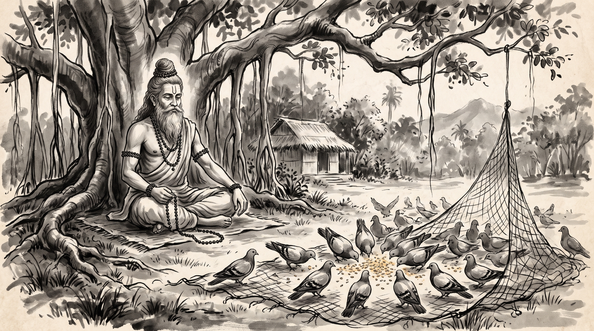

# The Pigeon and the Hunter: Collective Lift and the Trap of Divided Effort

The morning mist still clung to the roots of the ancient banyan tree outside the forest hermitage. Varuna, chief factor of the imperial guild of grain merchants, sat on a coarse reed mat with his head bowed and his shoulders heavy with defeat. His fingers traced the edge of his woolen wrap, restless and cold. Three days prior, a coordinated trade embargo imposed by rival guilds had seized all regional granaries, locking every merchant out of their reserves and threatening their entire merchant coalition with immediate bankruptcy.

Across from him sat the venerable Rishi, serene and anchored like stone. His silver beard flowed over his ascetic cotton wrap, his hair was gathered in a traditional Vedic *jata* topknot, and natural rudraksha beads rested upon his wrists. A faint line of sacred vibhuti marked his brow.

"You carry the exhaustion of men who tried to pull a heavy cart in six different directions at once, Varuna," the Rishi observed softly.

Varuna let out a strained sigh. "Master, when the embargo struck, our guild council fell into complete disarray. Instead of standing firm together, each merchant factor panicked and sought separate terms with the royal treasurers. One promised to lower grain prices unilaterally; another offered secret bribes to the inspectors; a third abandoned our shared warehouses to protect his private estate. Within forty-eight hours, the rival coalition picked us apart one by one. Our unity shattered before the negotiation even began."

"A flock that disputes the direction of flight while the net is falling will find every wing tangled in its own panic," the Rishi remarked. "Why do men who know the value of union in times of peace forget it the moment the snare touches the earth?"

Varuna looked up, his eyes burning with frustration. "How does a coalition maintain its discipline when fear whispers that salvation lies only in betrayal?"

---

## The Golden Rice and the Hunter's Net

The Rishi raised his hand toward the clearing beyond the hermitage hut, where wood doves circled in the clear sky.

"Listen to the ancient wisdom preserved in the *Panchatantra*," the sage said. "In the classic accounts of strategy, there is recorded the parable of the pigeon king Chitragriva and his flock."

"Once, high in the branches of a mighty silk-cotton tree, there lived a great king of pigeons named Chitragriva. His flock numbered in the thousands, bonded by shared flight and mutual trust in foraging across distant valleys. One morning, as Chitragriva and his flock flew over a dense forest in search of food, a young pigeon spotted vast handfuls of golden, polished rice scattered carelessly across the forest floor."

"Drawn by the glittering grain, the flock swooped downward in a eager rush, chattering with excitement at their unexpected fortune. Only Chitragriva held back, circling cautiously above the trees. He called down: *'My children, pause and consider. How can polished rice lie scattered in the deep, uninhabited forest where no cultivator dwells? This abundance is unnatural. Greed blinds the eye to the shadow of a trap.'* But the starving pigeons, intoxicated by the sight of grain, ignored their king's warning and plunged into the clearing to feed."

"The moment their claws touched the earth, a massive hempen net—spread skillfully by a local fowler who had hidden behind the brush—sprang upward, enveloping the entire flock in a tight, tangled web of cords. The fowler emerged from the thicket with a triumphant staff in hand, striding rapidly toward the trapped birds."

"Panic erupted instantly among the flock. Every pigeon beat its wings in a frantic, isolated frenzy, each pulling against its neighbor in a desperate effort to escape. They squabbled and accused one another: *'You landed too fast!'* *'Your weight triggered the cords!'* As they pulled in opposite directions, the net only tightened, cutting deeper into their feathers and dragging them closer to the ground while the fowler drew nearer."

"Seeing his flock on the brink of destruction, Chitragriva did not join the squabbling. He cried out above the chaos: *'Stop this scattered struggling! If you pull against one another, you ensure your own ruin. Our only salvation lies not in individual escape, but in collective action. When the fowler approaches, let every pigeon lift its wings at the exact same heartbeat. Let us take the net into the sky together as one wing!'*"

---

## The Power of the Synchronized Lift

"The king's words cut through the terror," the Rishi continued. "In an instant, the thousands of pigeons ceased their isolated fluttering. They held their breath, braced their feet against the meshes, and at Chitragriva's sharp cry, every wing beat downward simultaneously."

"To the astonishment of the advancing fowler, the massive net did not hold fast to the ground. Lifted by thousands of synchronized wings, the heavy hempen web rose bodily into the air, carrying the entire flock aloft like a flying carpet. They soared high above the forest canopy, bypassing the hunter's reach entirely."

"Running beneath them with his staff raised, the fowler stared upward in disbelief at the floating net of birds. He muttered to himself: *'A flock that acts as one mind is no longer prey; they have become masters of the sky.'* Realizing he could neither reach nor outrun them, the fowler abandoned the chase."

"Chitragriva led the soaring flock far across the mountains to a distant sanctuary where a trusted friend—a wise mouse named Chitranga who dwelt in the forest roots—lived. With sharp teeth crafted by nature to gnaw through stubborn knots, the little mouse severed every cord of the net. Released from their bonds, the pigeons flew free, their unity restored and their lesson indelible."

---

## What the Pigeon Flock Teaches

The Rishi turned his steady gaze back to Varuna.

"Every council chamber is a clearing strewn with golden rice, Varuna. When a rival coalition strikes, they do not defeat you with weapons alone; they bait the floor with fear, knowing that panic will make your own allies pull against you."

### 1. The Glitter of the Baited Floor
The grain in the forest was real, but the context was fatal. In your council, a rival's sudden offer of a private concession or a separate quota is always polished rice. When men see an easy escape dangled before their eyes, they forget to ask who laid the trap.

### 2. The Trap of the Isolated Pull
When the net fell, every pigeon blamed its neighbor and pulled in a separate direction. In a failing coalition, panic makes each merchant bargain for himself. The moment you pull apart, you tighten the cords around your own neck and deliver your house to the rival who set the snare.

### 3. The Power of the Single Heartbeat
Chitragriva did not ask each pigeon to untie its own knot. He commanded them to beat their wings at the exact same second. In a crisis, your guild does not need a thousand separate defenses; it needs one synchronized, unyielding response agreed upon by all houses.

### 4. The Value of the Hidden Root
Even when the net was in the air, the pigeons needed an ally outside the snare—the mouse who understood how to chew through hemp. Never rely solely on your own clan when structural bonds are broken; keep alliances with steady craftsmen and quiet clerks who know the foundational tallies of the trade.

---

## The Rishi's Counsel: Four Rules for Cohesive Strength

Varuna straightened his back, the weight in his chest lifting. "Master, how do I rebuild our merchant coalition so that no embargo can entangle us again?"

The Rishi raised four fingers.

### 1. Bind the Council by a Single Oath Before the Season Turns
Do not wait for the rival embargo to strike before you discuss unity. Before the new trade agreements are drafted, gather all merchant factors and have every house sign a single charter stating that no private terms will be accepted without the collective consent of the council. Set the agreement down in writing with every seal affixed.

### 2. Test Every Private Offer Against the Shared Ledger
When a royal syndic or rival guild offers an exclusive concession to your house alone, treat it as the hunter's rice. Bring the offer directly to the open assembly the very next morning. Show the council what was promised, and let all members inspect the bait together before greed blinds your judgment.

### 3. Practice the Synchronized Lift in Small Decisions
A flock that has never flown together will scatter when the net falls. Every week, hold a mandatory assembly where all merchant houses review shipping tallies and warehouse inventories as one body. When men are accustomed to moving in rhythm during calm days, they will not panic when the sky darkens.

### 4. Keep Ties With the Keepers of the Foundations
Just as Chitragriva relied on the mouse in the roots, ensure your guild maintains strong, quiet alliances with the master masons, clerks, and record-keepers who control the foundational tallies of the city. When the high council tries to lock your doors, the men who held the keys to the foundation will help you gnaw through the red tape.

**Source:** Panchatantra, Book 2 (Kakyolukiyam / Mitrabheda), "The Pigeon and the Hunter", locator UNVERIFIED

Varuna bowed low, his doubts dissolved into disciplined resolve. He rose from the mat, ready to gather his merchants and lift their shared house above the hunter's reach.

> *"When a net falls upon many, individual flutterings only tighten the knots; lift together with one breath, and even heavy bronze meshes rise into the open sky."*
