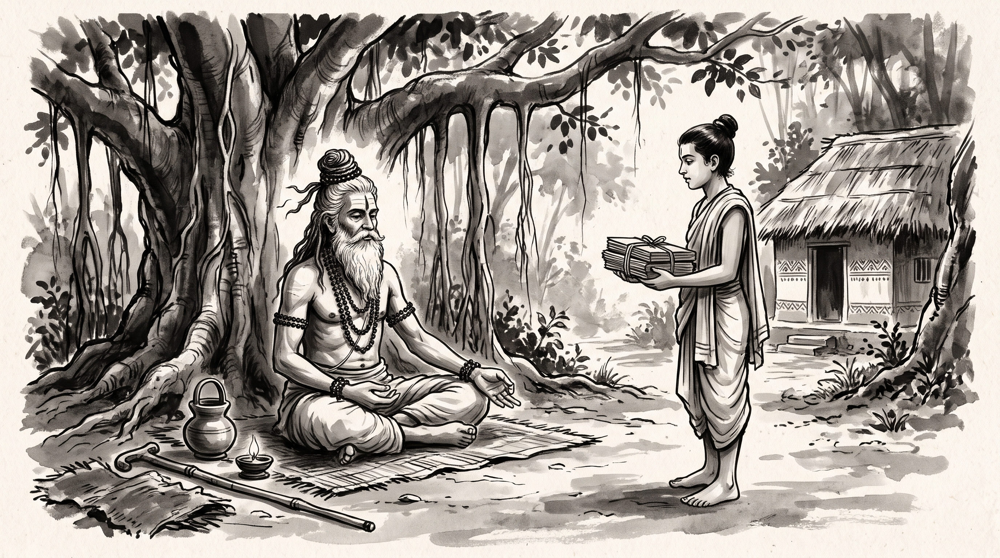

# The Twelve-Year Illusion: Stripping Away Academic Pride to Find the Root of Reality

The forest hermitage rested in the quiet embrace of the afternoon breeze. Dry leaves rustled beneath the ancient banyan tree, whose aerial roots dropped like pillars of weathered bronze into the fertile earth. Shvetaketu strode into the ashram courtyard with measured, dignified steps. He had spent twelve years at the distant university of sage Gautama, mastering the four Vedas, the auxiliary treatises, grammar, meter, and the subtle arts of royal disputation. His robes were immaculate, his speech was peppered with classical citations, and his carriage was stiff with the unyielding certainty of a young man who believed he had cataloged every truth of the cosmos.

Across from him sat his father, the venerable Rishi Uddalaka Aruni, centered and tranquil on a woven reed mat. His silver beard flowed over an ascetic cotton wrap, his matted hair was bound in a traditional Vedic *jata* topknot, and natural rudraksha beads circled his wrists. Subtle lines of sacred vibhuti traced the calm expanse of his brow.

Shvetaketu offered a formal, perfunctory bow, his chin lifted slightly. "Father, my twelve years of study are complete. I have mastered every hymn, every ritual formula, and every philosophical discourse known to the teachers of the northern realm. There is no dispute in the royal assemblies that I cannot settle, no treaty clause I cannot parse."

The Rishi looked up from his palm-leaf manuscripts, his gaze steady and unblinking. "You carry the heavy armor of memorized words, Shvetaketu, but your eyes remain clouded by the dust of your own applause."

Shvetaketu let out an impatient sigh. "Master, how can study be a burden? The king's ministers themselves consult me on matters of precedent and law. I know the exact syllables of every sacred verse and the proper sacrifices for every season. What more is there to know?"

The Rishi asked one quiet question. "Since you are so proud of your learning, my dear, did you ask for that instruction by which what is unhearable is heard, what is unperceivable is perceived, and what is unknowable is known?"

Shvetaketu frowned, hesitation flickering across his polished confidence. "What instruction is that, Father? My teachers never spoke of any such teaching."

---

## The Teaching of Uddalaka Aruni in the Chandogya Upanishad

The Rishi smiled with deep, sorrowful recognition. He gestured toward a lump of red clay resting beside a potter's wheel near the edge of the hermitage and a vessel of gold water poured into a bronze cup.

"Your teachers taught you the branches, Shvetaketu, but never showed you the root," the Rishi said gently. "In the *Chandogya Upanishad* of the Vedic tradition, in the discourse of Uddalaka Aruni, this very question was put to a proud young scholar who had studied all twelve years without knowing the foundation of reality."

"The father explained to his son through simple, tangible forms of the workshop and the earth. *'My dear,'* Aruni instructed, *'as by knowing a single lump of clay, all things made of clay are known—the difference being only a name, a word, the clay alone being real. As by knowing a single nugget of gold, all things made of gold are known—the difference being only a name, a word, the gold alone being real. As by knowing a single copper nail-clipper, all things made of iron and metal are known—the difference being only a name, a word, the metal alone being real.'* "

"Shvetaketu listened in stunned silence, his pride beginning to crack. *'Surely my revered teachers did not know this,'* he confessed, bowing his head. *'For had they known it, they would have told me. Venerable father, teach it to me.'* "

"The Rishi continued his instruction, guiding his son into deeper truths of existence. *'In the beginning, my dear, this world was Being alone, one only, without a second,'* Aruni explained. *'It thought: "May I be many, may I grow forth." It created fire. Fire thought: "May I be many, may I grow forth." It created water.'* "

"To make the invisible reality palpable, the father gave his son a practical test. *'Bring me a fruit from the banyan tree,'* Aruni commanded. Shvetaketu brought it. *'Break it open.'* The son broke it. *'What do you see there?'* *'These tiny seeds, revered sir.'* *'Break one of them open.'* *'I broke it, Father.'* *'What do you see there?'* *'Nothing at all.'* "

"The Rishi spoke the words that pierce through every layer of false scholarship: *'My dear, that subtle essence which you do not see—from that very subtle essence this great banyan tree arises. Believe me, my dear. That which is the subtle essence, this whole world has that as its Self. That is the Truth. That is the Self. That art thou, Shvetaketu—Tat Tvam Asi.'* "

"Shvetaketu sat motionless as the teachings unfolded layer by layer, realizing that memorizing the surface vocabulary of sacred texts is a pale shadow compared to grasping the root cause from which all phenomena spring."

---

## The Root and the Ledger: Recognizing Surface Scholarship

The Rishi turned his gaze from the clay vessels back to his son.

"Every royal court and merchant guild has its Shvetaketus," the sage remarked. "When a state council debates or a trade syndicate faces crisis, watch the young intellectual who arrives with memorized precedents and flawless diction. Surface scholarship operates in four familiar illusions."

### Memorizing the Syllabus Without Knowing the Substance
The young intellectual can recite every royal ordinance and tax code, yet cannot read the mood of the assembly or the quiet desperation of the craftsmen. He knows the rulebook by heart, but understands nothing of the human motivations that write the rules.

### Confusing Nomenclature with Mastery
Like the student who knows the names of all the clay pots without knowing clay, the proud official believes that naming a problem, categorizing a dispute in a ledger, or filing a formal complaint is the same as resolving it. He mistakes the label for the reality.

### The Illusion of Completeness
Because he has spent years studying the formal treatises of the capital, he assumes that whatever is not written in his scrolls does not exist. When an unprecedented crisis arises outside his textbook, his mind freezes behind rigid dogmas.

### Mistaking Accumulated Volume for Depth
He counts the number of scrolls he has memorized as a merchant counts sacks of grain, believing that bulk equals wisdom. Yet when the foundational pillar shifts, the entire structure of his arguments collapses into confusion.

---

## The Father's Counsel: Moving Beyond the Scroll

"Master," Shvetaketu asked, his voice subdued and stripped of its former arrogance. "When I return to the royal court and sit among the ministers, how do I discard the shell of mere recitation? How do I find the root of every matter?"

The Rishi held up four fingers.

### 1. Test Every Generalization Against the Ground
When a minister presents a grand policy or financial report in the council, do not accept the polished abstract terms. Ask to inspect the primary ledger, the raw tally of grain or stone, and the workers who carried the load. Touch the clay before you debate the shape of the pot.

### 2. Look for the Invisible Essence Behind the Conflict
When opposing factions clash in the assembly over taxes or boundaries, do not get lost in the fiery rhetoric of their debate. Strip away the surface accusations and find the single, silent motivation driving both sides—usually fear of scarcity or the preservation of power. Address the root cause, not the symptoms.

### 3. Strip Away Your Titles Before Entering the Assembly
Never enter a council chamber wrapped in the mantle of your degrees, lineage, or past commendations. Speak simply and directly to the facts at hand. A man who relies on his title to win an argument has already lost the truth.

### 4. Practice Humble Inquiry Daily
Set aside one hour each evening to review what you assumed you knew with absolute certainty, and test it against a dissenting view. True wisdom begins precisely where intellectual pride ends; when you admit what you do not know, the path to understanding opens.

**Source:** Chandogya Upanishad, Chapter 6 (UNVERIFIED)

Shvetaketu bowed low, placing his palms together. The proud scholar had vanished; in his place sat an attentive seeker ready to learn the true essence of the world.

> *"He who studies all the sacred texts yet knows not the subtle root from which they grow is like a blind man reciting the colors of a flower he has never touched."*
