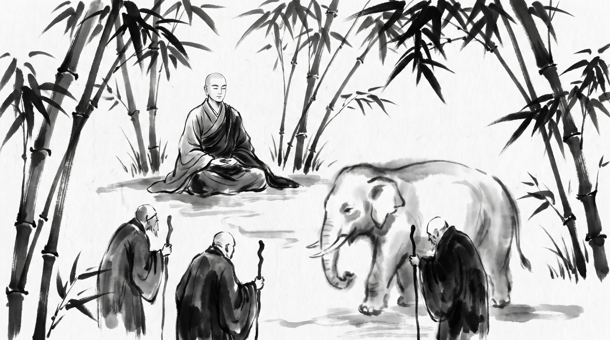

# The Blind Men and the Elephant: When Partial Perspectives Dress as Absolute Truth

The bamboo grove stood silent and cool under the afternoon sun, filtering golden rays across the packed earth. Upasaka, a senior royal assessor of the taxation bureaus of Kapilavastu, sat upon a woven reed mat before the serene Monk. His brow was furrowed with deep frustration, his fingers nervously tracing the edge of his wooden writing tablet.

"Master, the royal council is tearing itself apart over the assessment of the western trade provinces," Upasaka said, his voice taut with indignation. "Yesterday, during the treasury audit, five senior ministers examined the ledgers and reports from the frontier. Yet each minister inspected only one narrow ledger roll—one looked solely at grain stockpiles, another at copper mines, a third at textile tariffs, a fourth at caravan tolls, and the fifth at pasture taxes. Upon returning to the great assembly hall, each minister stood before the King and swore upon the sacred seals that his isolated finding was the absolute truth of the entire kingdom's economy. When the grain assessor declared that the realm was overflowing with wealth, the copper assessor shouted him down, claiming the treasury was hollow. They argued with such blind fury that the council ended in chaos, and the King remains paralyzed by their conflicting certainties. How can a ruler discern truth when every official mistakes a single fragment for the whole realm?"

The Monk opened his calm eyes, gazing steadily at the trembling stylus in the assessor's hand before answering.

## The Parable of the Blind Men in the Udana

"Your affliction is common to courts where men mistake a narrow vantage for total vision, Upasaka," the Monk said gently. "In the sacred teachings preserved in the *Udana*, the Blessed One once addressed this very delusion with the parable of the royal elephant and the blind men of Savatthi."

"In those days, a sovereign ruler of great curiosity commanded his royal ministers to gather all the men born blind within the city," the Monk related, his voice steady and rhythmic. "When the blind men were brought before the palace gates, the King ordered his grooms to lead forth a magnificent royal elephant and place the men around it."

"To one blind man the King presented the elephant's head, to another the tusk, to another the trunk, to another the ear, to another the body, to another the foot, to another the tail, and to another the tuft of the tail. Each man was permitted to touch and grasp his assigned portion."

"When the grooms withdrew the elephant, the King asked each blind man what the creature was like. The man who had touched the head declared that an elephant was nothing more than a vast water-pot. The man who had touched the tusk swore it was a sharp plowshare. The man who had touched the trunk insisted it was a stout plow-pole. The man who had touched the ear maintained it was a woven winnowing fan. The man who had touched the body declared it a massive granary. The man who had touched the foot swore it was an immovable stone pillar. The man who had touched the tail claimed it was a stout rope, and the man who had touched the tuft argued it was a coarse brush."

"Unable to agree on what they had touched, the blind men fell to shouting and striking one another with their fists, each utterly convinced that his partial touch was the sole truth of the creature, and that all others were fools or liars. The King watched from his high balcony and laughed at how men who perceive only a fragment will wage war for the whole."

## The Teaching on Fragmented Observation in Council Chambers

"The disputes in your council chambers follow this exact pattern, Upasaka," the Monk continued, his voice clear as a mountain stream.

**The Fallacy of the Single Ledger:** When an official inspects only one register of accounts—whether grain, copper, or tariffs—and treats it as the entirety of the realm's condition, he is like the man who grasps the elephant's tusk and pronounces the beast a weapon of war. He lacks the breadth to see the whole beast.

**The Wrath of Partial Certainty:** The more ignorant a minister is of the surrounding departments, the louder and more absolute is his assertion in the assembly. He shouts down his peers not because his data is sound, but because doubt would shatter his illusion of mastery.

**The Paralysis of the Throne:** When opposing ministers present conflicting fragments as absolute truths, the sovereign is left in darkness. Without a master builder to assemble the parts, the council becomes a marketplace of blind strife.

## The Counsel of the Master

Upasaka bowed his head, asking what counsel the Master offered to restore order to the royal assembly.

### 1. Compel the Ministers to Exchange Ledgers

Before permitting any debate in the royal council, command every minister to physically inspect three departments outside his own specialty for seven days. Force the grain assessor to sit in the copper mines and the tariff master to examine the pastures, ensuring no man speaks from a single point of touch.

### 2. Require a Unified Register Before Debate

Prohibit officials from presenting isolated fragments to the throne. Issue a royal decree that all departmental scrolls must be stitched into a single comprehensive scroll bearing the seals of all five ministers before any policy is debated. If the seals do not match, send the council back to harmonize their findings.

### 3. Reward the Synthesis of Parts over Loud Assertion

In the assembly, strip honor from the official who shouts the loudest about his narrow domain. Elevate the quiet counselor who maps the relationships between grain, metal, and trade, rewarding those who illuminate the whole creature rather than brandishing a single tusk.

**Source:** Udana, Udana 6.4 (UNVERIFIED)

Upasaka rose from the rush mat, his spirit steadied by the Master's words, ready to bring light to the dark council chambers of Kapilavastu.

> *"When a man touches only the tusk and proclaims the whole beast, the council chamber becomes a marketplace of blind assertions."*
