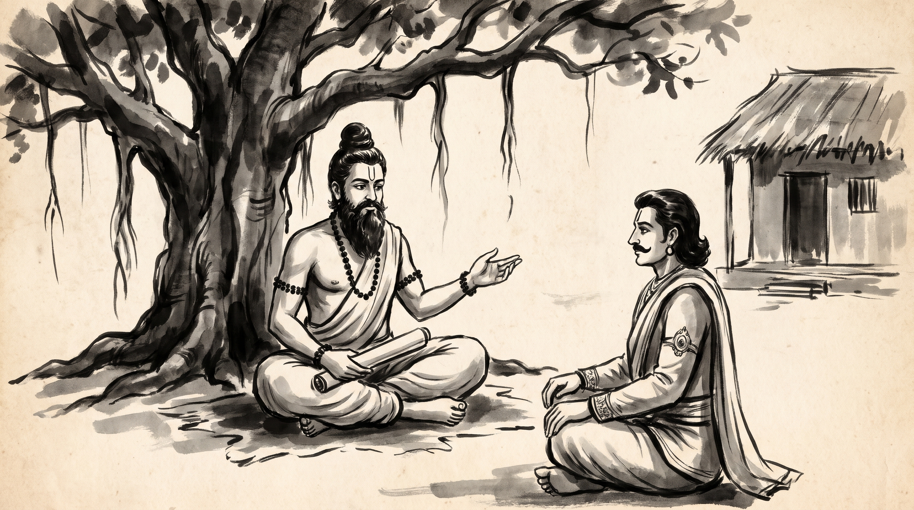

# The Unbending Counselor: Speaking Hard Truths to a Ruler Blinded by Affection

The afternoon sun cast long shadows across the stone floor of the forest hermitage, where the ancient banyan tree spread its protective canopy. Devadatta, master of the royal grain stores, sat upon a woven mat, his hands trembling slightly as he folded his cotton uttariya. His brow was furrowed with the heavy dread of a man who carried a message no ruler wished to hear.

Across from him sat the venerable Rishi, serene and unshakeable. His silver beard rested gently against his chest, his hair was bound in a traditional Vedic jata topknot, and natural rudraksha beads adorned his wrists. A subtle touch of vibhuti marked his calm forehead, untouched by the turmoil of kingdoms and courts.

"You carry the bitter realization of a steward who tried to warn the king of empty granaries, only to be accused of sowing panic," the Rishi observed quietly, his voice carrying the calm resonance of flowing water.

Devadatta let out a ragged breath. "Master, how does a counselor speak the unvarnished truth when the sovereign is utterly blinded by affection for his own kin? Every ledger I presented showed that the royal princes are draining the regional storehouses to fund their private faction. Yet when I laid the tallies before King Dhritarashtra, he turned his sightless gaze away, accusing me of harboring malice against his sons. He prefers sweet falsehoods that confirm his desires over the harsh reality that empties the realm."

The Rishi closed his eyes for a moment, listening to the rustle of leaves in the canopy above. "A ruler who closes his ears to unpleasant truths does not seek counsel; he seeks an echo for his own blind affection."

---

## Vidura's Counsel in the Udyoga Parva

The Rishi raised his hand toward the clearing where the forest wind stirred the dust. "Your burden is ancient, Devadatta. In the great epic of the *Mahabharata*, within the council deliberations recorded in the *Udyoga Parva*, this exact trial fell upon the wise minister Vidura."

"The kingdom of Hastinapura stood upon the precipice of ruin. Prince Duryodhana and his brothers had usurped the royal authority, driven the righteous Pandavas into exile, and filled the imperial court with sycophants who fed the blind King Dhritarashtra a steady diet of flattery and false assurance. Everyone in the assembly whispered of the impending war, but none dared speak the truth to the sovereign."

"Vidura, born of a humble lineage but elevated by supreme wisdom to the highest seat of counsel, knew that his duty to the throne superseded the king's fleeting comfort. He entered the inner chambers where Dhritarashtra sat surrounded by flattering courtiers."

"With unyielding courage, Vidura stood before the blind king and laid bare the bitter reality: *'O King, affection for your reckless sons has clouded your judgment. You reward those who whisper pleasant lies and silence those who point to the burning roof. If you do not restrain Duryodhana and restore justice to the Pandavas, the entire lineage of Kuru will be reduced to ash upon the plains.'*"

"Dhritarashtra winced, stung by the truth, but his blind paternal affection flared into anger. Bound by his weakness, the king rejected the counsel, rebuked Vidura for his bluntness, and cast him out of the inner circle."

"Yet Vidura did not retreat into bitter silence," the Rishi continued. "He understood that a counselor's integrity is measured not by whether the ruler accepts the truth, but by whether the truth is delivered without dilution."

---

## The Anatomy of the Blind Ruler's Court

The Rishi leaned forward, his gaze piercing. "Every council, guild, and merchant syndicate has its Dhritarashtras—leaders who are blinded by personal affection, ambition, or stubborn pride. When you attempt to bring hard truths to such a ruler, four distinct patterns inevitably unfold."

### 1. The Preference for Flattering Falsehoods
A ruler blinded by affection will always surround himself with ministers who tell him what he wishes to hear. When you present the actual ledgers of decline or the true cost of a failing strategy, he perceives your accuracy as hostility because it disrupts his comforting illusion.

### 2. The Rejection of the Messenger
When the truth cannot be refuted by logic, the court attacks the bearer of the message. The blind ruler allows sycophants to question your loyalty, your motives, or your temperament, shifting the debate from the crisis at hand to your alleged insubordination.

### 3. The Isolation of the Honest Voice
As the pressure mounts, the sovereign retreats further into his inner circle of flatterers, cutting off access to independent counsel. The honest minister finds himself frozen out of councils where decisions are finalized.

### 4. The Inevitable Reckoning of Unchecked Ruin
Because the warning was dismissed, the disaster that Vidura foresaw comes to pass unchecked. The kingdom falls, not because truth was absent, but because the ruler chose affection over reality until the walls collapsed.

---

## The Discipline of Unyielding Truth: The Rishi's Counsel

Devadatta bowed his head, absorbing the gravity of the lesson. "Master, how does a minister fulfill his duty when his sovereign refuses to listen?"

The Rishi raised four fingers, outlining the discipline of honest counsel.

### 1. Deliver the Truth Entire and Uncompromised
Never dilute a hard truth to make it palatable to a ruler who fears reality. State the facts clearly, record them in writing, and leave no room for ambiguity. Your obligation is the integrity of the message, not the comfort of the recipient.

### 2. Separate Your Duty from the Outcome
A true counselor does not tie his self-worth to whether the ruler obeys his word. Once the warning is delivered with dignity and clarity, your responsibility to the council is fulfilled. Let the consequences rest where they belong.

### 3. Maintain an Independent Record of All Warnings
When a blind ruler rejects sound counsel and later faces ruin, sycophants will attempt to rewrite history and blame the administration. Always keep a sealed, witnessed ledger of every warning issued, ensuring your record remains stainless.

### 4. Stand Firm Against the Tide of Sycophancy
Never join the chorus of flatterers out of self-preservation. Even if your voice is temporarily silenced or your station challenged, the preservation of ultimate truth outlasts any single court or temporary sovereign.

**Source:** Mahabharata, Udyoga Parva (UNVERIFIED)

Devadatta rose slowly from the reed mat, his shoulders squared with a quiet, unshakeable resolve. The fear of royal displeasure had vanished, replaced by the steady assurance of a steward who knew that truth is the only true foundation of a lasting realm.

> *"Speak the unvarnished truth to power without fear or favor; a ruler blinded by affection may reject the warning today, but his crown will fall tomorrow if the counselor softens his tongue."*