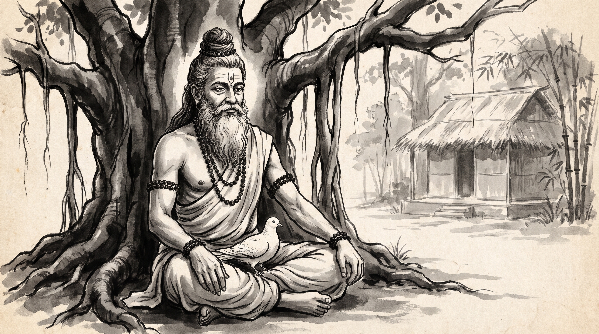

# The Shelter of the Oath: Protecting a Dependent at Personal Cost

The courtyard of the royal assembly hall in Indraprastha echoed with the heavy murmurs of ministers debating a delicate petition. Devadatta, the senior royal treasurer, stood before the council table, his hands resting upon a ledger bound in stiff parchment. His brow was furrowed with the strain of a man caught between state expedience and personal honor. A fugitive merchant, fleeing the wrath of a regional overlord, had sought asylum within the royal granaries, and turning him away would mean certain death.

Across the cedar-paneled chamber sat the venerable Rishi, visiting sage to the court. His silver beard flowed with quiet dignity, his hair was gathered in a traditional Vedic jata topknot, and natural rudraksha beads rested upon his shoulders. A subtle touch of vibhuti marked his calm forehead, untouched by the political turbulence swirling around the ministers.

"You weigh the cost of a refugee against the favor of an alliance, yet the ledger of conscience records a different currency," the Rishi observed calmly, his voice cutting through the whispered debates of the councilors.

Devadatta looked up, his voice strained. "Master, how does a leader honor a solemn pledge of protection when powerful allies demand surrender?"

---

## The Parable of King Sibi and the Refugee Dove

In the ancient epic accounts of the Mahabharata, specifically within the Vana Parva under the narrative of Sibi Charitra, the renowned monarch King Sibi sat upon his judgment throne in the northern capital. Without warning, a terrified white dove plummeted from the upper air, seeking frantic refuge within the folds of the king's royal garments, trembling and pleading for protection against a merciless hunter.

Moments later, a golden hawk swept down upon the terrace, landing with measured poise. The hawk spoke with the articulate voice of divine law, demanding the return of its rightful prey. "O King," the hawk declared, "this bird is my destined sustenance provided by the cosmic order. By shielding it, you starve me and disrupt the natural balance."

King Sibi listened with unwavering resolve. He acknowledged the hawk's hunger, yet anchored himself to a higher moral duty: the absolute sanctity of asylum once granted to the helpless. "This dove came to me seeking shelter," Sibi replied. "My oath binds me to protect any living creature that places its trust in my hands. I will not break this trust, even if my own life is forfeit."

The hawk pressed the king further, proposing a test of equity. "If your oath is absolute, then measure out the dove's weight in flesh from your own body, and let the balance satisfy my hunger."

Without hesitation, King Sibi placed the trembling dove upon one pan of the golden scales in the royal treasury, and carved flesh from his own thigh to place upon the other. Yet, no matter how much flesh the king added, the scale bearing the dove remained stubbornly heavier. At last, stepping entirely onto the scale himself, Sibi offered his whole being to fulfill the covenant. Moved by this supreme sacrifice, the gods revealed themselves, restoring the king's form and praising his unyielding adherence to duty.

---

## The Architecture of Protecting Dependents

The ancient encounter between King Sibi, the dove, and the hawk reveals enduring patterns of council politics and leadership accountability.

### 1. The Covenant of Asylum
When a vulnerable petitioner or guild member seeks shelter within your department from political retaliation, the initial impulse is often to calculate political fallout. In-world, the king did not interrogate how the dove arrived or who might be offended; the act of sanctuary superseded convenience. When a subordinate trusts your protection, transactional calculus must yield to moral duty. A leader might state: "Our department protects its own before negotiating terms."

### 2. The Articulation of Competing Claims
The hawk arrived with a polished, logical argument rooted in natural law and survival. In royal councils, pressure to sacrifice a subordinate is often dressed up as state necessity, compliance, or structural survival. Leaders frequently face polished emissaries demanding concessions. The counter-move is to hold the line on foundational ethics rather than debating tactical excuses. A leader might state: "We will find another path to revenue, but we will not trade our people."

### 3. The Scale of Personal Cost
True protection of dependents carries a tangible weight. Sibi did not offer surrogate weights; he offered his own flesh. In statecraft and treasury administration, shielding a team from unjust royal pressure often costs political capital, favor, or promotional velocity. If you are not willing to absorb friction on behalf of those who trusted your leadership, protection remains an empty promise. A leader might state: "Charge the deficit to my account, not the guild's."

---

## The Counsel

Devadatta bowed his head, absorbing the weight of the parable. "Master, how shall I answer the overlord's emissary tomorrow?"

### 1. Seal the Sanctuary First
Before engaging in negotiations with aggressive petitioners, formally document and secure the status of the protected individual within official records. In-world, Sibi folded the dove into his garments before speaking a word to the hawk. Ensure administrative shelter is absolute before debate begins.

### 2. Refuse Proxy Negotiations
When powerful external parties demand the sacrifice of a vulnerable contributor, do not delegate the refusal to intermediaries. Stand personally accountable for the protection policy, absorbing the initial shock of displeasure.

### 3. Hold the Balance Steady
When the pressure mounts and concessions are demanded, measure your own political capital against the survival of your people rather than compromising their security for short-term peace.

**Source:** Mahabharata, Vana Parva, Sibi Charitra (UNVERIFIED)

King Sibi stepped away from the scale with a body marked by sacrifice yet a spirit untouched by compromise, knowing that an oath honored at personal cost becomes the foundation of lasting trust.

> *"A king measures his throne not by the territory he commands, but by the weight of the helpless he protects within his robe."*
