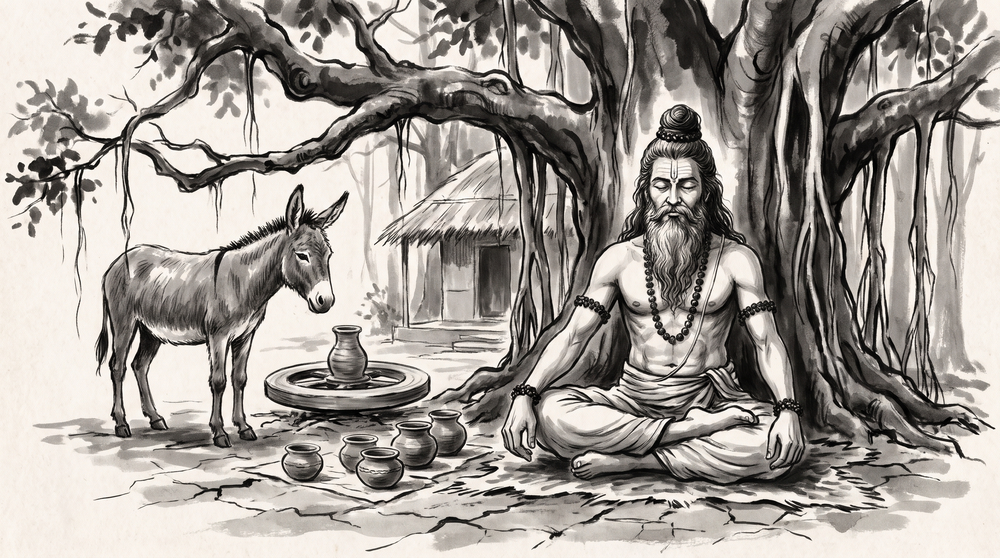

# The Mask of Authority: Imitating Leadership Without Substance

The courtyard of the guild hall in Pataliputra echoed with the clatter of raw clay and the anxious murmurs of junior artisans. Varada, the master potter and chief guild treasurer, stood beside his polishing bench, his brow furrowed with deep frustration. Several young apprentices had begun wearing the formal saffron robes and adopting the solemn silence of senior councilors during guild assemblies, yet when tested on glaze proportions or kiln temperatures, their vessels cracked and faulted. They believed that mimicking the outward posture of seniority bestowed the mastery of the craft, leaving the treasury burdened with defective work and eroded trust.

Beneath the spreading canopy of an ancient banyan tree at the edge of the hermitage grounds sat the venerable Rishi. His silver beard flowed with quiet dignity, his hair was gathered in a traditional Vedic jata topknot, and natural rudraksha beads rested upon his shoulders. A subtle touch of vibhuti marked his calm forehead, untouched by the administrative turbulence of the guild.

"You lament that mirrors reflect the form but never acquire the fire, yet imitation without mastery is merely a garment waiting to be torn," the Rishi observed calmly, his voice carrying over the rustle of banyan leaves.

Varada bowed slightly, his hands resting on his ledger. "Master, how does a leader cure those who mistake the trappings of authority for the substance of competence?"

---

## The Parable of the Potter and the Ass

In the classical wisdom tales of the Panchatantra, specifically within Book 3 concerning tactical deception and alliance, a humble potter of a northern village maintained a hard-working ass to carry heavy loads of wet clay and finished earthenware from the riverbank to the kiln yards. Day after day, the beast labored under crushing weights across dusty paths, enduring the relentless sun and meager rations.

Seeking to lighten the animal's burden and protect it from retaliatory beatings when it wandered into nearby barley fields to graze, the potter hit upon a cunning scheme. He skinned a dead tiger that had been found near the forest border and draped the tawny, striped hide over the donkey's back, securing it tightly with leather cords. 

When twilight fell and the disguised donkey wandered into the villagers' fenced fields, the watchful farmers and night guards caught sight of the striped shape in the gloom. Terrified and deceived by the outward markings of the fearsome beast, the guards fled in panic without daring to raise a club, leaving the entire harvest open to the animal's grazing. The donkey feasted undisturbed night after night, secure in the illusion of its borrowed majesty.

One moonlit night, however, as the disguised ass grazed deep within a barley patch, another animal across the valley let out a loud, resonant bray. Hearing the call of its own kind, the donkey forgot its disguise and the peril of exposure. It lifted its head and let loose a harsh, grating bray of its own. The watchmen, hearing the unmistakable sound rather than the roar of a predator, rushed forward with heavy wooden clubs and struck the animal down.

---

## The Mechanics of Imitating Authority

The ancient account of the potter's beast and its fleeting disguise lays bare enduring patterns of council politics and council posturing.

### 1. The Surface Vestment
Junior contributors often observe senior councilors and assume that authority resides in vocabulary, posture, or title rather than operational depth. In-world, the donkey wore the tiger's pelt with complete visual conviction, deceiving every casual observer in the dark. Adopting the style of leadership without mastering the underlying craft creates a fragile facade that shatters the moment scrutiny arrives. A leader might state: "Do not adopt the language of strategy until you have balanced the ledger."

### 2. The Illusion of Impunity
Protected by outward symbols, mediocre actors often venture into high-stakes negotiations or complex technical reviews where their lack of substance goes momentarily unchallenged. Just as the village guards fled from the silhouette in the twilight, peers and sponsors may initially yield space to a loud title or borrowed methodology. However, this impunity lasts only until an unexpected test forces a genuine response. A leader might state: "A borrowed title grants passage through the gate, but the toll is paid in competence."

### 3. The Unchecked Impulse
The ultimate vulnerability of the imitator is the inability to restrain instinctive habits when pressed. The donkey could not resist braying when it heard its kin, betraying its true identity through its own voice. In administrative councils, when an unseasoned operator attempts to manage a crisis using rehearsed clichés instead of reasoned judgment, their superficial understanding inevitably becomes glaringly obvious. A leader might state: "When the debate deepens, your true measure speaks louder than your title."

---

## The Counsel

Varada bowed his head, absorbing the weight of the parable. "Master, how shall I guide these apprentices tomorrow?"

### 1. Test the Craft Before the Title
Before granting junior artisans greater responsibilities or ceremonial duties in council, require them to demonstrate practical mastery over core operational tasks without the trappings of rank.

### 2. Strip Away the Borrowed Posture
When an operator relies on rhetoric rather than results, halt the discussion and demand specific, verifiable metrics from their department rather than accepting polished summaries.

### 3. Establish Substance Over Display
Reward tangible craftsmanship and reliable execution in guild reviews, ensuring that structural competence is recognized as the only valid path to advancement.

**Source:** Panchatantra, Book 3 (UNVERIFIED)

Varada walked back from the hermitage with a steady step, knowing that true authority is forged in the silent discipline of the craft, not draped upon the shoulders in imitation.

> *"He who wears the skin of a beast without its strength invites the club the moment he speaks."*
