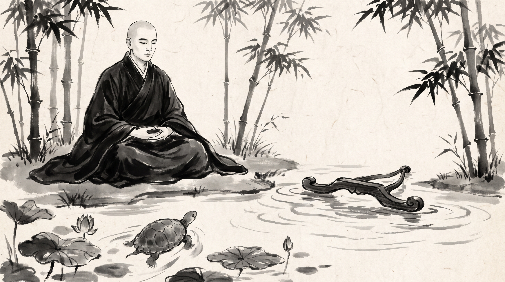

# The Drifting Yoke: Recognizing Once-in-a-Generation Strategic Openings

The morning mist clung heavily to the stone steps of the monastery courtyard, wrapping the tall bamboo stalks in a pale, damp shroud. Mahasena, a senior harbor master of the royal port of Rajagaha, sat upon a low wooden bench with his head bowed and his merchant seal pouch clutched tightly in his palms. His travel-stained linen tunic bore the salt spray of the eastern coast, and his breathing was shallow with agitation. For three days, a rare royal decree had been posted at the harbor gates, offering a profound stewardship over the western maritime trade routes—an unprecedented appointment that would elevate a trustworthy official above all merchant guilds. Yet Mahasena had spent those three days deliberating, weighing petty procedural objections and consulting minor harbor clerks, until the closing seal on the registry was nearly upon him.

Across from him sat the venerable Monk, draped in a simple kasaya robe of muted ochre, his head clean-shaven and his gaze fixed upon a shallow stone basin where autumn leaves drifted on clear water. The Monk offered no immediate comfort, maintaining a steady, patient stillness that quieted the rustle of the bamboo leaves.

"You carry the hesitation of a man who believes the ocean has no end and shores appear at every stroke," the Monk said softly.

Mahasena raised his gaze, his eyes shadowed with regret. "Master, the royal council offered me the grand trade stewardship on the full moon. It was an appointment granted once in a generation, conferring authority over every merchant vessel entering our waters. Yet I hesitated. I told myself that such an immense responsibility required further preparation, that I should wait until the spring audits were completed and the junior inspectors approved the transfer. While I debated minor ledgers with the harbor scribes, another junior minister stepped forward, accepted the seal without demur, and secured the post. Now the harbor gates are sealed, the registry is closed, and I realize the opportunity has vanished into the deep currents of the realm. Why is it that men blessed with years of experience fail to recognize when a rare door swings open for a single breath?"

## The Blind Turtle in the Majjhima Nikaya

The Monk listened with calm attention, his hand resting gently upon the folds of his monastic robe.

"Your hesitation arises from mistaking an infinite ocean for an endless succession of favorable tides, Mahasena," the Monk said. "In the sacred discourse of the *Majjhima Nikaya*, recorded within the teachings of the *Bala-Pandita Sutta*, numbered as the one hundred and twenty-ninth discourse, the Blessed One expounded upon the extreme rarity of attaining a precious opportunity in the cycle of existence."

"The Buddha spoke of a vast cosmic ocean stretching across the four quarters of the earth, fathomless and boundless. Within this great expanse, suppose there dwelt a blind turtle—a creature whose eyes have never beheld the light of day, swimming blindly through the dark, cold depths. This blind turtle rises to the surface of the boundless ocean only once every hundred years."

"Upon the crest of the waves, driven by unpredictable gales and shifting currents, floats a single yoke with a single small aperture just large enough for the neck of a turtle to pass through. The winds toss the golden yoke across the boundless waters, north and south, east and west, never resting in one place."

"The Blessed One asked the assembled disciples: *'Tell me, monks, would that blind turtle, rising to the surface once in a hundred years, thrust its neck through the single aperture of that floating yoke?'* "

"The disciples answered with reverence: *'That would be a wondrous occurrence, Lord. Only after a very long time, through sheer coincidence across countless ages, might such a thing happen.'* "

"The Buddha declared: *'More rapid still, more certain still, is the return of a foolish person to lower states after squandering a rare condition of high responsibility. Yet even more difficult to encounter than the blind turtle assembly the floating yoke is the arrival of a rare opening that demands immediate, resolute action.'* "

## The Mechanics of Opportunity in the Assembly

The Monk watched the ripples settle across the stone basin, the grey water reflecting the tall bamboo stems without distortion.

"The ancient parable of the blind turtle reveals four unyielding truths about rare moments of responsibility and advancement in the councils of rulers," the Monk said.

The first pattern is the illusion of boundless time. In the deep ocean, the turtle swims through darkness, believing the water is everywhere and time has no boundary. In the courts and harbors of kingdoms, officials imagine that administrative positions, leadership seals, and stewardship roles are like fish in the sea—abundant, patient, and perpetually waiting for a leisurely hand to reach out and claim them.

The second pattern is the shifting current of circumstance. The golden yoke does not wait at anchor; it is driven by winds and tides beyond any single man command. When a royal mandate or a council vacancy opens, external forces propel it across the political waters. Those who wait for perfect calm or complete consensus find that the currents have carried the opportunity far beyond their reach.

The third pattern is the narrow aperture of readiness. The opening in the floating yoke is small and precise. A cautious official who approaches with hesitation, trailing superfluous conditions and redundant consultations, fails to align with the narrow channel. Only a prompt, decisive movement allows one to pass through the opening before the waves shift.

The fourth pattern is the permanence of the closed registry. Once the turtle descends back into the dark depths without finding the yoke, the surface remains empty. In the administrative assemblies of the realm, when a rare appointment is filled by another, the ledger is sealed, the royal decree is signed, and those who hesitated are left standing on the shore with their ledgers unopened.

## The Guidance of the Master

Mahasena bowed his head lower, his fingers loosening their grip upon his empty pouch. "Master, how does an official in the assemblies of power recognize the floating yoke when the waters are turbulent?"

The Monk looked upon him with steady equanimity and offered three rules of conduct.

### 1. Inspect the Royal Seal before the Assembly Convenes
When a rare administrative mandate or leadership stewardship is announced by the royal council, do not wait for complete consensus among junior scribes or auxiliary ministers. Examine the terms of the appointment immediately, verify your own qualifications against the core duties, and prepare your acceptance in writing before the public assembly sits to debate.

### 2. Seize the Aperture Without Secondary Consultation
When an opening appears in the hierarchy, set aside redundant consultations and procedural delays. A golden yoke carried by the wind does not pause for secondary committees. Present your readiness directly to the presiding arbiter with calm resolve, ensuring your petition is delivered while the opening is directly overhead.

### 3. Archive the Lost Tide and Guard the Remaining Waters
If the currents shift and another official secures the stewardship before your petition is heard, do not linger on the shore lamenting the missed moment. Accept the closure of the ledger with unshakeable equanimity, secure your current post with renewed diligence, and maintain your vigilance so that when the next rare tide rises, your preparations are absolute.

**Source:** Majjhima Nikaya, Bala-Pandita Sutta, MN 129 (UNVERIFIED)

Mahasena rose slowly from the wooden bench, his linen tunic smooth once more, and bowed with deep reverence to the Master before turning back toward the quiet paths of the monastery.

> *"A blind turtle surfaces once in a hundred ages to find the golden yoke; when the current carries the opening to your neck, do not wait for a second wave."*
