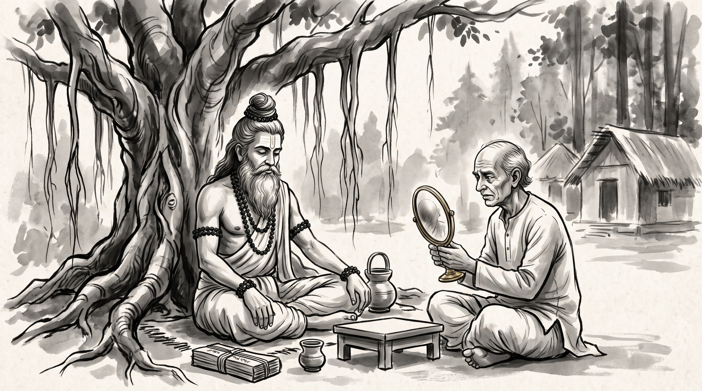

# The Bald Merchant: The Peril of Trying to Please Conflicting Factions

The afternoon sun cast long shadows across the stone courtyard of the forest hermitage. Somadatta, a senior royal treasurer responsible for allocating the imperial grain reserves, sat upon a woven mat before the Rishi's leaf-thatched hut. His fingers nervously stroked his thinning hair, and his face bore the exhausted lines of a man caught between two relentless masters.

Across from him sat the Rishi, serene and steady beneath the banyan canopy. His long grey beard rested upon his cotton wrap, his hair was bound in a traditional Vedic *jata* topknot, and rudraksha beads circled his wrists. The sage regarded Somadatta with quiet patience.

"You wear the frantic look of a man attempting to walk in two opposite directions at once, Somadatta," the Rishi observed.

Somadatta let out a heavy sigh. "Master, my post as royal treasurer has become a living penance. We serve two powerful factions in the capital: the Southern Maritime Syndicate, which demands that every grain surplus be shipped immediately to foreign ports for silver, and the Northern Landholders Guild, which insists that all reserves remain in royal granaries to feed the interior. Every morning the syndic chiefs arrive at my hall demanding one policy; every evening the guild elders counter with the exact opposite."

"And how do you respond?" the Rishi asked softly.

"In my cowardice, I try to please them both," Somadatta confessed, his voice dropping to a whisper. "When I am with the southerners, I promise to lower export tariffs. When I sit with the northern elders, I swear to lock the granary gates. I adjust my words to match whoever sits across my desk. Yet now, both factions despise me. They see me as treacherous and spineless, and my treasury council is falling apart around me. How can a man survive when the masters he serves demand mutually exclusive devoirs?"

---

## The Fable of the Merchant and His Two Wives

The Rishi smiled with gentle understanding, his eyes reflecting the flickering shadows of the leaves. 

"Your predicament is as old as the royal courts of Ayodhya and Hastinapura, Somadatta," the Rishi said. "In the *Panchatantra*, Pandit Vishnu Sharma records the parable of the foolish merchant who thought he could satisfy two opposing households."

"In a bustling provincial town, there lived a merchant of middle years who had accumulated modest wealth. Being ambitious for domestic tranquility, he took two wives. The first was a young woman of twenty summers who loved luxury, youthful fashion, and lively assemblies. The second was a mature woman of forty years who valued steady tradition, sober frugality, and quiet dignity."

"The merchant lived in a perpetual dilemma. When he stayed in the upper chambers with his young wife, she wrinkled her nose at his advancing age and the silver threads beginning to show in his hair. 'You look like an elder uncle when I wish for a companion of my own vigor,' she would scold, tugging playfully yet firmly at his beard and hair."

"When he descended to the lower chambers to dwell with his senior wife, she sighed at his attempts to dress in youthful silks. 'You make a fool of yourself trying to court the fashions of boys,' she would declare, shaking her head and plucking out any dark hairs she found remaining among his locks to align him with her own mature dignity."

"For months, the merchant submitted to both women, eager to avoid conflict in either chamber. Whenever the young wife complained of his maturity, she pulled out his white hairs so he might appear young. Whenever the senior wife complained of his vanity, she pulled out his dark hairs so he might appear sober. Each wife believed she was shaping him to her own ideal."

"At last, the merchant walked to the polished brass mirror in his hallway and looked upon his reflection. Between the two women, every hair upon his head had been plucked away. He was entirely bald, his scalp bruised and tender, mocked by the very households he had bent over backward to please."

---

## The Pattern of Divided Allegiance

The Rishi leaned forward, resting his hands upon his knees. 

"The merchant lost his hair not because his wives were wicked, Somadatta, but because he believed a man could serve two contradictory demands without losing his own foundation. When you try to be everything to conflicting factions, you do not bridge the gap—you become the ground upon which they fight."

### 1. The Trap of Mutable Promises
The merchant gave each wife permission to alter him. In statecraft, when a minister tells the southern merchants one thing and the northern guild another, he hands them the tweezers. A leader who changes his posture with every visitor ceases to be an authority and becomes a mirror reflecting whoever stands closest.

### 2. The Illusion of Perpetual Peace
The merchant believed that avoiding an immediate argument today would buy peace tomorrow. But appeasing mutually exclusive demands does not postpone conflict; it concentrates it. Every concession made to one faction is treated as a betrayal by the other, doubling your enemies while stripping away your allies.

### 3. The Loss of the Core Self
When you spend all your energy managing the perceptions of opposing masters, your own judgment is the first thing plucked away. By the time the merchant looked in the mirror, nothing of his true self remained. A leader without a firm baseline is soon governed entirely by the whims of those he sought to appease.

---

## The Rishi's Counsel: Holding the Center

Somadatta bowed his head, the weight of the parable settling upon his shoulders. "Master, how does a treasurer hold the treasury when the two halves of the realm pull in opposite directions?"

The Rishi raised three fingers.

### 1. Publish the Ledger in the Open Assembly
Do not negotiate in private chambers where each faction can extract contradictory promises. Bring the grain registers and the royal tax limits into the central courtyard before the council of elders. Let both the Southern Syndicate and the Northern Guild look upon the exact same numbers at the exact same time. When the constraints are visible to all, neither can demand the impossible without exposing their unreason to their peers.

### 2. State Your Mandate, Not Your Desires
When a faction demands that you bend the rules to favor their trade, do not argue with them or offer polite excuses that invite debate. State the royal charter clearly: *'The granary is bound by imperial decree to preserve three seasons of reserve for the entire realm.'* A fixed law cannot be cajoled, whereas a nervous minister can be badgered into submission.

### 3. Accept the Discontent of One
You cannot serve two opposing masters without failing at least one. Choose the enduring stability of the realm over the temporary applause of either faction. Let the discontented grumble; a firm administrator who survives with his head intact is infinitely more valuable to the kingdom than a compliant pleaser who ends up bald and broken.

**Source:** Panchatantra, Book 1 (UNVERIFIED)

Somadatta stood up, his posture straighter than when he arrived. The frantic pulse in his temples had quieted, replaced by the steady resolve of a man who would no longer let others pluck away his judgment.

> *"Do not let conflicting factions pluck away your principles strand by strand in the pursuit of peace; hold fast to your mandate, publish the truth in the open assembly, and let the baleful desire for universal favor fall away."*
