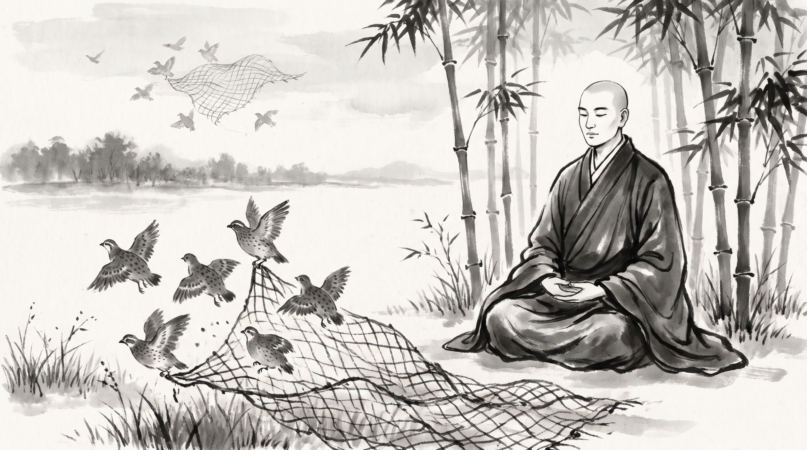

# The United Quail: Defeating the Fowler Through Peer Solidarity

The morning mist still clung to the bamboo stalks surrounding the forest hermitage when Upasena, a junior monastic supervisor responsible for coordinating the alms-collecting rounds across distant village territories, approached the senior teacher. His shoulders were bowed, and his face showed the acute strain of a man whose traveling brotherhood was fracturing under external pressure. He knelt upon the woven mat, placing his palms together in respectful greeting.

The monk sat motionless beneath the jade-green canopy, his shorn head bare to the cool air, draped in saffron-hued monastic robes without adornment. His breathing was calm, anchored in the stillness of the grove. He regarded Upasena with steady, compassionate eyes.

"You carry the weight of a divided camp, Upasena," the monk observed softly. "Your mind is troubled not by the length of the journey, but by the friction among those walking beside you."

Upasena sighed, his gaze fixed on the earth. "Master, our brotherhood of monks has grown fragile. When we travel through the agrarian valleys, local landlords and rival guilds attempt to divide us by offering alms to one faction while turning others away. Some brothers grow envious, suspecting their peers of currying private favor. Petty rivalries over station and provisions have taken root among us. Yesterday, two senior monks refused to share their shelter provisions with the visiting mendicants from the eastern hills. If our brotherhood cannot stand together against these petty divisions, the patrons will easily scatter us, and our community will dissolve from within."

"A flock that quarrels over grain while the hunter stands at the edge of the clearing is already caught," the monk replied, his voice even and unhurried.

---

## The Fable of the Quail and the Fowler

The monk adjusted his robes, his eyes reflecting the soft light filtering through the bamboo leaves. 

"In the sacred lore of the *Jataka Tales*, specifically the *Vattaka Jataka*, the Bodhisattva once took birth as the king of a great flock of quails living in the forest," the monk recounted. "Numbered by the thousands, the birds lived in harmony, foraging together across the harvested fields and returning safely to the thickets at dusk."

"Noticing the immense profit to be gained, a crafty fowler came to the region. He learned the call of the quail to absolute perfection. Hiding himself behind a screen of branches, he imitated the whistle of the mother bird, luring the flocks out into the open stubble fields. Eager to reach the perceived call, the quails flew down into the grass where the fowler had cast a broad, heavy hemp net over them. Trapped beneath the dark meshes, thousands of quails fluttered in panic, each pulling in a different direction while the fowler rushed forward with his wicker basket."

"Seeing the flock on the verge of destruction, the wise king of the quails raised his voice above the confusion. 'Listen, my brothers and sisters,' he cried out. 'We struggle in vain while each pulls alone. When the fowler casts his net upon us, let us no longer fight as isolated birds. When the signal is given, every quail must put its head through a mesh of the net, and together we must lift the net upward as one body. If we fly upward in unison, we can carry the net straight to the thornbushes at the edge of the forest and drop it over the branches, freeing ourselves to fly away.'"

"The flock grasped the wisdom instantly. The next time the fowler cast his net and rushed upon them with his ropes, the king gave the signal. Thousands of quails thrust their heads through the meshes, braced their wings, and heaved upward with a single, coordinated thrust. The heavy net rose into the air like a great grey cloud, carrying the entire flock aloft. They flew swiftly toward the forest boundary, dropped the net over the sharp thorns of a wild jujube tree, and escaped cleanly into the safety of the deep woods."

"The fowler stood bewildered beneath the tree, staring up at the empty sky while his net remained hopelessly snagged upon the thorns. The village elders gathered round to mock his failure. For days, the united quails repeated this feat, lifting the net and escaping every trap the fowler laid, until the frustrated fowler abandoned his craft in despair."

"Yet, the tale records a warning for the future. One evening, after a successful escape, two quails landing upon the feeding ground accidentally brushed against one another in haste. One turned angrily and snapped, 'Who pushed me into the dust?' The other retorted with sharp pride, 'Did I carry the weight of the net alone while you lagged behind?' Words turned to accusations, and the flock began to divide into competing cliques, glaring across the grass. Observing this internal discord, the wise king warned his followers: 'When discord enters the flock, the net will soon reclaim its power over us.' Within days, the quails forgot their unity, pulled apart in rival directions when the next net fell, and the fowler captured them with ease."

---

## The Pattern of Divided Allegiance

The monk raised his hand gently, gesturing to the bamboo stems swaying in unison outside the shelter.

"The fowler did not conquer the quails with his own strength, Upasena; he conquered them by waiting for their unity to fray," the monk said. "In every council, guild, and monastery, the external pressure is merely the net; the true danger is the internal friction that makes joint action impossible."

### 1. The Illusion of Isolated Survival
When pressure mounts from rival patrons or competing sanghas, members often panic and attempt to negotiate their own safety independently. Just as individual quails fluttering under the net only tangle themselves further, brothers who abandon peer solidarity in a crisis invite the very defeat they seek to avoid.

### 2. The Weaponization of Petty Grievances
External rivals do not need to break your gates if they can first stir up minor slights among peers. A dispute over seating at council, distribution of alms bowls, or recognition for a journey report acts like the quarrel upon the feeding ground—it blinds the community to the descending net.

### 3. The Power of Synchronized Lifting
No single monk or junior supervisor possesses the individual strength to lift the heavy burdens placed upon a traveling brotherhood by demanding lords. Only when peers coordinate their efforts, align their routes, and lift the administrative load in unison can the entire assembly clear the obstacle.

---

## The Monk's Counsel: Binding the Flock Together

Upasena listened intently, his knuckles unclenching as the lesson settled into his mind. "Master, how shall I lead my traveling brothers when external pressures tempt each man to look only after his own provisions?"

The monk raised three fingers, his touch light against his knee.

### 1. Establish a Common Signal Before the Net Falls
Do not wait until the crisis is upon your brotherhood to coordinate. Convene a weekly gathering of peers where every member reports upcoming route bottlenecks and shares travel schedules openly. Open communication prevents the net from taking you unawares.

### 2. Refuse to Argue Over Minor Slips in the Field
When a peer accidentally oversteps or delays a journey during a high-pressure trek, do not turn the incident into a public grievance or retaliate with petty complaints. Remember that internal friction is the fowler's true harvest.

### 3. Share the Weight Across All Ranks Equally
When a heavy administrative burden or royal audit descends upon your unit, distribute the labor transparently among all capable hands rather than loading the burden onto the newest novices. A collective lift requires every participant to put their head to the mesh.

**Source:** Jataka Tales, Vattaka Jataka, No. 35 (UNVERIFIED)

Upasena bowed low, touching his forehead to the cool stone floor. The anxiety that had clouded his eyes was gone, replaced by the calm, resolute posture of a leader prepared to hold his brotherhood in unbreakable unity.

> *"Do not let minor rivalries divide your peers when the heavy net falls; lift the burden together as one flock, or be caught separately in the dust."*
