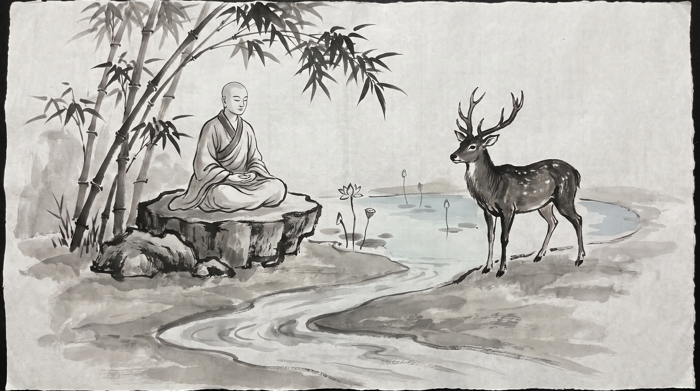

# The Forest King's Covenant: Leadership Sacrifice Under Threat

The bamboo grove near the mountain monastery rested in the quiet embrace of the afternoon breeze. Stalks swayed in gentle harmony, casting long shadows across the smooth stones. Sona, a senior caravan leader of the northern trade route, sat upon a flat meditation rock with his head bowed and his hands resting tightly on his knees. His face carried the deep fatigue of a man who had borne the safety of fifty merchant families through treacherous passes, only to find dissent brewing among his own deputies.

Across from him sat the venerable Monk, draped in simple kasaya robes over one shoulder. His head was clean-shaven, and his expression was as steady and calm as the unruffled pond beside them.

"You carry the burden of a protector who believes his sacrifice went unseen, Sona," the Monk observed softly.

Sona looked up, his voice strained. "Master, our caravan was trapped in the upper valley by winter snows and marauding bandits. Supplies dwindled, and panic gripped the younger team leaders. They demanded that we surrender half our stores and abandon the slower burden-bearers to appease the raiders. When I refused, offering my own horse and personal provisions to feed the vulnerable first, they accused me of weakness and threatened to split the caravan. They said my leadership was putting everyone at risk."

Sona clenched his fists against his knees. "I stood alone to shield the weakest among us, but my own people resented the cost. How can a leader protect a team that turns against the very shield held over them?"

"And what question do you bring to this grove?" the master asked.

"How does a leader bear the burden of unconditional protection when those protected do not yet see the peril from which they are being guarded?"

---

## The Sacrifice of the Golden Stag

In ancient times, the Bodhisattva was born as a magnificent golden stag, gleaming like burnished gold with eyes like jewels and horns of silver. He was king of a great herd of five hundred deer living in the royal forest, protected by a compassionate king who had granted sanctuary to the beasts. Alongside him lived his cousin, the branch-eared stag, who also led a herd of five hundred deer.

One day, the king of the country, fond of venison, went out with his huntsmen and surrounded the forest, driving the deer toward a great banyan tree where he could shoot them as they fled. To prevent a wholesale slaughter of the herds, the Golden Stag approached the king and struck a covenant: every day, by rotation, one deer from the herds would voluntarily present itself at the royal kitchen so the rest could live in peace.

Day after day, a deer went willingly to the royal kitchen. In time, the lot fell upon a pregnant doe in the herd of the branch-eared stag. Distressed, she begged her lord to spare her until her fawn was born, but the branch-eared stag refused harshly, telling her that death comes to all and her turn had come.

Weeping, she went to the Golden Stag and pleaded her case. The Golden Stag listened with deep compassion, saying, "Go in peace, sister; I will take your place upon the block."

The Golden Stag walked to the royal kitchen and laid his noble head upon the execution stone. When the royal cook arrived, astonished to find the golden king of the deer instead of an ordinary beast, he ran to inform the king.

The king hurried to the spot, looked upon the golden stag, and asked in wonder, "O king of stags, did I not grant safety to your herd? Why have you come here to die?"

The Golden Stag replied, "O monarch, a pregnant doe came to me in terror, pleading for her unborn life. Because her leader refused her, I took her place, that justice and mercy might not perish from the forest."

Moved to the depth of his soul by such supreme nobility, the king lowered his bow and declared, "Even among men, I have never seen such righteousness. Rise, golden king; I grant safety not only to you, but to every creature in all forests."

The Golden Stag bowed, secured the safety of his entire herd, and returned to the forest grove.

---

## The Patterns of Leadership Under Threat

The Monk noted several patterns revealed by the story, pointing to how protection operates within councils, guilds, and caravans.

- **The Burden of the Sovereign Shield**: When danger closes in, panic causes those within the caravan to demand short-term compromises that sacrifice their most vulnerable peers.
- **The Failure of Second-Tier Leadership**: The branch-eared stag represents deputies who manage processes but lack empathy for the human cost, viewing team members as mere numbers on a ledger.
- **The Ultimate Substitution**: True leadership does not pass the cost of crisis downward; the leader steps into the breach, absorbing the pressure so the guild survives intact.

---

## Counsel for the Caravan Leader

Sona asked what he should do when his own deputies resisted protection, and the teacher answered.

### 1. Set the Tally in Writing Before the Council Sits
Do not negotiate safety in the heat of panic. Before the next assembly of caravan leaders, write down every supply allocation, route contingency, and protection protocol on a palm leaf scroll. Have both senior deputies review and seal it with their own signet before the crisis peaks.

### 2. Absorb the First Blow Without Retaliation
When deputies question your protective measures out of fear, do not answer with anger or authoritarian decrees. State the cost of abandoning the vulnerable clearly once, then hold your ground like a stone pillar against the river current.

### 3. Establish a Transparent Rotation of Hardship
If sacrifice must be shared during lean seasons, ensure the burden begins at the top. When the team sees the leader taking the hardest watch and the lightest rations first, manufactured dissent dissolves into quiet respect.

**Source:** Jataka Tales, Nyagrodhamiga Jataka, No. 12 (UNVERIFIED)

Sona bowed his head, the turbulent knot in his chest loosening into quiet resolve. He touched his palms together in silent reverence and walked back toward the mountain trail to lead his people through the mountain pass.

> *"The golden stag lays his head upon the stone, not for glory, but that the herd may cross the valley unharmed when the winter frost thaws."*
