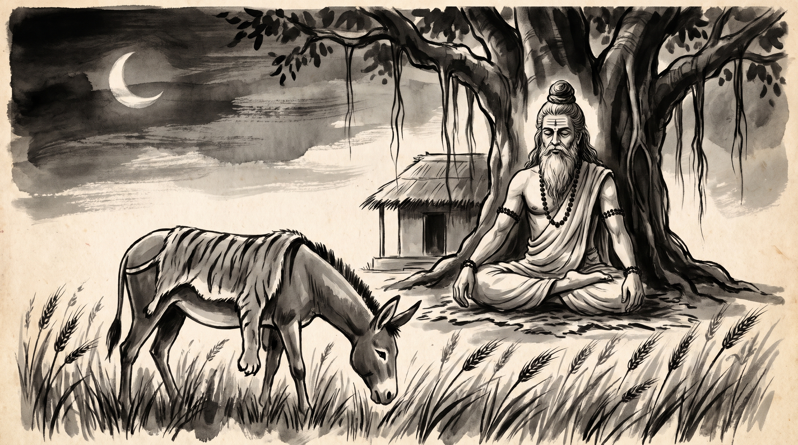

# The Disguised Beast: Superficial Imitation and False Authority

The morning mist still clung to the banyan roots surrounding the forest ashram when Devadatta, a royal treasurer responsible for overseeing the imperial storehouses and grain ledgers, approached the venerable Rishi. His posture was stiff, and his eyes carried the restless anxiety of a man who had staked his reputation on a subordinate whose brilliance was entirely hollow. He knelt upon the woven reed mat, placing his palms together in respectful greeting.

The Rishi sat motionless beneath the ancient canopy, his silver beard resting against an ascetic cotton dhoti, his matted hair gathered in a traditional Vedic *jata* topknot, and natural rudraksha beads circling his wrists. Subtle lines of vibhuti traced the calm expanse of his brow. He regarded the treasurer with steady, compassionate eyes.

"You carry the dread of an impending exposure, Devadatta," the Rishi observed softly. "Your mind is troubled not by the treasury accounts, but by the fear that the mask you praised will be stripped away before the council."

Devadatta let out a heavy breath, his gaze fixed on the earth. "Master, during the recent reorganization of the royal mint, I elevated a junior clerk named Bhadra to oversee the regional tax collectors. Bhadra wrapped himself in grand vestments, spoke in deep, authoritative tones, and adopted the majestic bearing of a senior imperial commissioner. Impressed by his imposing appearance and confident swagger, I assigned him to lead the high-stakes negotiations with the western merchant guilds. For months, his outward prestige cowed the guild leaders into compliance."

The treasurer's hands clenched against his knees. "Yesterday, however, during a tense council audit regarding grain tariffs, a disgruntled provincial merchant challenged Bhadra's complex fiscal formulas. Instead of offering a reasoned defense, Bhadra panicked, lost his composure, and blurted out a crude, braying cry of frustration that echoed through the stone hall. In that single moment, the entire assembly realized he understood nothing of statecraft or accounting; his authority was nothing more than theatrical costume. Now the council is demanding an investigation into my judgment. How does one protect an enterprise from the collapse of superficial authority?"

"A beast does not become a lion merely because it wears a pelt," the Rishi replied, his voice even and unhurried.

---

## The Fable of the Ass in the Lion's Skin

The Rishi adjusted his ascetic wrap, his eyes reflecting the soft light filtering through the leaves. 

"In the sacred lore of the *Panchatantra*, in the foundational book of *Labdhapranasham*—Loss of Gained Advantage—there is preserved the timeless parable of the Potter's Ass," the Rishi recounted. "In a small village near the Yamuna river, there lived a potter who owned a hardworking donkey. Day after day, the poor animal carried heavy loads of clay and pots across the dusty tracks until its ribs showed through its grey coat and its spirit was worn thin by labor."

"One evening, as the potter returned from the kilns, he found a dead hunter's lion skin discarded near the forest edge. A clever thought flashed through the potter's mind. He picked up the tawny pelt, carried it home, and draped it carefully over his donkey's back, securing it with hemp cords. 'With this disguise,' the potter chuckled, 'no one will dare touch my grain when the animal grazes in the royal barley fields at night.'"

"Night after night, the donkey wandered into the lush barley fields belonging to the surrounding villagers, draped in the fearsome lion skin. Whenever the watchmen caught sight of the tawny silhouette moving through the moonlight, trembling with terror, they fled instantly into their huts, daring not to utter a word or raise a stick. The donkey feasted to its heart's content on the tender green shoots, growing sleek and bold upon stolen grain."

"One night, emboldened by his unchecked success and swelling with arrogance, the donkey began to strut through the village square. But as luck would have it, a local watchman, hiding behind a mud wall with a heavily muffled head and a thick woolen blanket draped over his shoulders, caught sight of the strange shape. Mistaking the beast for a real predator, the watchman panicked, drew his bow with a notched arrow, and held his breath."

"Yet, as the watchman peered closer through the dark, he noticed something deeply amiss. The creature was not moving like a forest lord; its ears twitched awkwardly, and its posture lacked any royal dignity. Hoping to test his suspicion without risking a direct strike, the watchman crouched low and made a harsh, guttural sound."

"Startled by the noise, the donkey forgot its disguise entirely. Imagining itself challenged by a rival beast, the donkey threw back its head, opened its jaws wide, and let loose a loud, discordant, agonizingly familiar bray—*Hee-haw! Hee-haw!*—that rattled across the mud walls of the village."

"In an instant, the illusion shattered. The watchman dropped his bow, seized a heavy wooden cudgel, and rushed forward shouting to the villagers. 'It is only a foolish donkey wrapped in a skin!' The villagers poured out from their homes with clubs and staves, beating the impostor mercilessly until it fled back to the potter's shed in disgrace, its borrowed majesty stripped away forever."

---

## The Pattern of Hollow Authority

The Rishi raised his hand gently, gesturing to the banyan roots grounding the hermitage floor.

"The donkey did not fall because the watchman struck him, Devadatta; he fell because his own voice betrayed his nature," the Rishi said. "In every council, mint, and merchant guild, false authority collapses the moment it is forced to speak under pressure."

### 1. The Power of Visual Imposture
An impostor relies entirely on outward display—costumes, titles, imposing postures, and borrowed jargon—to cow observers into uncritical submission. Just as villagers fled from the silhouette of a lion skin without inspecting the creature underneath, men often bow to superficial prestige simply because it is wrapped in an authoritative package.

### 2. The Trap of Unchecked Overreach
When superficial authority goes unchallenged for too long, the impostor mistakes the fear of others for genuine competence. They strut openly into arenas requiring rigorous analysis, believing their disguise is impenetrable, thus walking directly into the trap where their limitations will be exposed.

### 3. The Inevitable Sound of Exposure
No amount of theatrical staging can alter a creature's intrinsic nature. When challenged by unexpected questions or sudden audits, the impostor cannot produce reasoned argument; they resort to defensive posturing or emotional outbursts that reveal their emptiness to the entire assembly.

---

## The Rishi's Counsel: Stripping the False Pelt

Devadatta listened intently, his knuckles unclenching as the lesson settled into his mind. "Master, how shall I evaluate my subordinates and officers so that I am never again deceived by a borrowed skin?"

The Rishi raised three fingers, his touch light against his knee.

### 1. Test Every Subordinate Under Pressure Before Granting Authority
Do not assign high-stakes negotiations or treasury audits to officers whose competence rests solely on their polished demeanor. Before entrusting an agent with public representation, subject their proposals to rigorous, unannounced peer review and technical cross-examination.

### 2. Inspect the Substance Behind the Title
When a subordinate presents complex plans or financial projections, demand to see the underlying ledgers, calculations, and step-by-step methodology. An authentic expert explains the mechanics clearly; an impostor hides behind vague generalizations and impressive titles.

### 3. Establish Clear Audits That Require Substance, Not Display
Institute regular council reviews where officers must defend their decisions using empirical data and verifiable results rather than rhetorical flair. When the environment rewards substance over theatrical display, false pelts fall away before disasters occur.

**Source:** Panchatantra, Book 4 (Labdhapranasham) (UNVERIFIED)

Devadatta bowed low, touching his forehead to the cool stone floor. The anxiety that had clouded his eyes was gone, replaced by the calm, resolute posture of an administrator prepared to govern with clear-eyed realism.

> *"Do not mistake a borrowed pelt for royal power; when the audit bell tolls, the braying voice will always betray the beast beneath the skin."*
