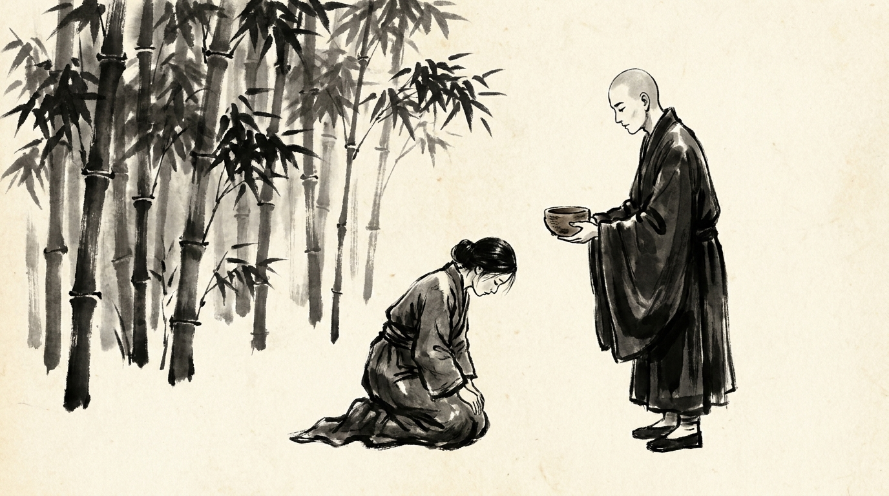

# The Mustard Seed of Reality: Accepting Universal Grief When Personal Loss Blinds Judgment

The bamboo grove swayed softly in the evening breeze, casting delicate patterns of light and shadow upon the packed earth. Upasena, a senior royal trade administrator responsible for overseeing the northern grain reserves and mercantile contracts, sat cross-legged on a woven rush mat. His shoulders were bowed, not from physical exhaustion, but from the crushing weight of personal grief and blinded judgment. His weathered hands gripped his knees as he looked across at the serene Monk seated in quiet contemplation.

"Master, personal tragedy has clouded my judgment and paralyzed our entire department," Upasena murmured, his voice tight with anguish and exhaustion. "Last month, during the height of the winter harvest, my youngest child fell victim to a sudden fever and perished within days. My mind shattered under the weight of this unique catastrophe. Unable to accept the finality of death, I neglected the grain storehouse audits, ignored urgent dispatches from the regional tax collectors, and lashed out at every official who tried to remind me of my administrative duties. I became convinced that the heavens had singled me out for an unendurable injustice."

"Now," Upasena continued, shaking his head bitterly, "my obsession with this singular tragedy has infected the entire ministry. Because I abandoned my oversight, corrupt subordinate scribes have falsified ledger tallies, diverted emergency rations into private hands, and left the capital's storehouses critically depleted. The royal council is demanding an immediate inquiry into my negligence, and I find myself unable to face the council or restore order. How does one break free from the blinding grip of personal grief when the entire realm suffers for one's blindness?"

"Sorrow is not an island visited only by the unfortunate; it is the shore upon which every human life breaks," the Monk replied, his voice even and unhurried.

---

## The Parable of Kisa Gotami and the Mustard Seed

The Monk adjusted his draped monastic robe, his eyes reflecting the soft light filtering through the bamboo leaves. 

"In the sacred commentary of the *Dhammapada*, in the foundational teachings preserved in the *Dhammapada Atthakatha*, there is recorded the profound account of Kisa Gotami," the Monk recounted. "In a bustling merchant city of ancient India, a young mother named Kisa Gotami suffered the unimaginable loss of her only child. Unable to comprehend the finality of death, she cradled the lifeless infant in her arms, wandering frantically from house to house through the dusty streets, begging every stranger and merchant for medicine to revive her child."

"Some thought her mad; others turned away in silent pity. At last, a wise elder directed her to the Buddha, who sat beneath the cool shade of a grove. Kisa Gotami fell at the Buddha's feet and implored him to restore her child. The Blessed One looked upon her with infinite compassion and said: 'Go, daughter, bring me a handful of mustard seed from a house where no death has ever visited.' Filled with desperate hope, Kisa Gotami seized upon the condition. She ran from door to door through the city gates, knocking on every noble estate and humble cottage, asking for mustard seed from any household untouched by grief."

"Everywhere she went, the answer was the same. One household had lost a father, another a daughter, a third a loyal servant or a beloved brother. As the afternoon sun waned, Kisa Gotami sat by the roadside, watching the flickering lights of the city lamps extinguish one by one into the gathering dark. She realized that the lives of men flicker and go out just like those lamps, and that the law of death is universal, touching every single family without exception. Returning the lifeless child to the charnel grove, she released her exclusive grief, returned to the Teacher, and attained profound inner peace."

---

## The Patterns of Grief and Blind Judgment

The Monk regarded the troubled administrator with steady, compassionate eyes.

### 1. The Isolation of Exclusive Suffering
When personal tragedy or crisis strikes, leaders often retreat into the illusion that their suffering is entirely unique, separating them from the community. In the ancient council or the marketplace, this isolation breeds negligence, causing leaders to abandon their immediate responsibilities and inward tallies while expecting the world to halt for their pain. The seeker must recognize that suffering is universal, not a singular curse.

### 2. The Futile Search for an Exception
Kisa Gotami searched frantically for a home untouched by death, exhausting her spirit on an impossible quest. In administrative disputes and crises, leaders often waste precious weeks searching for extraordinary loopholes, blaming external injustices, or waiting for a miraculous restoration of past conditions. The seeker must abandon the quest for exceptions and confront the stark reality of present conditions.

### 3. The Release of Exclusive Attachment
Only when Kisa Gotami witnessed the universal presence of death across every household did her frantic denial give way to clarity and acceptance. In leadership and governance, holding onto a grievance, a lost asset, or a personal slight paralyzes decision-making. The seeker must release exclusive attachment to what was lost in order to govern what remains.

---

## The Counsel

Upasena bowed his head, his hands trembling slightly. "What must I do tomorrow when I face the royal council and my neglected ledgers?"

### 1. Audit the Ledger of Reality Without Illusions
Summon your senior scribes at dawn, lay open every damaged grain ledger upon the chamber table without concealment, and tally the exact shortfall caused by your absence. Face the deficit directly instead of hiding behind excuses of grief.

### 2. Issue a Public Decree of Shared Accountability
Convene the regional tax collectors and regional officers before the midday bell. Acknowledge your failure openly, restore transparent reporting lines, and establish a clear, unyielding schedule for inventory verification across every storehouse.

### 3. Establish Immutable Ratios for Emergency Reserves
Draft a strict administrative ordinance mandating that ten percent of all incoming grain reserves be sealed in iron-bound chests for emergency distribution, removing discretionary access by junior clerks and ensuring communal resilience against future shocks.

**Source:** Dhammapada Commentary, Dhammapada Atthakatha (UNVERIFIED)

Upasena rose from the mat, his spine straightened and his breath steady, the heavy fog of exclusive sorrow having yielded at last to the clear light of duty.

> *"A single mustard seed of truth shatters a mountain of illusion when the heart confronts the universal flood of sorrow."*
