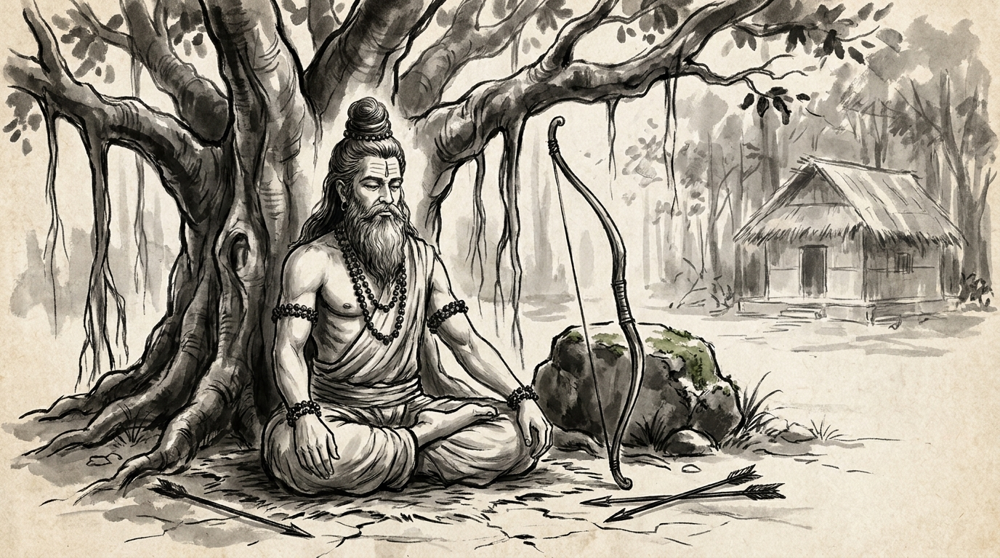

# The Bed of Arrows: When Loyalty to a Flawed Compact Binds the General

The forest hermitage rested in the quiet embrace of the afternoon breeze. Dry leaves rustled beneath the ancient banyan tree, whose aerial roots dropped like pillars of weathered bronze into the fertile earth. Satyaketu, a veteran commander of the imperial guard, sat upon a woven reed mat with his head lowered and his jaw tightly set. His eyes burned with the stinging disbelief of a man who had not been defeated by an opposing army, but paralyzed by an oath he had sworn to a compromised sovereign.

Across from him sat the venerable Rishi, centered and tranquil. His silver beard flowed over an ascetic cotton wrap, his matted hair was bound in a traditional Vedic *jata* topknot, and natural rudraksha beads circled his wrists. Subtle lines of sacred vibhuti traced the calm expanse of his brow.

"You carry the heavy silence of a warrior who fought valiantly for a collapsing hall because his vow forbade him from questioning the king," the Rishi remarked softly.

Satyaketu let out a ragged breath. "Master, our imperial army has been shattered upon the plains of Kurukshetra. For decades, I watched crown princes corrupt the royal assembly, usurp lands, and silence righteous ministers. Yet, because I swore an oath of absolute fealty to the throne of Hastinapura in my youth, I obeyed every command. When the war began, I took my place at the vanguard, defending leaders whose injustice I despised in my heart. I believed that honor meant standing by the compact until the final trumpet blew, no matter how rotten the core became."

Satyaketu's fists tightened against his knees. "Yesterday, upon the battlefield, I was struck down not by a superior tactician, but by the sheer weight of my own complicity. My armor was pierced by arrows from every direction, and as I lay upon the ground, I realized that my unquestioning loyalty had merely prolonged a tyranny. How does a soldier honor an oath when the throne itself has betrayed the law?"

"And what did you do as the arrows struck?" the sage asked quietly.

"I accepted the bed of iron shafts," Satyaketu said, his voice trembling with bitter clarity. "I lay upon the bed I helped build through my silence, watching the kingdom burn because I could not separate the throne of the king from the character of the man."

---

## The Great Patriarch on the Bed of Arrows

The Rishi smiled with deep, sorrowful recognition. He raised his hand and gestured toward the tranquil river flowing beyond the hermitage hut, where the current moved steadily over smooth stones.

"Your burden is ancient, Satyaketu, and it was borne by the greatest patriarch of our lineage. In the *Mahabharata* of Sage Vyasa, within the *Bhishma Parva*, is recorded the fate of Devavrata—known to all worlds as Bhishma, the grandsire of the Kurus."

"Bhishma was born of royal blood and blessed with the boon of choosing his own hour of death. In his youth, to secure his father's happiness, he took a fierce and terrible vow: he swore to renounce the crown, remain celibate for life, and serve as the eternal protector of the throne of Hastinapura, whoever might sit upon it."

"That oath was magnificent in its sacrifice," the Rishi continued, his voice steady and resonant. "For decades, Bhishma sustained the empire. He trained princes, commanded armies, and kept the realm stable through sheer force of duty. But as the decades turned, the throne passed to weak and corrupt rulers—first Dhritarashtra, blinded by partiality, and then Duryodhana, consumed by arrogance and unlawful ambition."

"When Duryodhana humiliated Queen Draupadi in the royal assembly, stripping her dignity before the gathered elders, Bhishma sat in the hall. He knew the law. He knew the act was monstrous. Yet, when Draupadi looked to the grandsire for justice, Bhishma lowered his head and spoke words that shattered his own moral authority: *'The course of morality is subtle; I cannot answer your question openly.'* Because his oath bound him to defend the physical seat of power regardless of who occupied it, he chose institutional survival over moral truth."

"Day after day on the field of Kurukshetra, the grandsire led the Kaurava host," the Rishi said. "He fought with peerless skill, knowing full well that his side represented unrighteousness. He protected Duryodhana's ambition while his heart bled for the Pandavas. At last, on the tenth day of battle, the prince Shikhandi was placed before him in the chariot of Arjuna. Knowing Shikhandi's past, Bhishma lowered his weapons. He refused to fight a warrior he deemed unworthy of combat, allowing Arjuna's arrows to pierce his armor."

"As Bhishma fell, his body did not touch the earth. He came to rest upon a couch of sharp iron arrows—a bed woven entirely from the weapons he had permitted, defended, and endured through decades of unbending obedience to a flawed compact."

---

## The Architecture of the Flawed Vow

The Rishi turned his gaze from the river to the commander.

"Every royal court has its Bhishmas, Satyaketu. When an institution loses its moral compass, it relies entirely upon honorable men to maintain its facade. The trap closes in four distinct moves, and you walked through every one of them."

### 1. Swearing Fealty to the Seat, Not the Law
You swore allegiance to the seat of the king rather than the foundational law of righteousness. When a compact demands that you defend injustice simply because it sits upon the royal throne, your oath ceases to be an act of honor and becomes an instrument of tyranny.

### 2. The Silence of Seniority
When the elders in the assembly witness wrongdoing and remain silent out of respect for tradition, their silence acts as sanction. The junior officers look to the general; if the general does not speak against corruption, the entire camp assumes corruption has received royal approval.

### 3. Cumulative Complicity
Every compromise accepted for the sake of 'stability' adds another shaft to the bed. A warrior does not fall upon a couch of arrows all at once; he lies down upon one compromise each season until the weight of accumulated silence leaves him completely immobilized.

### 4. The Illusion of Irreplaceable Duty
You believed that if you stepped away from the vanguard, the realm would instantly dissolve. The flawed compact always convinces the dutiful man that his personal sacrifice outweighs the corruption of the system, trapping him in a service that destroys the very values he swore to protect.

---

## The Rishi's Counsel

"Master," Satyaketu asked, sitting straighter now as the cool breeze stirred his robes. "When the kingdom is fractured and an officer is bound by old allegiances, how does one guard honor without building a bed of arrows?"

The Rishi held up four fingers.

### 1. Tie Every Oath to a Moral Clause
Never swear unconditional fealty to any mortal leader or administrative seat. When you accept a commission from a guild, a council, or a king, state clearly the boundaries of your service: *'I will defend this realm while it abides by truth and justice.'* If the leadership strays from the law, your oath loses its binding force before your conscience does.

### 2. Speak Out at the First Assembly
When injustice occurs in the council—whether it is the rigging of a merchant ledger or the mistreatment of an innocent minister—do not wait for a grand war to take a stand. Speak your dissent immediately in the open hall. A single word of truth spoken early prevents a thousand arrows on the battlefield later.

### 3. Audit Your Ledger of Compromises
A commander must inspect his alliances as carefully as his armory. Once each season, review every directive you have executed:
- Does this order serve the foundational law, or merely the personal ambition of the ruler?
- Have I remained silent on a matter that requires my voice?
- Am I defending a flawed policy out of genuine duty or out of fear of losing my rank?

Write your answers down on a palm leaf and read them before the council sits.

### 4. Step Down Before the Collapse
When you realize that an institution is beyond reform and that your presence merely lends legitimacy to its corruption, do not wait to be struck down. Lay down your command honorably, yield your insignia at the gates, and withdraw to a neutral post. It is better to walk away with clean hands than to fall upon a bed of iron of your own making.

**Source:** Mahabharata, Bhishma Parva (UNVERIFIED)

Satyaketu bowed low, his palms pressed together. The heavy weight of his past obedience had lifted, replaced by a quiet, resolute clarity.

> *"Do not weave a bed of iron arrows through decades of silent obedience to a compromised throne; hold your oath to the law of truth, and step away before the final shaft is laid."*
