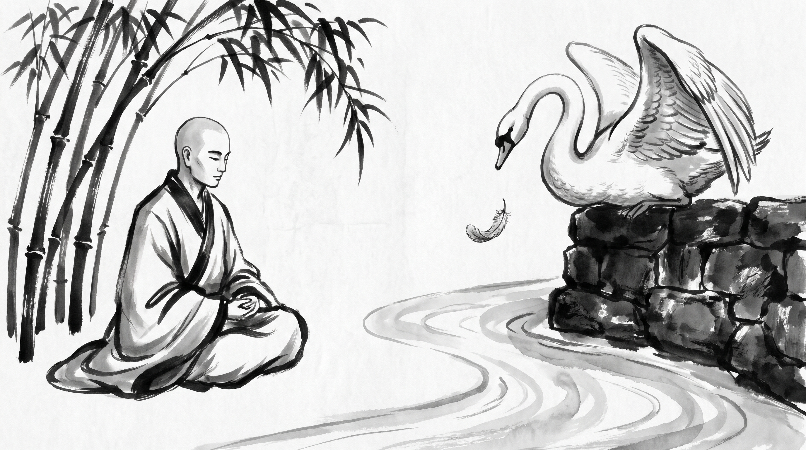

# Resisting the Drain: When Greedy Beneficiaries Exhaust a Patron's Grace

The morning mist clung softly to the emerald stalks of the bamboo grove, diffusing the pale sunlight into a quiet, meditative glow across the monastic courtyard. Surata, a senior estate steward responsible for managing the royal granaries and charitable endowments of the capital district, sat upon a low stone bench. His ledger rolls lay unrolled beside him, soiled with ink smudges and marked by frantic margin notes. His shoulders were bowed under a heavy burden of disillusionment, and his breath escaped in long, weary sighs.

Across from him sat the Monk, draped simply in his saffron Kasaya robe over one shoulder, his head cleanly shaved and his gaze completely tranquil. The Monk rested his hands calmly upon his lap, observing Surata's deep turmoil with unwavering attentiveness.

"You bear the exhausting sorrow of a steward who has watched a boundless fountain of support run dry through the unbridled greed of those who consumed it, Surata," the Monk remarked softly.

Surata struck his ledger with the flat of his palm, his voice trembling with frustration. "Master, it is a madness that defies all reason! For three years, a wealthy merchant benefactor sustained our provincial storehouses with regular shipments of grain, silver, and fine textiles, asking for nothing in return save that we help the destitute families of the valley. Yet the district magistrates and greedy sub-councilors took this generosity as an endless, bottomless pit. They increased their demands monthly, pillaging the storehouses for personal luxuries rather than public relief. When the benefactor gently cautioned them to moderate their requests, the councilors scoffed, saying that wealth that flows once will flow forever without limit. Now the benefactor has closed the storehouses entirely, and our people starve because the councilors could not stop plundering a gift. How do you counsel a community that devours its own lifeline down to the bone?"

The Monk listened in absolute silence, the rustle of the bamboo leaves above providing the only sound in the stillness. "When a hand receives without restraint, Surata, it soon forgets that every golden feather is an act of grace, not a tax levied upon the heavens."

---

## The Swan and the Mother's Greed in the Jataka

The Monk turned a smooth pebble over in his palm before speaking in a low, measured voice.

"In the *Jataka Tales*, within the ancient lore preserved as the *Suvarna Hamsa Jataka*, there is recorded a parable concerning this very destruction of a sustainable benefactor through insatiable extraction.

"In a previous birth, it is related that a noble soul who had attained great spiritual merit was reborn as a majestic swan possessed of radiant plumage that shone like molten copper and spun gold. This noble bird dwelt upon Mount Kailash, yet because of past family ties, he beheld one day that his former human wife and daughters had fallen into severe poverty following his passing. Moved by compassion, the swan flew down to their humble dwelling, perched upon the roof beam, and addressed them with a human voice. 

"'Do not weep for your sustenance,' the swan declared. 'I shall give to you a single golden feather from my wings upon each visit. With the coin you receive from selling this single feather, you and your daughters shall live in comfort and dignity without want.'

"True to his word, the swan returned season after season, shedding one luminous golden feather during each visit. The family sold the feather in the village marketplace for a handsome sum, rising steadily from destitution to comfort and stability. Their storehouse filled with grain, and their debts were fully paid.

"Yet greed, once seeded in the human heart, is a ravenous flame that feeds upon the very hand that cools it. One day, the mother called her daughters together and whispered an insidious counsel. 'This swan visits us regularly and bestows upon us a single golden feather at a time. But what if one day he flies away and never returns? Or what if sickness overtakes him? Let us seize the swan the next time he alights upon our roof, pluck every single feather from his body in one stroke, and secure all the gold for ourselves at once. Then our wealth will be boundless and eternal.'

"The daughters, blinded by greed and corrupted by the ease of their newfound fortune, agreed to their mother's counsel. When the swan returned in his usual benevolence to bestow his gift, the mother sprang forward from the doorway, caught the majestic creature by his wings, and held him fast while the daughters stripped every feather from his body. 

"Yet, behold the working of cosmic law. The moment the golden feathers were torn from the swan by force, greed's harvest turned to dust. The stolen feathers did not remain gold; by the power of truth and the violation of grace, they instantly transformed into common, dull grey feathers of ordinary fowl. Worse still, as the plumage grew back in the following weeks, it did not return as gold, but as common grey feathers. The noble swan looked upon the greedy household with sorrow, shook his wings, and flew away into the high mountains, never to return."

---

## The Anatomy of Exhausted Grace

The Monk pointed toward the path where the morning sunlight began to fade behind the thick bamboo stalks.

"The parable of the golden swan reveals three immutable patterns that govern every relationship between a sustainable benefactor and those who depend upon their grace.

"First, the illusion of infinite supply leads directly to reckless extraction. When a benefactor gives freely out of compassion or loyalty, unregenerate minds mistake generosity for an inexhaustible natural resource. In the council chambers and royal storehouses, men cease to calculate the cost of their demands. They assume that because a ledger balanced yesterday, it will balance tomorrow, regardless of how many hands dip into the ink.

"Second, the desire to institutionalize a gift destroys its voluntary soul. The mother and daughters were not content to receive what was offered through grace; they sought to secure a permanent guarantee through force and seizure. In administrative affairs, this appears when leaders attempt to codify extraordinary discretionary support into mandatory tribute, forgetting that goodwill cannot be chained to a decree without dying in the process.

"Third, the sudden withdrawal of a benefactor leaves a vacuum filled only by ordinary grey reality. When the noble bird departed, the household was left not merely poor, but stripped of the very grace that elevated them. In communal and merchant life, when a key patron, an innovative master craftsman, or a devoted advisor finally walks away from relentless exploitation, the fellowship is left holding only the dull grey feathers of its own unbridled greed."

---

## The Counsel of Sustained Equilibrium

Surata bowed his head, his hands resting upon his unrolled ledgers. "Master, how does a steward protect a benefactor's grace from being devoured by those who know only how to take?"

The Monk answered with quiet authority.

### 1. Set Written Limits on Discretionary Support
Before accepting any endowment or grant from a benefactor, draft a strict scroll of allocation that specifies exact quantities, distribution dates, and intended recipients. Keep the ledger open to public audit so that no councilor can quietly siphon off surplus resources under the guise of general administration.

### 2. Protect the Source Above the Harvest
Never allow the urgency of immediate petitioners to override the well-being of the primary source. If an institutional patron or master producer shows signs of fatigue or withdrawal, immediately curtail secondary demands and shield the benefactor from direct exposure to grasping intermediaries.

### 3. Establish Clear Quotas for Relief
When distributing resources provided by voluntary grace, tie every distribution to verifiable performance or genuine destitution. Prevent entitlement from taking root by ensuring that recipients understand that support is an act of sustained trust, not a permanent hereditary right.

**Source:** Jataka Tales, Suvarna Hamsa Jataka, No. 136 variant (UNVERIFIED)

The estate steward gathered his ledgers with a steady hand, his heart no longer burdened by confusion, but illuminated by the stark geometry of cause and effect.

> *"When greed strips the golden feather by force, the radiant gift turns instantly to grey ash, and the benefactor departs forever into the silent hills."*
