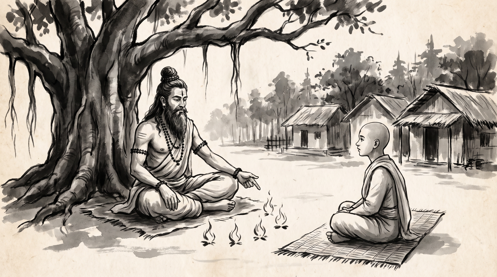

# Pravahana's Five Fires: Realizing Your Technical Expertise Lacks Foundational Domain Knowledge

The morning sun filtered through the dense canopy of the forest hermitage, casting long patterns of light across the roots of the ancient banyan tree. Somasarma, chief royal recorder and master of tax registers for the northern province, sat motionless upon a grass mat near the threshold of the thatched hut. His hands were clenched upon his knees, his jaw set tight, and his gaze fixed upon the dusty ground. The quiet hum of cicadas filled the clearing, but inside him churned the acute exhaustion of a sudden, total administrative collapse.

Across from him sat the venerable Rishi, still and observant. The sage's silver beard rested against an unstitched cotton dhoti, his matted locks were bound in a traditional Vedic *jata* topknot, and beads of natural rudraksha encircled his wrists. A faint line of sacred ash rested across his brow. He watched the younger man for a long while before speaking.

"You sit like an accountant who has balanced every ledger down to the last copper coin, only to discover the royal treasury has no roof," the Rishi said softly.

Somasarma raised his eyes, breathing heavily. "Master, for ten years I mastered every fiscal formula, grain tariff calculation, land assessment decree, and treasury accounting method in the empire. I can audit any ledger from memory and prove exact yields across a hundred districts with absolute mathematical precision. Yet yesterday, during the high assembly before King Pravahana himself, when the council was asked why three border provinces had suddenly collapsed in agricultural output despite my flawless tax records, I stood in complete silence. I could calculate the losses to the last grain, but I could not explain why the soil lost its vitality, how the monsoon waters were drawn from the sea, or how seasonal changes governed crop rotation. The ministers dismissed my audit as academic illusion, pointing out that my intricate numbers lacked any understanding of root causes and foundational domain realities. How does one survive when years of technical mastery shatter against a single foundational question?"

---

## Pravahana's Five Fires in the Chandogya Upanishad

The Rishi listened with calm equanimity. He pointed with an open hand toward the slow-moving river that curved past the ashram bank, where the mist rose quietly from the deep water into the morning air.

"Your predicament is ancient, Somasarma, and the masters of wisdom recorded its remedy long ago," the Rishi said. "In the fifth chapter of the *Chandogya Upanishad*, the great sage Svetaketu—proud of his vast Vedic scholarship—entered the court of King Pravahana Jaivali. The king tested him with five fundamental questions regarding the origin, journey, and destination of beings—the mysteries of the celestial fires, the clouds, the earth, man, and woman. Svetaketu, despite knowing all the sacred hymns by rote, could not answer a single one. Humiliated, he returned to his father, realizing that rote mastery without knowing the foundational cycle of creation is merely hollow sound."

"King Pravahana demonstrated that every specialized craft rests upon five foundational truths: the source, the mechanism, the environment, the recipient, and the final return. When a practitioner knows only the intermediate calculations while ignoring the root laws of the domain, the first major structural shift exposes their emptiness."

---

## The Anatomy of Foundational Blindness

The Rishi paused, letting the silence deepen beneath the banyan branches.

- **Mastery of the superficial register**: Somasarma focused entirely on tracking symptoms—tariffs, ledgers, and yields—while treating foundational domain dynamics as someone else's concern. In councils and guilds, specialists accumulate complex technical metrics while remaining utterly blind to structural shifts in the broader ecosystem.
- **The shock of root interrogation**: King Pravahana's questioning bypassed Svetaketu's sophisticated scholarship and struck directly at first principles. When leadership or crises demand fundamental explanations, intricate procedural arguments collapse because they lack root justification.
- **The false security of specialized silos**: The technician believes flawless execution within a narrow mandate insulates them from ignorance of the whole. Yet when the domain itself shifts, the silo becomes a trap where precise calculations only accelerate disaster.
- **The arrogance of procedural isolation**: Believing that mathematical accuracy exempts one from understanding human and environmental realities creates a fragile glass tower that shatters at the first foundational test.

---

## The Counsel

Somasarma lowered his head. "Master, what must I do when my technical brilliance is exposed as foundational ignorance?"

### 1. Map the Root Cause Before Refining the Tally
Stop optimizing intermediate reports and audit the foundational assumptions of your domain. Spend one hour each week tracing every process back to its ultimate source and human impact.

### 2. Study the Whole Ecosystem Beyond Your Mandate
Do not wait for a crisis to expose your blind spots. Sit with frontline operators, field workers, and domain veterans to learn the physical and human realities behind the numbers.

### 3. Answer Hard Fundamentals with Honest Inquiry
When questioned on root principles you do not know, abandon defensive jargon immediately. Acknowledge the gap and commit to mastering the foundational domain before proposing further procedural fixes.

**Source:** Chandogya Upanishad, Chapter 5 (UNVERIFIED)

Somasarma bowed low, the heavy burden of false pride lifting from his shoulders as he gazed toward the river mist.

> *"The scholar who masters every ripple on the surface while ignoring the depth of the well will thirst beside a dry basin when the rains shift."*

