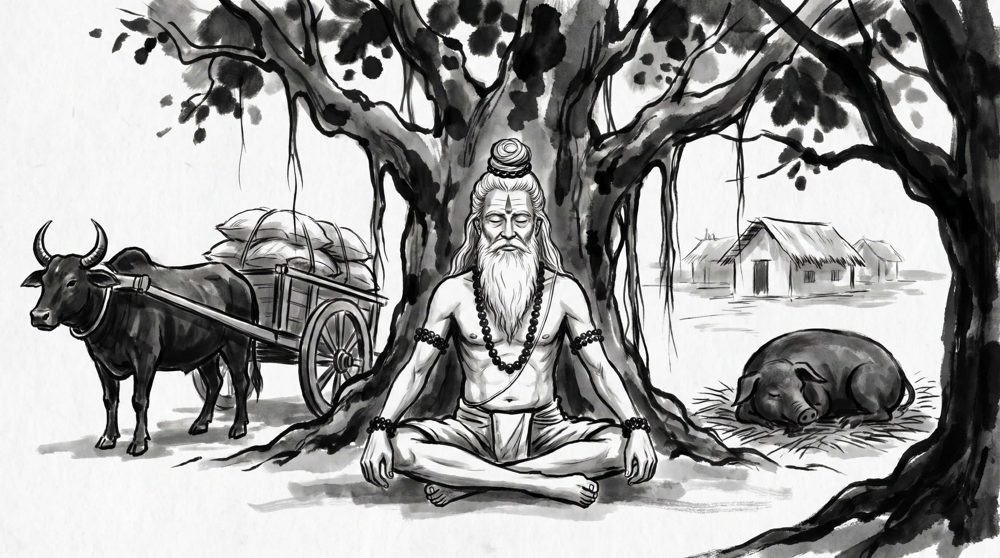

# The Ox Who Envied the Pig: Why Wishing for Another's Easy End Can Be Your Own Undoing

The forest hermitage rested in the quiet embrace of the afternoon breeze. Dry leaves rustled beneath the ancient banyan tree, whose aerial roots dropped like pillars of weathered bronze into the fertile earth. Somana, a senior logistics supervisor of the imperial grain granaries, sat upon a woven reed mat with his head lowered and his shoulders heavy with fatigue. His hands were calloused from hauling heavy sacks of grain, and his eyes burned with resentment as he watched the distant palace courtyards where favored courtiers rested without labor.

Across from him sat the venerable Rishi, centered and tranquil. His silver beard flowed over an ascetic cotton wrap, his matted hair was bound in a traditional Vedic *jata* topknot, and natural rudraksha beads circled his wrists. Subtle lines of sacred vibhuti traced the calm expanse of his brow.

"You carry the bitterness of a servant who watches an idle guest eat sweetmeats while the plough remains strapped to your own shoulders, Somana," the Rishi remarked softly.

Somana let out a heavy sigh. "Master, every dawn I rise before the sun. I inspect the grain carts, settle disputes among the carters, and bear the wrath of the royal treasurer if a single sack is damp or misplaced. Meanwhile, I see new favorites in the court who do no labor, who spend their days in shaded pavilions eating rich foods and drinking scented water, untouched by the dust and burdens of administration. Why should I break my back hauling the empire's wealth while others feast in idleness? Yesterday, as I watched a royal steward lounge in velvet cushions without lifting a finger, I found myself wishing I could trade places with such an effortless existence. Is enduring endless toil virtue, or merely foolishness?"

"And did you consider what awaits the creature whose labor is removed before its time?" the sage asked quietly.

"I saw only their comfort," Somana replied, his voice tightening. "How does one extinguish the envy of seeing another man's path free of toil?"

---

## The Tale of the Ox and the Fed Swine

The Rishi smiled with deep, sorrowful recognition. He raised his hand and gestured toward the tranquil meadows shimmering beyond the hermitage hut, where cattle grazed and wild fields stretched toward the horizon.

"Your envy is born of looking only at the feeding trough and never at the butcher's yard, Somana. In the ancient lore of the *Panchatantra*, there is preserved a parable of the hardworking ox and the pampered swine. 

In a prosperous agricultural estate, there lived a sturdy ox who labored from dawn until dusk. He pulled heavy carts loaded with timber, turned the massive stone oil-press through endless circles, and bore the weight of the harvest upon his broad shoulders. His hide was toughened by sun and dust, and his muscles ached with honest fatigue. 

In the same homestead lived a large pig who performed no labor whatsoever. While the ox toiled in the fields, the swine was kept in a warm, sheltered sty. Attendants brought him baskets filled with sweet grain mash, rice bran, and rich kitchen scraps. The pig wallowed in soft straw, ate his fill without breaking a sweat, and grew round, heavy, and sleek.

Every evening, as the ox returned from the fields with his neck chafed by the wooden yoke, he passed by the pig's pen and felt a sharp pang of envy. *'Look at this fortunate creature,'* the ox would mutter to himself, shaking his head. *'I labor under the lash and the yoke from morning till night, receiving only dry straw and coarse grass. That creature does nothing, yet is bathed, fed on delicacies, and kept in comfort. Why is the world so unjust to honest labor?'*

One autumn evening, as the festival season approached, the estate master and his kinsmen gathered in the courtyard. The master pointed directly at the sleek, fat pig wallowing in its straw and said to his attendants: *'This creature is now fully fattened and has reached its peak. Prepare the great cauldrons and sharpen the blades; tomorrow is the harvest feast, and this swine must be sacrificed for the banquet.'*

The ox, resting nearby after unhitching his cart, overheard the master's decree. He watched the attendants bring even richer feed to the pig that night, while the doomed animal squealed with delight, happily devouring the final feast. The ox looked at his own coarse grass, his yoke resting against the barn wall, and the heavy cart he would pull again at dawn. A profound shudder passed through his massive frame. He realized that the pig's effortless ease was not a reward for virtue, but the fattening process before slaughter. His own heavy labor and coarse straw were the very price of his survival."

---

## The Patterns of the Heavy Yoke

The Rishi turned his gaze from the meadow back to Somana.

"Every estate has its oxen and its pampered swine, Somana. When you envy the man who bears no burden, you fail to see why his burden was lifted."

### 1. The Velvet Stye Without Labor
The pampered pig does not toil because he is being prepared for consumption. In the council or the guild, when someone is given high titles, effortless budgets, and total exemption from hard operational audits, do not rush to envy their luxury. Often, they have been isolated from real responsibility precisely because their patron intends to spend their reputation when crisis strikes.

### 2. The Final Feast of the Unchallenged
The pig squeals with joy when the sweet mash is poured into his trough on the eve of the feast. When a favorite receives unearned praise and lavish rewards without accountability, they celebrate their status blindly. A wise man observes what happens when the festival arrives and the master demands a return on his investment.

### 3. The Protection of the Yoke
Your heavy yoke and coarse grass are burdensome, Somana, but they keep you indispensable. Because you know every grain sack, every carter, and every ledger detail, you cannot be easily replaced or carved up for sacrifice. Real security lies in bearing the weight that makes you essential to the enterprise, not in lounging in a pen where your only value is your flesh.

---

## The Rishi's Counsel

"Master," Somana asked, sitting straighter now as the bitterness drained from his chest. "When I return to the granaries tomorrow, how shall I view my daily labor?"

The Rishi held up three fingers.

### 1. Inspect Your Yoke Before You Envy Another's Pasture
Whenever you feel resentment toward those who seem to live without toil, pause and examine what price they are paying behind closed doors. Ask yourself whether their exemption from labor is a privilege or a precursor to abandonment.

### 2. Keep Your Hands Upon the Ledger
Never surrender your operational knowledge or delegate the core of your responsibility to courtiers who promise an easy life. The man who holds the details of the work holds his own leash; surrender the work, and you become the property of another's whim.

### 3. Honor the Labor That Keeps You Alive
Embrace the daily toil that builds your competence. An ox may sweat beneath the sun, but at the end of the harvest, he returns to the pasture to graze another day, while the pampered guest becomes the feast.

**Source:** Panchatantra, Book 1, "The Ox and the Pampered Swine" (Locator UNVERIFIED)

Somana bowed low, his hands resting upon his knees. The heavy resentment in his heart had vanished, replaced by the quiet, steady strength of the working ox.

> *"Do not envy the swine its sweet mash or its effortless pen; the heavy yoke and coarse grass preserve the ox, while the fattened feast claims the guest of leisure."*