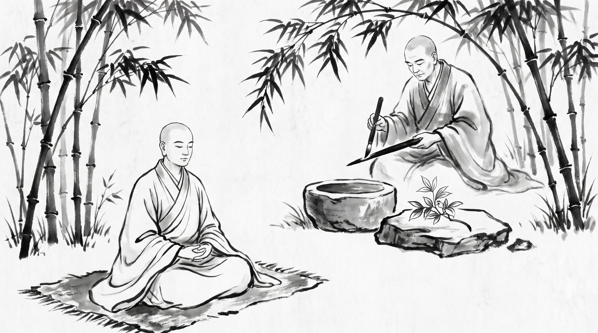

# The Wise Physician Jivaka: Diagnosing Structural Rot Before Prescribing Surgery

The morning mist hung heavy over the bamboo grove at Veluvana, muffling the distant chanting from the monastery halls. Upasaka Sumana, senior royal treasurer of Rajagaha, sat upon a smooth stone bench with his shoulders slumped and his ledger case resting unopened beside his sandals. His face bore the gray pallor of a man whose administrative departments were unraveling amidst widespread accusations of embezzlement, yet every proposed remedy—from mass dismissals to slashing departmental budgets—only deepened the institutional paralysis.

Across from him sat the venerable Monk, draped in a simple kasaya robe, his head clean-shaved and his eyes luminous with absolute calm.

"You carry the panic of a frantic surgeon in your step, Sumana," the Monk observed softly.

Sumana let out a long, weary sigh, resting his palms on his knees. "Master, our royal administration in the outer provinces is rotting from within. Tribute is delayed, granary accounts do not balance, and regional ministers are accusing each other of corruption. Last week, the high council panicked and demanded a complete purge: cut all regional budgets by half, dismiss every magistrate appointed in the last three years, and seize all provincial ledgers. But when we tried to enforce it, the entire bureaucracy ground to a halt. Innocent scribes resigned in terror, corrupt officials hid behind red tape, and the treasury lost even the revenue it had. How does a ruler heal a diseased administration when the crude knife of sweeping purges destroys the living tissue along with the rot?"

"And what did the high council say when their wholesale purge choked the grain supply?" the Monk asked quietly.

"They blamed the scribes for lacking zeal," Sumana murmured bitterly. "How does one distinguish between systemic rot and healthy tissue before applying the blade?"

---

## The Royal Physician of Rajagaha

The Monk smiled with deep, compassionate stillness, gesturing toward the tranquil stream flowing past the bamboo thickets.

"Your dilemma is as old as the healing arts of Jambudvipa, Sumana," the Monk said. "In the sacred records of the *Vinaya Pitaka*, in the foundational accounts of the *Mahavagga* (Chapter 8), there is preserved the legendary mastery of Jivaka Kumarabhaccha, the royal physician of King Bimbisara, whose diagnostic precision saved kingdoms from self-induced destruction."

"In those days, royal courts and wealthy merchant houses frequently suffered from severe internal ailments—chronic obstructions, poisoned humors, and deep-seated tumors. Lesser physicians, eager to display decisiveness and win royal favor, would rush forward with heavy bronze scalpels and caustic potions, carving indiscriminately into the patient's flesh. Yet, more often than not, their violent interventions severed vital blood vessels, shocked the system, and caused agonizing death rather than healing."

"When King Bimbisara and the great merchant guilds faced complex internal disorders that baffled every court physician in Magadha, they summoned Jivaka. Unlike the hasty practitioners who shouted for immediate amputation, Jivaka approached the patient with absolute stillness. He did not touch a scalpel until he had examined the pulse, tested the tongue, traced the flow of breath, and identified the exact core of the obstruction. In one famous instance, a wealthy merchant of Rajagaha suffered from a chronic cranial blockage that caused blinding agony. While other physicians demanded a perilous skull surgery that would likely prove fatal, Jivaka performed a delicate, microscopic incision, extracted a colony of parasitic worms, and sewed the vessel with masterly grace, restoring the merchant to full health within days without spilling a drop of precious blood."

"Jivaka's supreme rule was absolute: *The scalpel belongs only in the hand that knows where the disease ends and the healthy organ begins. To cut without precise diagnosis is merely murder in disguise.*"

---

## The Anatomy of Systemic Rot

The Monk turned his gaze from the flowing stream back to Sumana.

"Every royal administration and merchant guild has its crude surgeons, Sumana. When crisis strikes, they demand an immediate purge. But true mastery follows four diagnostic principles."

### 1. The Panic for the Scalpel
When accounts fail or scandals erupt, incompetent administrators always reach for the heaviest blade. They demand sweeping budget cuts, mass layoffs, and total restructuring. They do this because crude violence looks decisive to terrified onlookers, masking their own profound ignorance of how the machine actually functions.

### 2. Failing to Trace the Pulse of the Ledger
A hasty physician treats every symptom as a separate disease. In government, when tribute is delayed, fools blame the provincial collectors without checking where the royal couriers were intercepted. Before cutting any department, you must trace the exact flow of authority and resource from its source to the blockage. 

### 3. Cutting Living Tissue Instead of the Tumor
When purges are ordered without diagnosis, the honest scribes and loyal master craftsmen are the first to be dismissed because they are visible and vulnerable, while the cunning corrupt officials slip deeper into the shadows. A blunt knife cuts the heart while leaving the parasite untouched.

### 4. The Mastery of the Microscopic Incision
True structural repair is never loud or sweeping. It is precise, quiet, and surgical. Jivaka did not carve open the king's entire body; he located the single obstructed vessel and released the pressure. In administration, target the exact corrupt clause, the specific fraudulent ledger, or the single negligent magistrate, leaving the healthy network undisturbed.

---

## The Master's Counsel: How to Diagnose Before You Cut

"Master," Sumana asked, leaning forward with intense focus, "how do I halt the high council's blind purges and restore health to our administration?"

The Monk raised his hand, holding up three fingers.

### 1. Halt All Indiscriminate Purges Immediately
Issue a formal royal stay on all blanket budget cuts and mass dismissals across the provinces. Inform the high council that sweeping purges without audited evidence are acts of self-sabotage. Demand a thirty-day diagnostic freeze where every provincial ledger is examined independently.

### 2. Trace the Obstruction to Its Root Ledger
Do not rely on hearsay from competing ministers. Send trusted, independent auditors to inspect the physical granaries and treasury vaults in person. Compare the receipts issued at the port with the tallies recorded at the capital gate to find the exact junction where the tribute vanished.

### 3. Apply the Needle, Not the Broadsword
Once the corrupt official or flawed procedural loophole is identified, remove it with quiet, decisive finality. Dismiss only the guilty party, reform the specific administrative clause, and issue a public guarantee protecting loyal scribes and honest regional workers. Heal the structural rot without spilling the blood of the innocent.

**Source:** Vinaya Pitaka, Mahavagga, Chapter 8 (UNVERIFIED)

Sumana bowed low, touching his forehead to the cool stone. The paralyzing confusion in his mind had vanished, replaced by the calm clarity of diagnostic mastery.

> *"Do not let terrified counselors carve your administration with a broadsword; hold fast the steady pulse, locate the single hidden blockage, and let precise surgery heal the realm without spilling innocent blood."*
