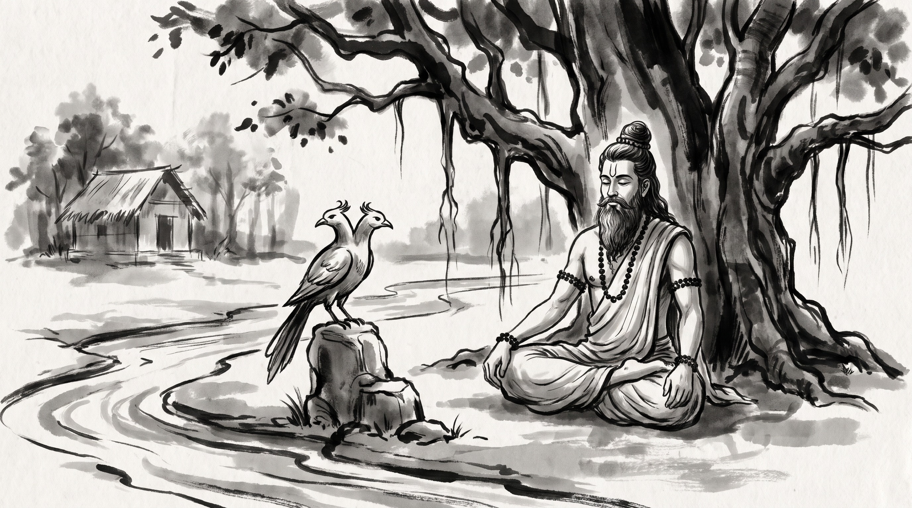

# The Bird with Two Heads: When Co-Founders Sabotage the Shared Enterprise

The forest hermitage rested in the quiet embrace of the afternoon breeze. Dry leaves rustled beneath the ancient banyan tree, whose aerial roots dropped like pillars of weathered bronze into the fertile earth. Damodara, a senior guild treasurer of the bustling textile markets of Ujjain, sat upon a woven reed mat with his head lowered and his jaw tightly set. His eyes burned with the stinging disbelief of a man who watched his primary partner deliberately set fire to the merchant house they both inhabited.

Across from him sat the venerable Rishi, centered and tranquil. His silver beard flowed over an ascetic cotton wrap, his matted hair was bound in a traditional Vedic *jata* topknot, and natural rudraksha beads circled his wrists. Subtle lines of sacred vibhuti traced the calm expanse of his brow.

"You carry the heavy sorrow of one who shares a vessel with a helmsman determined to bore a hole through the hull, Damodara," the Rishi remarked softly.

Damodara let out a ragged breath. "Master, my partner and I were entrusted by the royal assembly as joint treasurers of the silk guild. We share the same vaults, the same ledger, and the same royal charter. Yet my partner is consumed by bitter rivalry. When the royal treasury granted us funds for the winter caravan, he insisted on unilateral control over half the wagons. Because I questioned his reckless procurement of unseasoned timber, he retaliated out of spite. He has begun striking side deals with rival merchants, slashing our wholesale tariffs below cost, and draining our joint reserves just to prove his dominance over me. He does not care that our entire merchant house faces bankruptcy; his sole desire is to crush my authority, even if it means we both drown in the debt we share."

Damodara clenched his fists against his knees. "How does one reason with a partner who drinks poison simply because he believes it will harm my digestion?"

---

## The Bharunda Bird of the Panchatantra

The Rishi smiled with deep, sorrowful recognition. He raised his hand and gestured toward the tranquil pond shimmering beyond the hermitage hut, where water lilies floated and a pair of water birds glided silently across the dark water.

"Listen, Damodara, to the ancient account from the *Panchatantra* regarding the Bharunda bird," the sage began, his voice steady and resonant.

"In the deep reaches of a Himalayan forest, there dwelt a wondrous creature known as the Bharunda. It possessed a single sturdy body and two distinct necks, each crowned by its own intelligent head. Though they shared one torso, one stomach, and one life, the two heads often acted with separate wills and competing ambitions.

One afternoon, while wandering along the banks of a mountain stream, the first head discovered a rare, celestial fruit washed down from an upper grove—glistening with divine nectar and possessing an aroma that promised eternal vigor. Delighted, the first head consumed the fruit and exclaimed aloud, *'O fortunate companion! I have tasted ambrosia. Never has such sweetness graced our throat.'*

Instead of rejoicing in their shared nourishment, jealousy flared in the second head. Vexed that it had missed the taste because the first head had eaten, the second head grumbled, *'Selfish wretch! You devour the prize alone while I receive nothing. By the gods, the next fruit I find shall be my choice, whether it be sweet or bitter.'*

Some days later, as the Bharunda flew along a rocky ridge, the second head spotted a strange, dark fruit hanging from a venomous creeper—a deadly poison known to strike down any living creature within the hour. Consumed by spite and burning to assert its equal power, the second head cried out in malice, *'Now you shall see my strength! I will pluck and consume this fruit so that you, too, share my feast!'*

The first head pleaded desperately, *'Do not do this, brother! We share one stomach and one blood. If you swallow venom, we shall both perish in agony!'*

Ignoring the warning, the blinded second head seized the poisonous fruit and swallowed it whole. Within moments, the virulent toxin coursed through their shared veins. Both heads convulsed in torment, and the unified body of the Bharunda collapsed lifeless upon the forest floor."

---

## The Anatomy of Shared Destruction

The Rishi paused, letting the silence of the forest settle over the treasurer.

"The fable of the Bharunda bird reveals three enduring patterns of co-ownership when ego eclipses survival," the sage said.

First, there is **the illusion of independent defeat.** In any joint enterprise, assembly council, or shared treasury, partners often forget that the legal and financial entity is singular. When one leader undermines the balance sheet out of spite, they imagine they are merely humbling their rival. They fail to comprehend that a punctured hull sinks both cabins.

Second, there is **retaliatory poisoning.** When cooperation breaks down, a wounded participant frequently sabotages operational efficiency—withholding data, leaking internal disputes, or making reckless commitments—solely to demonstrate leverage. They consume the poison of bad faith, believing their immunity will protect them from the fallout.

Third, there is **the fatal delay of shared organs.** Just as the first head delayed decisive intervention until the venom was already swallowed, partners often watch destructive maneuvers unfold with passive disbelief. They assume common sense will prevail until the crisis becomes terminal.

---

## The Counsel of the Sage

Damodara bowed his head. "The metaphor is stark, Master. What action must I take before our guild treasury is entirely depleted?"

"Act with immediate structural clarity," the Rishi replied.

### 1. Establish Mandatory Co-Signature Protocols
Draft a formal amendment for the assembly archives stating that no coin may be disbursed from the joint vaults and no tariff adjusted without the verified seals of both treasurers present together.

### 2. Institute a Written Deadlock Mechanism
Write a binding covenant on a fresh palm leaf specifying that any operational disagreement regarding pricing or inventory must be submitted immediately to the senior guild elders for arbitration before either party takes unilateral action.

### 3. Ring-Fence Core Reserves
Audit the remaining assets today and segregate the emergency grain and silver reserves into a secure third-party holding account under the direct supervision of the council overseers, removing discretionary access until the partnership terms are formally restructured.

**Source:** Panchatantra, Book 1 (Mitra-bheda) (UNVERIFIED)

Damodara touched his palms to the earth, the suffocating fog of frustration finally parting before the cool light of clear resolve. He stood upright, his stride steady as he turned from the hermitage toward the gates of the capital.

> *"He who poisons the shared well to spite his companion drinks his own death from the same cup."*
