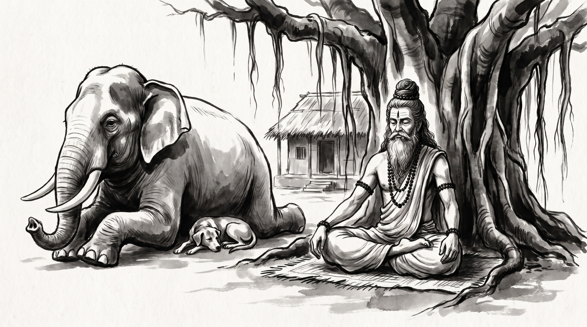

# The Palace Stable and the Faithful Friend: Loyalty Tested When a Royal Patron Abruptly Withdraws Favor

The forest hermitage rested in the quiet shadow of the hills. Beneath the sprawling branches of a banyan tree, whose aerial roots descended like pillars of weathered bronze, sat Somadatta, the chief keeper of the royal stables and state elephants. His brow was furrowed, and his hands trembled slightly as he held an unrolled parchment tally. The king\'s court had abruptly shifted its favor, and the stable provisions and honors that Somadatta had earned through decades of service were suddenly redirected to a newly favored court favorite.

Across from him sat the venerable Rishi, centered and tranquil. His silver beard flowed over an ascetic cotton wrap, his matted hair was bound in a traditional Vedic *jata* topknot, and natural rudraksha beads circled his wrists. Subtle lines of sacred vibhuti traced the calm expanse of his brow.

"You speak of shifting winds in the royal council, Somadatta," the Rishi remarked softly. "You served the royal house with absolute devotion, believing that steadfast loyalty to a great patron was an impenetrable shield. Yet the moment the sovereign\'s eye turned elsewhere, your station crumbled overnight."

Somadatta let out a heavy breath. "Master, it is worse than a mere loss of station. For years, I cared for the great royal elephant, training him and nourishing him. But what broke my heart was not the king\'s coldness; it was witnessing how quickly the entire court abandoned me the moment the royal favor withdrew. Those who once sought my counsel now pretend not to know me in the assembly hall. How does one endure the sudden abandonment of a patron who once called you indispensable?"

"And what of the bond between the royal elephant and the faithful hound who shared his quarters?" the sage asked quietly.

"Ah," Somadatta murmured. "That strange friendship was the talk of the capital. But even that pure bond was tested when the patron\'s whim changed."

"Tell me," the Rishi asked, "did the beast understand loyalty better than the courtiers?"

---

## The Parable of the Royal Elephant and the Faithful Hound

The Rishi smiled with deep, sorrowful recognition. He raised his hand and gestured toward the tranquil riverbank shimmering beyond the hermitage hut, where water lilies floated and cattle grazed in the morning light.

"Your grief is sudden in its sting, Somadatta, but the truth behind it is as ancient as the sacred rivers. In the *Panchatantra* of Pandit Vishnu Sharma, in the foundational book of *Mitra-Bheda*—the Loss of Friends and False Alliances—there is preserved the profound parable of the royal elephant and the dog."

"In a magnificent palace in a prosperous kingdom, the king maintained a splendid state elephant, magnificent in stature and bedecked with gold ornaments. The elephant was fed the finest rice, bathed in scented water, and tended by devoted keepers. Yet, despite all the royal luxury, the majestic beast pined away in deep melancholy, refusing his food and growing thin."

"Observing this distress, a humble stray dog wandered into the royal stables one evening. Drawn by no ambition other than simple companionship, the little dog scampered up onto the raised wooden raised stone dais where the great elephant stood, nestled against the massive animal\'s foreleg, and began to play fearlessly in his straw. The elephant, touched by this unassuming presence, gently lifted the little dog with his trunk, set him upon his head, and shared his choice morsels of sweet rice."

"From that day onward," the Rishi continued, "an unbreakable bond formed between the royal beast and the humble hound. They ate from the same trough, slept side by side, and played together in the palace courtyard. The elephant regained his vigor, his skin shone with health, and his noble spirit returned."

"One day, a wealthy merchant visiting the royal court saw the faithful hound resting between the elephant\'s massive tusks and was captivated by the animal\'s noble breed. He approached Somadatta\'s predecessor in the stables and offered a thousand gold coins for the dog. Tempted by the enormous wealth, the keeper sold the hound and let the merchant take him away."

"The moment the hound vanished, the great elephant plunged back into profound despair. He dropped his head, refused the royal rice, and stood motionless in his stall like a carved pillar of stone. The king, alarmed that his prize state elephant was dying of grief, summoned his chief ministers and wise counselors to discover the cause."

"A wise minister inspected the stables and reported: *'O King, the elephant is not sick of any physical ailment. He languishes because he has been separated from his dearest friend—a humble dog that shared his food and quarters. The wealth of a thousand gold pieces is nothing compared to the life of the state elephant.'* Realizing the truth, the king immediately ordered the merchant to be summoned, the gold returned, and the faithful hound restored to the royal stables."

"When the dog was brought back into the courtyard," the Rishi continued, "he bounded across the flagstones and leaped straight up onto the elephant\'s trunk. The great beast caught him gently, set him upon his head, and wept tears of pure joy, instantly resuming his meals. Such was the depth of true companionship, untainted by courtly calculation."

---

## The Anatomy of Patronage and Abandonment

The Rishi turned his gaze from the river to Somadatta.

"Every royal court has its elephants and its hounds, Somadatta. When a patron\'s favor shifts, the illusion of permanence dissolves. The DogElephant bond reveals four unchanging truths about courtly alliances."

### 1. The Patron Cares for the Function, Not the Man
The king loved the elephant not for his soul, but for his imperial majesty in processions. When the patron bestows favor, he is investing in an asset, not a person. When the wind changes, the asset is reassigned without a second thought.

### 2. Rank Attracts Parasites, But Solitude Tests True Bond
While the elephant was gorgeously adorned, many flatterers stood around him. Yet none of them noticed his heartbreak. Only the humble hound, seeking nothing from the elephant\'s royal status, sensed his profound sorrow and brought him back to life.

### 3. The Transactional Sale of Loyalty
The stable keeper sold the hound for gold coins, believing a friend was a surplus commodity that could be monetized. In every realm, short-sighted overseers sell off core team members or trusted allies to satisfy an immediate transactional gain, destroying the morale of the entire unit.

### 4. Recovery Requires Restoring the Core Connection
When the elephant pined, no amount of fine rice or royal medicine could cure him; only the return of his true companion restored his spirit. When leadership tries to fix a broken culture with perks while banishing trusted allies, recovery remains impossible until authentic bonds are restored.

---

## The Rishi\'s Counsel

"Master," Somadatta asked, sitting straighter now. "When a royal patron withdraws favor and the court turns its back, how does a loyal man protect his standing?"

The Rishi held up four fingers.

### 1. Never Tie Your Entire Worth to One Master\'s Stables
An elephant tied to a single post is helpless when the stable master changes. Build relationships across multiple guilds and departments. Ensure your reputation rests on your proven craftsmanship, not merely on the shifting whims of a single royal patron.

### 2. Recognize True Companions Among the Humble
When fortune smiles, many courtiers crowd your stall. When fortune fades, observe who remains. Do not measure your worth by the number of flatterers during peak season, but by the quiet steadfastness of those who stand by you when the royal provisions are cut.

### 3. Document Your Contributions Beyond the Tally
Keep clear, written records of every project you manage, every surplus you save, and every team you build. Do not rely on oral promises from patrons whose memories vanish when their favor is challenged. Secure your legacy in black and white on palm leaves.

### 4. Guard Your Inner Stability Against Courtly Whims
The elephant nearly died because he let his joy depend entirely on external royal attention. Cultivate inner resilience. Whether the king sends gold chains or withdraws his glance, let your steady dedication to your craft remain unshakeable.

**Source:** Panchatantra, Book 1 (Mitra-bheda), "The Elephant and the Data Dog" (UNVERIFIED)

Somadatta bowed low. The bitterness in his chest had dissolved. In its place stood the quiet strength of unyielding principle.

> *"Do not let your spirit wither when a royal patron shifts his glance; value the steadfast bonds that remain, keep your craft true, and let no sudden gale uproot your inner pillar."*
