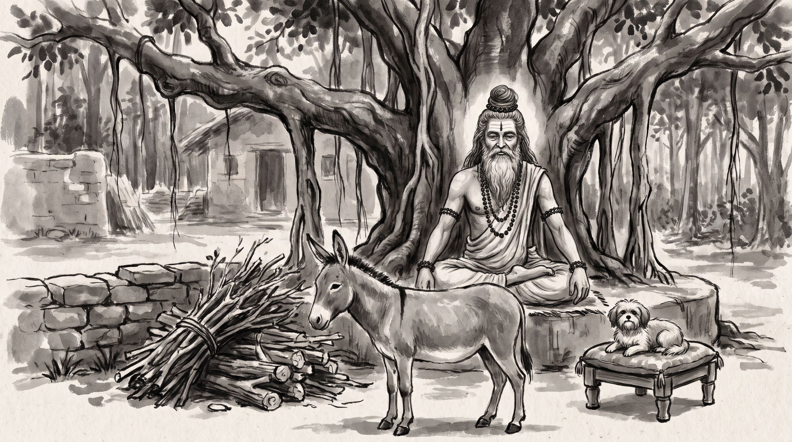

# The Ass and the Lapdog: Why Imitating the Favored Counselor's Demeanor Without Trust Breeds Disaster

The courtyard of the forest hermitage lay silent beneath the heavy afternoon heat, save for the rhythmic scraping of bronze vessels being scoured by junior novices. Somadatta, chief treasurer of the imperial merchant guild of Ujjain, sat upon a coarse reed mat with his head bowed and his hands trembling in quiet humiliation. His fine silk uttariya was stained with dust, and his brow furrowed with the bitter realization of a man who had mistaken proximity for authority. Across from him sat the venerable Rishi, centered and tranquil. The sage's silver beard flowed over his chest, his hair was bound in a traditional Vedic jata topknot, and natural rudraksha beads rested against his collarbone.

"You carry the bruised pride of one who leapt into the royal chamber before the council had summoned you, Somadatta," the Rishi remarked softly, his voice cutting through the rustle of banyan leaves.

Somadatta let out a ragged sigh. "Master, the delusion was complete. For months, I observed a junior scribe in the royal treasury—a youth named Kanta—who had won the unexpected favor of the prime minister. Kanta performed no heavy ledgers, audited no granaries, and carried no cargo tallies. Instead, he simply loitered near the minister's couch, echoing every phrase the statesman uttered, wearing perfumed garments, and mimicking the grand gestures of a trusted confidant. The prime minister would pat his head and feed him sweetmeats from his own silver platter."

The treasurer's fists tightened against his knees. "Believing that favor is won by posture rather than ledger-work, I decided to bypass the annual audit reports. Yesterday, during the grand assembly of guild leaders before the king, when the prime minister reclined upon his cushioned dais, I stepped forward uninvited, adopted the exact familiar slouch of favorite courtiers, laughed aloud at his private jokes, and seated myself upon the edge of his dais. I expected a knowing smile. Instead, the assembly froze in horror."

"And the consequence?" the sage asked quietly.

"The king's guards struck my shoulders with their staves and dragged me from the hall," Somadatta whispered, his voice cracking. "The prime minister declared that I had breached palace decorum, mocked the dignity of the assembly, and exposed a total lack of administrative discipline. My seal of authority was suspended for three moons. I imitated the demeanor of the favored favorite, yet earned only the cudgel of the guard. How does one distinguish between the genuine trust earned through service and the hollow mimicry of a court pet?"

---

## The Washerman and the Burden-Bearer

The Rishi smiled with deep, compassionate understanding. He raised his hand toward the clearing beyond the hermitage boundary, where a working ass stood tethered near a stack of firewood, its back scarred from heavy panniers.

"In the kingdom of Kashi," the Rishi began, his tone steady and measured, "there dwelt a washerman named Dhavala who maintained two creatures for his livelihood: a stout ass that bore heavy loads of wet linen and firewood from the riverbank to the drying yards, and a sleek, small lapdog that spent its hours resting upon cushions within the master's cottage, fed on curds and sweet milk from the master's own bowl."

"Every evening, as the washerman returned weary from the river, the little lapdog would leap up, place its paws upon the master's chest, lick his cheeks, and curl itself upon his lap. The washerman would stroke its ears, murmur affectionate praises, and carry it wherever he walked through the courtyard."

"The burden-bearing ass, standing day after day in the open yard laden with dripping bundles of cloth, observed this scene with mounting envy. Day and night, the beast brooded upon the disparity. *'Why does this insignificant creature recline upon cushions and feast on cream while I sweat under heavy panniers?'* the ass reasoned within its dull mind. *'It is merely because he greets the master with leaps and joyous cries. If I replicate these exact actions, surely the master will cast aside the yoke and seat me upon his lap in the inner chamber.'* "

"One afternoon, while the washerman was resting upon a couch in the open portico of his house, the ass broke its tether. Leaving behind its pile of firewood, it trotted heavily across the stone pavement, breaking into the courtyard with a thunderous clatter. Without warning, the beast let out a harsh, braying roar that rattled the rafters, leaped clumsily onto the couch, planted its hooves upon the washerman's chest, and attempted to lick the master's face with its rough tongue."

"Terrified by the sudden apparition of a massive beast trampling his cot, and deafened by the abrasive braying, the washerman leaped up in panic. Seizing a heavy bamboo cudgel from the corner, he rained blow after blow upon the ass's flanks, shouting for his servants to drive the intruder out. Battered, bruised, and bleeding, the wretched ass fled back to its tethering post by the woodpile, nursing its wounds while the untouched lapdog watched quietly from the safety of the cushion."

---

## The Mechanics of False Proximity

The Rishi leaned forward, resting his palms upon his knees. 

"The Panchatantra records this fable not to mock the beast, Somadatta, but to expose the recurring delusion of those who mistake theatrical posture for foundational substance. Examine the patterns that govern this collapse within every court, council, and guild."

First, there is the **Perceptual Illusion of Privilege**. The observer witnesses the outward reward—the favored seat, the gentle word, the shared meal—without perceiving the invisible foundation of long service, proven discretion, or prior sacrifice upon which that favor rests. The ass sees the lapdog resting, but forgets the years of quiet domestication.

Second is the **Unearned Transgression of Boundaries**. When an underling attempts to leap directly from the periphery to the center of power through mere stylistic imitation, they violate the unspoken compact of hierarchy. Proximity is a byproduct of tested trust; when seized as a shortcut, it registers as insolence to those who guard the gates.

Third is the **Inevitable Retribution of Reality**. The moment the imposter's performance collides with actual responsibility or solemn assembly, the illusion shatters. The authority figure, needing to preserve order and signal competence to peers, must make an immediate and harsh example of the transgressor. The cudgel falls hardest upon those who presumed upon an intimacy they never earned.

---

## The Counsel of the Seated Sage

Somadatta bowed his head lower. "Master, the assembly sits in judgment tomorrow. What must I do to recover my station without repeating my folly?"

"Rise," the Rishi commanded gently. "Do not seek the cushion where you have not earned the seat. Return to the ledgers."

### 1. Audit Your Actual Ledger Before Seeking the Dais
Before you present yourself in the high council, examine what tangible burdens you currently carry and discharge with absolute fidelity. If your accounts are disordered and your granary tallies flawed, no amount of graceful posturing will save you when the royal inspectors review your work.

### 2. Refuse Unearned Familiarity with Superiors
Never force an intimacy with leaders or patrons that your service has not naturally constructed. Speak only when your counsel is requested, deliver your reports with rigorous precision, and reject the temptation to mirror the informal banter of those who have spent decades earning the sovereign's personal ear.

### 3. Rebuild Trust Through Quiet Competence
Go to the guild treasurer tomorrow morning, surrender your suspended seal without argument, and request the most arduous backlog of wool and grain audits. Discharge them in silence. Let your restoration rest upon the heavy lifting of administrative duty, not upon the swift leap of ambition.

**Source:** Panchatantra, Book 3 (Kakolukiyam) (UNVERIFIED)

Thus chastened by the sage's words, the treasurer returned to his ledgers, laying aside all ambitions of courtly favor until his character matched the weight of his station.

> *"An ass leaping into the master's lap receives the driver's staff, not the embrace."*
