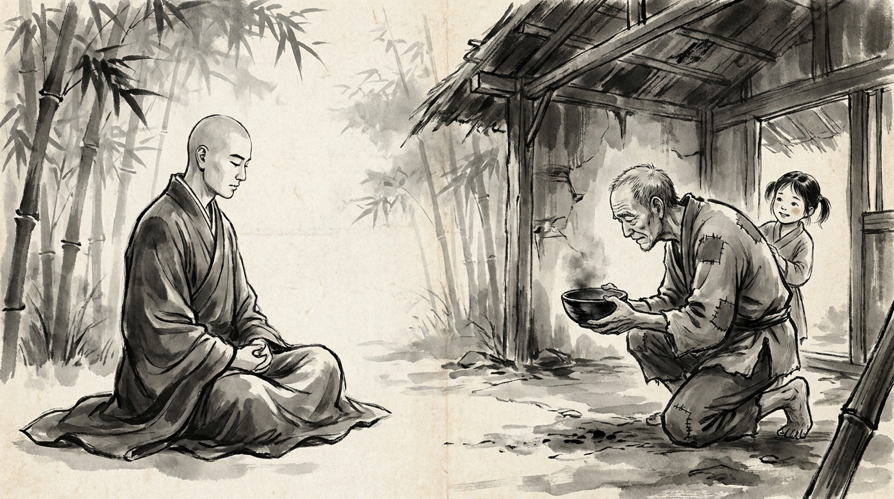

# Recognizing Worth: Seeing Past Soot to Sovereign Gold

The bamboo grove swayed in the crisp autumn air, casting long, shifting shadows across the weathered stone floor of the monastery. Vira, a senior trade inspector of the royal port, knelt upon his mat with a heavy ledger unrolled before him. His hands trembled slightly with the lingering frustration of a council session concluded hours prior. He looked up at the venerable Monk who sat in stillness, draped in simple saffron robes.

"Honored Master," Vira spoke, his voice tight with grievance, "today the merchant council reviewed proposals from the outer districts. A small guild of weavers presented a method for reinforcing silk with organic resin—a quiet innovation that could double the wear of royal garments. Yet because the weavers are humble and their presentation crude, bearing no marks of aristocratic patronage, the senior ministers dismissed the proposal instantly as worthless brass. They mocked the parchment and cast it aside. I remained silent, fearful of aligning with what the chamber deemed crude. How do we mistake priceless gold for dross simply because the vessel is tarnished by obscurity?"

The Monk opened his eyes, gazing calmly at the fallen leaves before replying, "When the eye seeks only polished reputation, even true wealth is discarded as dirt. Tell me, Vira, does the weight of metal change when coated in soot?"

---

## The Serivanija Jataka: The Two Traders of Surappara

In ancient times, in the kingdom of Seri, two traders journeyed through the towns and villages selling pots, pans, and trinkets. One was avaricious and harsh of speech; the other was righteous, gentle, and fair in trade. They divided the streets between them so they would not compete in the same lanes.

One day, the greedy trader entered a certain dilapidated house in the city of Surappara. Within lived an impoverished grandmother and her granddaughter, who had fallen from prosperity into utter destitution. They had nothing left of value save for a golden bowl that had belonged to their ancestors. However, centuries of grime, kitchen smoke, and black tarnish covered the vessel entirely, so neither the women nor any casual observer knew it was gold.

The greedy trader took the bowl in his hand, scratched its base with a needle, and instantly recognized the brilliant glint of genuine gold beneath the soot. But greed seized his heart. Hoping to acquire the treasure for nothing, he sneered, curled his lip, and threw the bowl onto the dusty floor. 

"This is not worth half a copper coin!" he spat, rising angrily. "What sort of rubbish do you bring me?" With that, he stormed out of the house, intending to return later when despair had softened them, to demand it for a pittance.

Later that same day, by coincidence or destiny, the righteous trader entered the very same lane and stopped before the tumbledown house. The granddaughter recognized his kind countenance and pleaded with her grandmother to show him the bowl and ask its worth. 

The righteous trader took the bowl, turned it over, and perceived at once that it was solid gold of immense value. He looked gently at the two women and said, "Mother, this bowl is pure gold. All my stock of wares together, along with all my coin, is not worth a fraction of its value."

The women were astonished. "Sir," the grandmother replied, "a harsh trader earlier today threw it on the floor and declared it worthless dross. Your honesty is a marvel."

The righteous trader smiled peacefully. He handed over his entire store of five hundred silver coins and all his trading goods, keeping back only a single small coin and his weighing scales for his boat passage across the river. He took the golden bowl, crossed the river Nethravathi, and secured his fortune through absolute discernment.

When the greedy trader returned to claim the bowl for nothing, the grandmother rebuked him and drove him away. Hearing that another had taken the treasure, the avaricious trader was consumed by blinding rage and bitter grief. He smashed his own wares against the stones, vomited hot blood from the intensity of his fury, rushed down to the river bank, and perished on the spot.

---

## The Geometry of Discernment and Greed

The story of the two traders reveals the permanent mechanics of how leaders evaluate value, ego, and opportunity within competitive hierarchies.

First, the trap of superficial appearance governs those whose vision is clouded by pride. The greedy trader held the exact same asset in his hands as the righteous trader, yet his arrogance blinded him. In councils and tribunals, mediocre leaders routinely reject breakthrough insights because the proposal lacks the polished rhetoric or aristocratic pedigree of elite factions. They look only at the surface tarnish and discard genuine gold.

Second, malice and manipulation always overreach. The greedy trader did not merely misjudge the bowl; he attempted to fabricate a rigged bargain through deliberate devaluation. In administrative politics, rivals often feign indifference toward a rising subordinate's project, deprecating its worth publicly while scheming to appropriate its fruits later. This cynical maneuver creates a self-fulfilling trap where arrogance destroys opportunity.

Third, true discernment requires uncorrupted character. The righteous trader possessed neither greed nor contempt; his calm integrity allowed him to see the metal's true nature beneath centuries of grime. When leaders cultivate inner quietude, they cease to be swayed by superficial packaging, factional bias, or loud posturing. They recognize intrinsic worth wherever it resides.

---

## The Counsel of the Master

Vira bowed his head, seeking guidance on how to navigate the court's blind spots. The Monk offered three concrete disciplines:

### 1. Inspect the inner substance before the council speaks
When a subordinate department or a marginalized peer brings an unconventional proposal, do not rely on the chamber's summary dismissal. Request the raw data, review the underlying mechanics yourself in private, and record your assessment in a signed ledger before public debate hardens into prejudice.

### 2. Separate personal pride from objective appraisal
Never reject an initiative simply because its presentation lacks polish or your rivals sponsor it. When evaluating a submission, evaluate its structural utility and long-term yield independently of who delivered it or how rough the parchment appears.

### 3. Secure foundational assets quietly and fairly
If you identify genuine merit in a dismissed project, champion its core principles transparently and equitably rather than attempting to exploit its creators' vulnerability. Fair dealing preserves trust across alliances, whereas predatory manipulation invites the swift collapse of your own standing.

**Source:** Jataka Tales, Serivanija Jataka, No. 3 (UNVERIFIED)

Vira gathered his ledgers, his mind cleared of resentment, seeing the royal court's daily intrigues not as insurmountable obstacles, but as a test of unclouded vision.

> *"The unskilful eye looks upon gold crusted with soot and sees only dirt; the wise trader looks beneath the tarnish and claims the treasure before the greedy man realizes his own ruin."*
