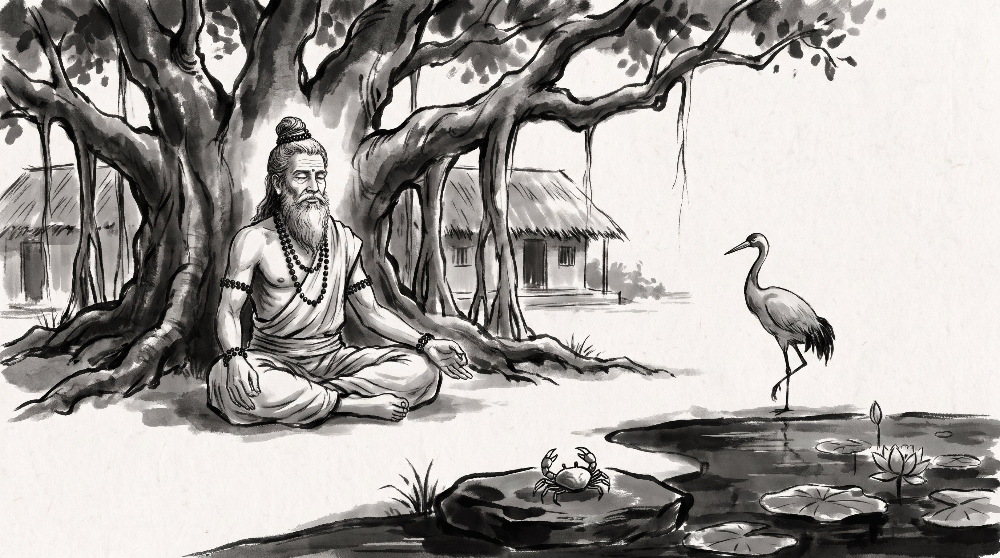

# The Shell and the Beak: Defending Your Domain When False Protectors Arrive

The morning mist hung low over the ashram courtyard, where dry bamboo leaves whispered against the flagstones. Somadatta, chief registrar of the royal granaries, sat upon a woven mat with his hands folded in his lap. His brow was furrowed with the heavy fatigue of a man who had watched his storehouses steadily dwindle while political factions scrambled for control. Across from him, the venerable Rishi sat in absolute stillness under the banyan canopy, his silver beard resting against his simple ascetic wrap, his hair gathered in a traditional Vedic *jata* topknot, and rudraksha beads encircling his wrists.

"You bear the look of one who mistook a predator's sanctuary for a harbor, Somadatta," the Rishi observed quietly.

Somadatta let out a heavy sigh. "Master, our provincial granaries have faced two successive seasons of drought. Panic spread among the guild merchants as rumors flew that the royal treasury would confiscate all reserve stocks. In that time of terror, a senior minister named Kandarpa stepped forward. He told us: \'The royal overseers are ruthless and intend to seize every bushel. Entrust your reserve ledgers and warehouse keys solely to my household guard; I will shelter your grain and shield your merchants from the tax collectors.\' We trusted his promise of salvation. We handed over our keys, believing he was our protector against the famine."

Somadatta's jaw tightened. "Yesterday, the royal proclamation was read in the assembly. Minister Kandarpa was appointed grand superintendent of all provincial stores. He presented our reserve ledgers to the king as his own administrative triumph, while denouncing our guild as reckless and untrustworthy. To prove his strict governance to the court, he stripped our master merchants of their trade rights and absorbed our granaries into his private estate. He played the holy savior while devouring our livelihood. How does one recognize true counsel when the ecosystem itself is collapsing?"

---

## The Weeping Crane of the Panchatantra

The Rishi smiled gently, his eyes reflecting the deep stillness of the ashram pond beyond the trees. 

"Your predicament is ancient, Somadatta, born whenever fear clouds judgment. In the *Panchatantra*, compiled by Pandit Vishnu Sharma in the foundational book of *Mitra-Bheda*—the Loss of Friends and False Alliances—there is preserved the parable of *Baka-Karkataka Katha*: the Crane and the Crab."

"Beside a vast, tranquil lake teeming with fish and aquatic creatures, there once lived an ancient crane. As years passed, his feathers greyed and his limbs stiffened. He could no longer dart through the water to seize swift fish. Facing starvation, the crane devised a strategy founded not upon strength, but upon the exploitation of fear."

"He stood motionless on one leg at the water's edge, his head bowed in mock sorrow, tear-drops glistening on his beak as though performing austere penance for all living beings. The fish and water creatures gathered at a respectful distance, astonished to observe their lifelong predator mourning their fate."

"A great fish swam close to the shallow bank and asked: \'Uncle, why do you stand like a holy ascetic, weeping instead of hunting?\'"

"The crane sighed with profound melancholy: \'Alas, my heart grieves for you, little ones. This morning, I overheard the fishermen plotting to drain this entire lake next month and capture every living creature within it. I have lived beside you for many seasons; though I am an ascetic who eats only fallen moss, I cannot bear to witness your impending doom.\'"

"Terror swept through the lake," the Rishi continued. "Fear is a poison that blinds the intellect. The aquatic creatures did not question why an aging predator had suddenly become their spiritual protector. They crowded around his legs, pleading: \'Is there no escape? Save us from this calamity!\'"

"The crane feigned deep reluctance. \'It is not my duty to alter destiny, yet compassion compels me. Beyond yonder rocky hill lies a pristine lake fed by deep springs, untouched by nets. I can carry you there in my beak, a few at a time, and deposit you safely into paradise.\'"

"The fish rejoiced, competing eagerly to be chosen. Day after day, the crane lifted naive fish in his beak, flew over the crest of the hill, and landed upon a sun-baked slab of jagged black rock. There, far from the water, he shattered their shells and feasted at his leisure. Each evening he returned to the lake, sighing over the heavy toll of his mercy, while the pile of bleached bones grew high upon the hidden ridge."

---

## The Patterns of False Benevolence

The Rishi leaned forward, his gaze piercing. 

"Every court and guild hall has its weeping cranes, Somadatta. When scarcity strikes, watch whoever steps forward offering exclusive shelter. The false protector moves through four distinct patterns."

### 1. Amplifying the Scarcity
The crane did not merely mention the fishermen; he made himself the sole bearer of the terrifying news. In administrative councils, the false protector magnifies the crisis, convincing leaders that disaster is imminent and that normal institutional checks must be suspended.

### 2. Monopolizing the Conduit
The crane demanded that every fish pass through his beak alone. In public affairs, the false protector insists on acting as the exclusive intermediary between your guild and the sovereign authority, ensuring that no independent voice reaches the council table.

### 3. Performing Burdened Virtue
Each evening the crane returned complaining of how exhausting his charitable flights were. The false savior constantly reminds his subordinates of the personal risks he takes on their behalf, cultivating a psychological debt that discourages critical auditing.

### 4. Harvesting at the Summit
When the cooperative effort is complete, the crane delivers his cargo to the barren slab of rock. The false patron absorbs the assets into his own household monopoly while casting blame and ruin upon those who trusted him.

---

## The Counsel of the Wise Crab

"Master," Somadatta asked, his voice steadying. "When resources dwindle and anxiety runs high, how does an administrator protect his guild? How do we cultivate the crab's discernment?"

The Rishi raised three fingers.

### 1. Verify the Danger Independently
Never accept a single administrator's report of external peril. Before yielding operational control, dispatch your own trusted messengers to the royal tax pavilion and neighboring granaries to inspect whether the alleged threat is real or fabricated.

### 2. Distribute the Channels of Communication
Refuse to let any single syndic hold exclusive access to the council chamber. Present your harvest ledgers and storehouse inventories before an open assembly of multiple elders, ensuring that your records are witnessed by many eyes rather than held in one man's custody.

### 3. Maintain Written Records and Clear Seals
Keep rigorous tallies of every grain bushel and trade charter, inscribed on palm leaves and authenticated by the seals of multiple guild masters. When your accounts are transparent and multiply witnessed, a predatory intermediary cannot claim your work as his own invention.

**Source:** Panchatantra, Book 1 (Mitra-bheda), "Baka-Karkataka Katha" (UNVERIFIED)

Somadatta bowed respectfully. The weight of deception lifted from his spirit, replaced by the cool, clear resolve of practical wisdom.

> *"Do not surrender your life to a weeping crane upon the promise of a distant lake; test every warning against reality, keep your records open, and never let a single protector hold the only path to safety.""*
